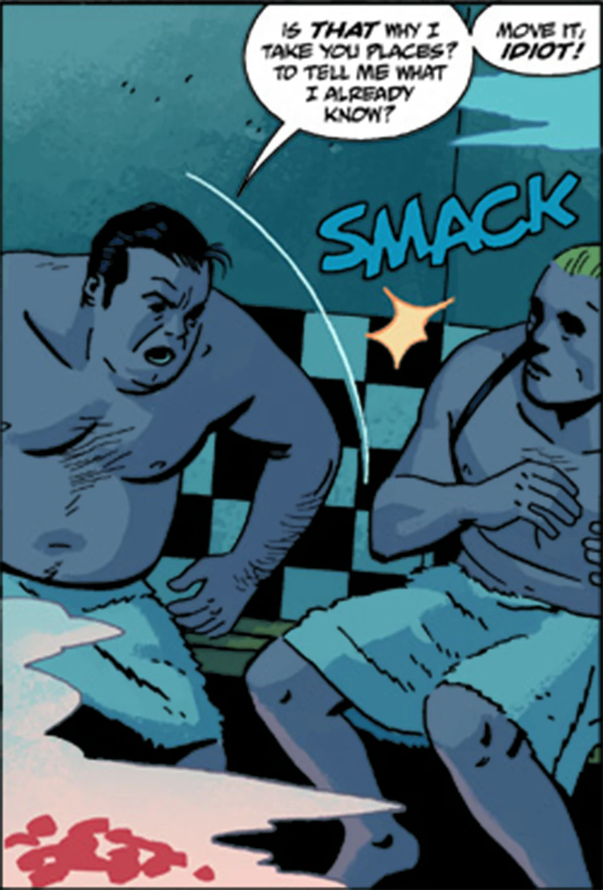

Arnie_wald.jpg

**Arnold "Arnie" Wald** was an influential mob-boss during the 1930s. He has plans to acquire ground currently used by tenement dwellers and their homes that will rise in value as the city seeks a place to build a freeway in a few years.

## History

At the suggestion by his henchman [Mr. Isog](/entry/Isog), Wald began a ploy in having his gangsters dressed up as "Indians" terrorizing the tenement dwellers until it went awry as [Cindy Tynan](/entry/Cindy_Tynan) and the police are quick to recognize several dead "indians" as gangsters.

Wald ordered a hit on Tynan, but his dumb muscle was intercepted by [Lobster Johnson](/entry/Lobster_Johnson_%28character%29). Following on information gotten from Cindy the Lobster attempts to bring Wald to justice in his sauna retreat. Wald survived, but was spooked badly enough to agree to Isog's suggestion they hire the [Black Flame](/entry/The_Black_Flame_%28character%29).

At first things go well, the Flame shows off his skills by burning to a destitute bum to a skeleton and then setting some tenements aflame with unquenchable black fire. The following confrontation with the Lobster's crew results in Wald getting his hands on information concerning the Lobster's lair. He decided to lead the raid, firing off several incendary charges with his rifle. When he gets wounded he flees, only to run into some powerplay from the wife of the Black Flame. He survived and is later seen being treated by an unscrupulous doctor sans anasthesia to combat the infection. While recuperating he awakes to Isog standing near his bed and though initially disgruntled the news Isog brings perks him up.

## Personality

Arnie Wald is in a sense a bully and not the brave variety. He talks big, acts tough and yet has a tendency to run at the first sign of personal danger. He has some working knowledge of the occult, but distrusts it and leaves most such things to Isog. He also vehemently hates cigarette smoke, going into a fit of rage whenever Isog smokes in his presence.

## Appearances

- *[The Burning Hand](/entry/The_Burning_Hand)*
- *[Get the Lobster!](/entry/%E6%90%9E%E6%8E%82%E9%B3%8C%E8%99%BE))*
- *[Metal Monsters of Midtown](/entry/Metal_Monsters_of_Midtown)*
- *[The Pirate's Ghost](/entry/The_Pirate%27s_Ghost)*
