## Sketchbooks

### Convention Sketchbooks

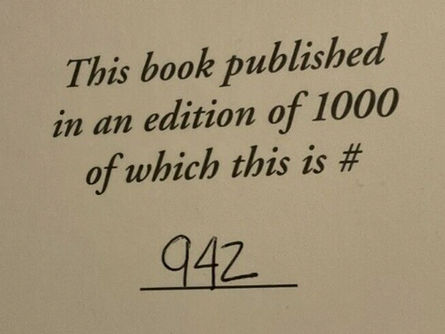

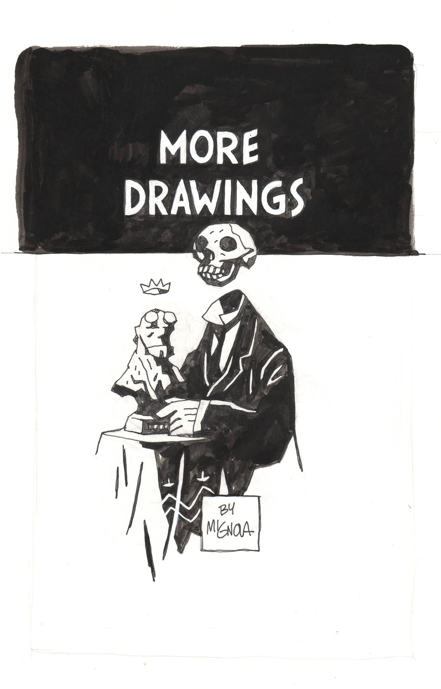

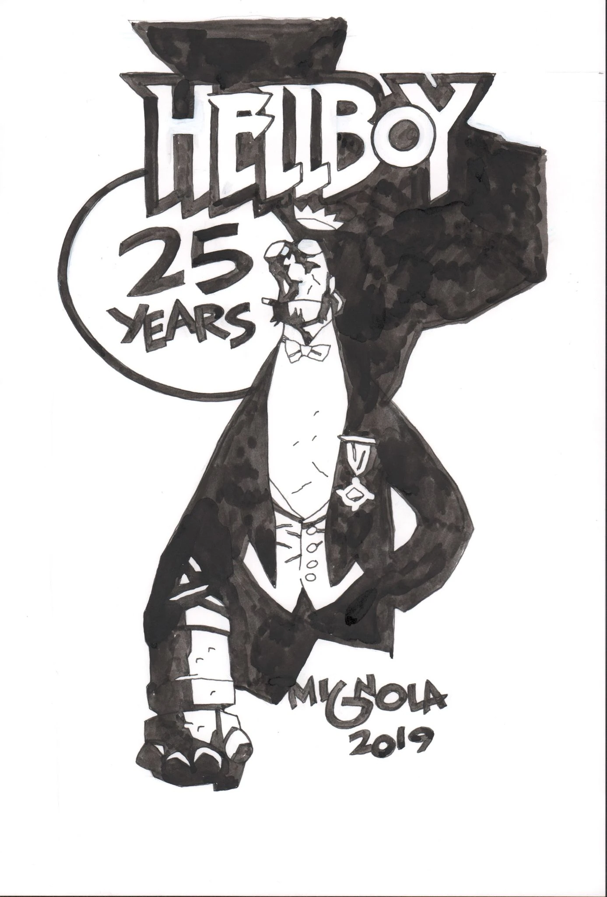

[Mike Mignola](/entry/Mike_Mignola) has self-published a number of sketchbooks that feature Hellboy universe characters in their contents and frequently feature [Hellboy](/entry/Hellboy_(character)) himself on the cover. In years he attends conventions, Mignola will frequently self publish a sketchbook in a limited quantity that he then makes available for purchase at his convention booths. New sketchbooks tend to debut at major conventions and are also sold at subsequent conventions until supplies run out.

Title
Publication Year
Debut Convention
Quantity
Cover

&#10;
Hellboy Convention Sketchbook
2001
San Diego Comic-Con
1000
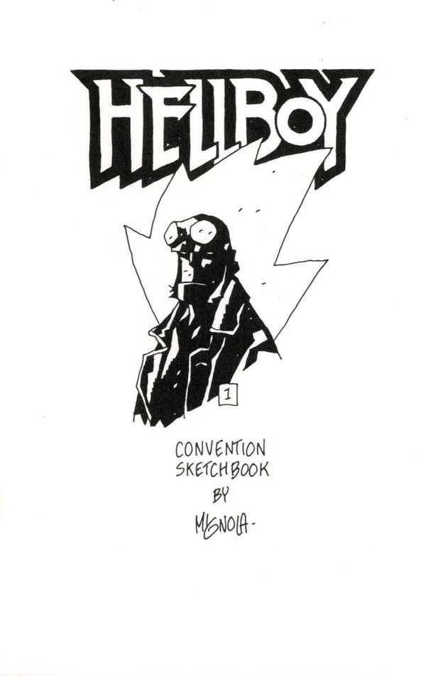

Hellboy 10th Anniversary 1994-2004: A Book of Drawings
2004
San Diego Comic-Con
2000
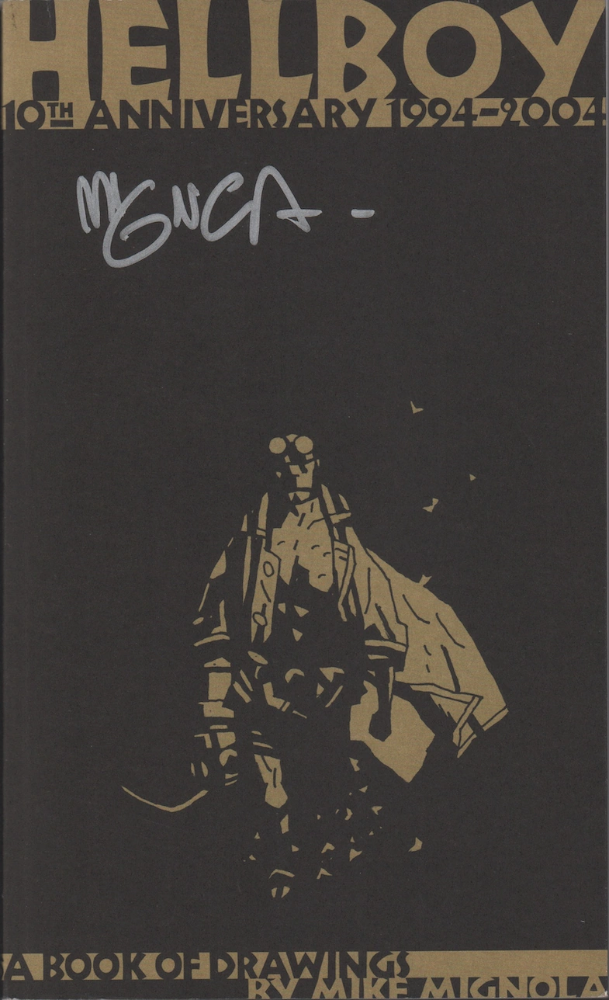
Signed

Some Drawings
2006
San Diego Comic-Con
750
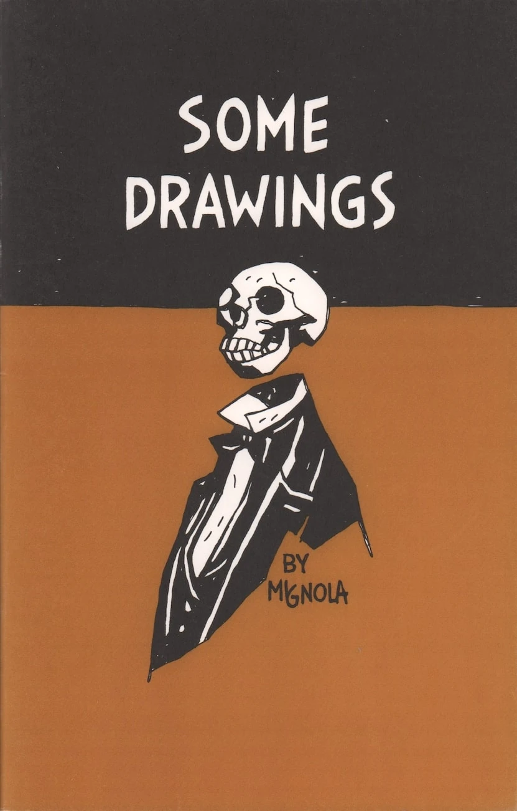

From the Vault: Covers, Pin-Ups &amp; Other Odd Bits
2007
San Diego Comic-Con
1500
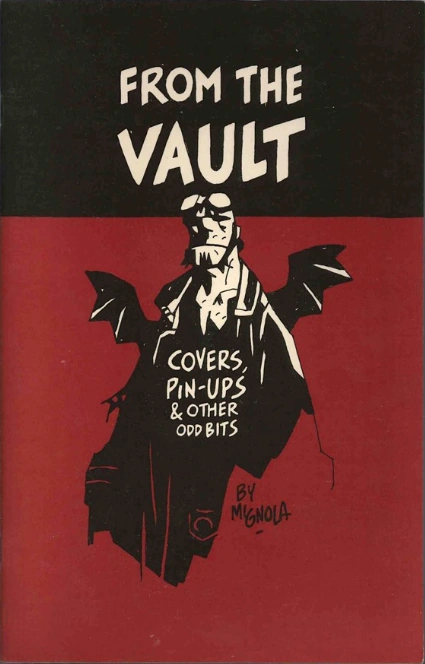

More Drawings
2008
San Diego Comic-Con
2000
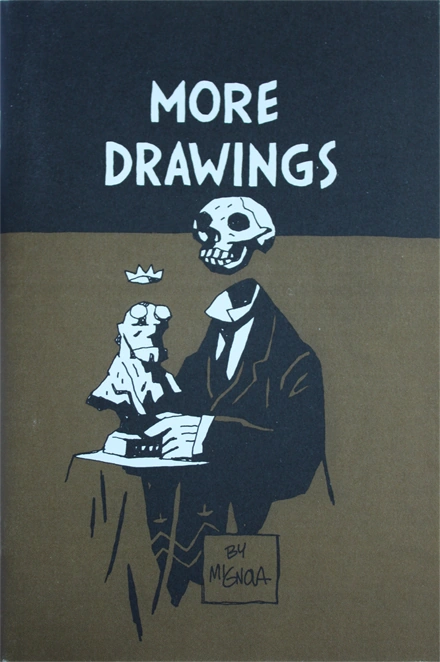

From the Vault 2
2009
San Diego Comic-Con
1500
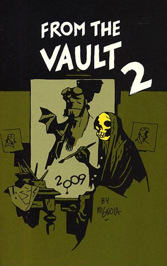

From the Vault 3
2010
San Diego Comic-Con
1500
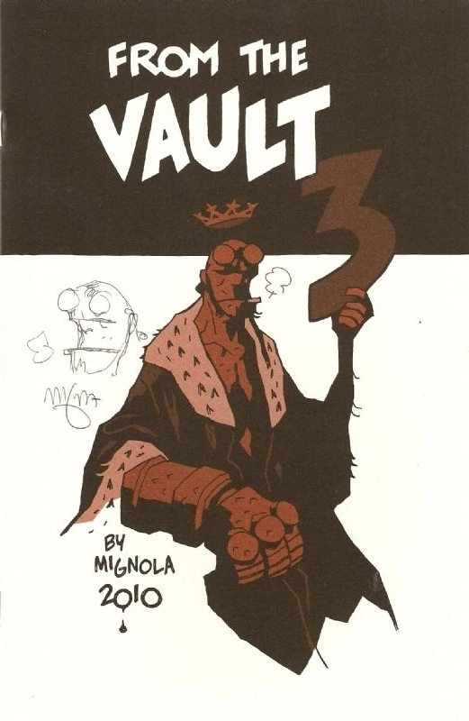

From the Vault 4
2011

1200
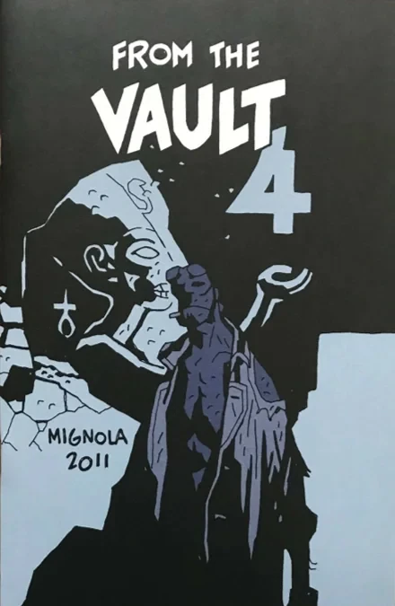

From the Vault 5
2012

1000
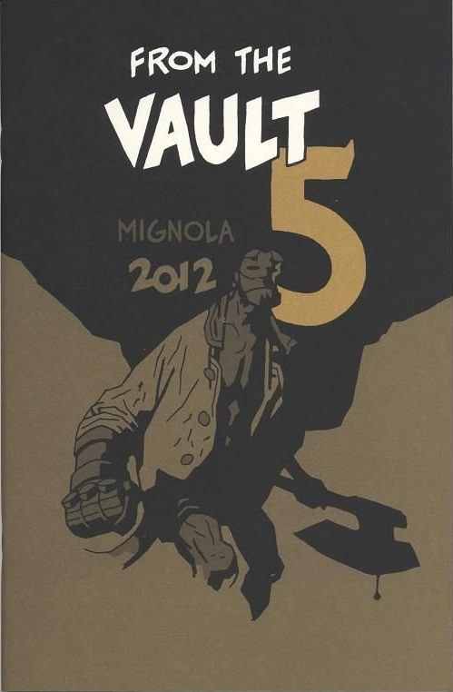

A Year of Monsters
2013
Emerald City Comic Con
1000
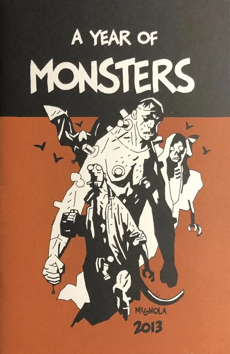

From the Vault Six
2015
Emerald City Comic Con
1000
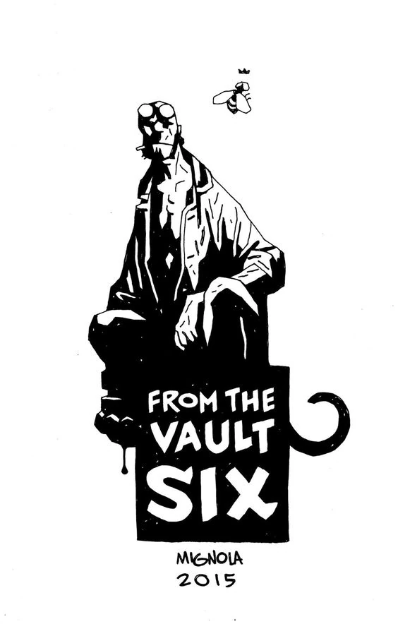

Hellboy 25 Years
2019
NYC Comic Art Expo
1000
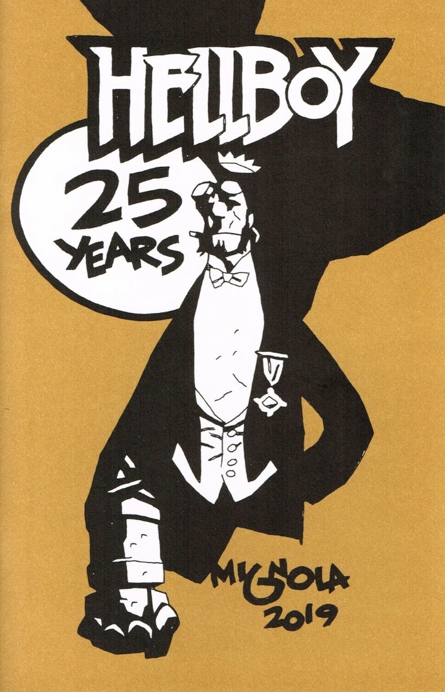

### *The Quarantine Sketchbook*

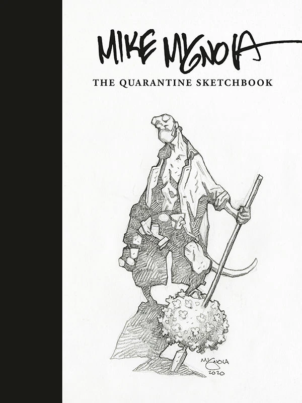

Over the course of the Covid-19 pandemic, [Mike Mignola](/entry/Mike_Mignola) created a large number of sketches that he would share on social media and then sell via online auctions to raise funds for World Health Kitchen charity. Many of the sketches featured either [Hellboy](/entry/Hellboy_(character)) himself or other characters from his universe. Dark Horse Comics later collected many of the sketches into *The Quarantine Sketchbook*, a large, hardcover volume. Like to the sketches it collects, all the profits from the sales of *The Quarantine Sketchbook* were donated to The World Kitchen.

## Annotated Art Books

These books contain sketches and mostly "unfinished" comic pages and covers accompanied by commentary on the process of illustrating the stories.

Title
Date Published
Material Collected
Cover

&#10;
The Art of Hellboy
March 26, 2003 (Hardcover)
-
&#10;
March 31, 2004 (Paperback)

<li>Introduction and annotations throughout the book by Scott Allie</li>
<li>Finished and unfinished interior pages and covers</li>
<li>Sketches of the characters</li>
<li>Previously unpublished drawings</li>
<li>Hi, My Name's Hellboy</li>
<li>The Vârcolac (Original Version)</li>

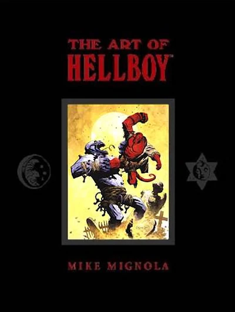.jpg)
MIKE MIGNOLA
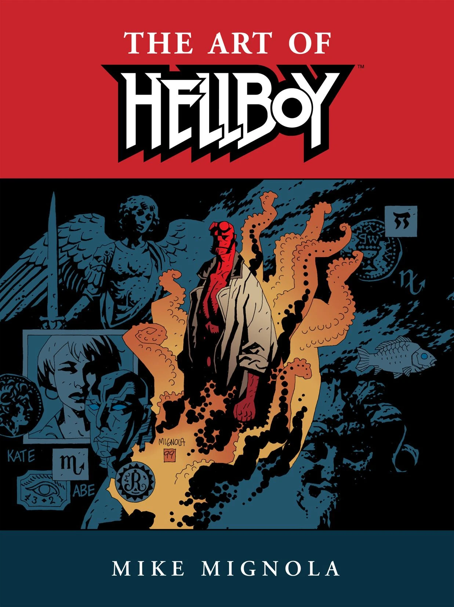
MIKE MIGNOLA

Mike Mignola's
Hellboy Artist's Edition:
Hellboy in Hell and Other Stories 
(Hardcover)
-

Mike Mignola's
Hellboy Artisan Edition:
Hellboy in Hell and Other Stories 
(Paperback)

July 9, 2014 (Hardcover)
-
&#10;
May 10, 2022 (Paperback)

<li>Hellboy in Hell #1–4 (Unlettered)</li>
<li>Hellboy in Hell: The Three Gold Whips (Unlettered)</li>
<li>Mike Mignola's Hellboy</li>
<li>Mike Mignola's Hellboy: World's Greatest Paranormal Investigator</li>
<li>Faith, an excerpt from John Byrne's Next Men #21</li>
<li>The Corpse</li>
<li>The Ghoul, or, Reflections on Death and the Poetry of Worms</li>
<li>The Troll-Witch</li>

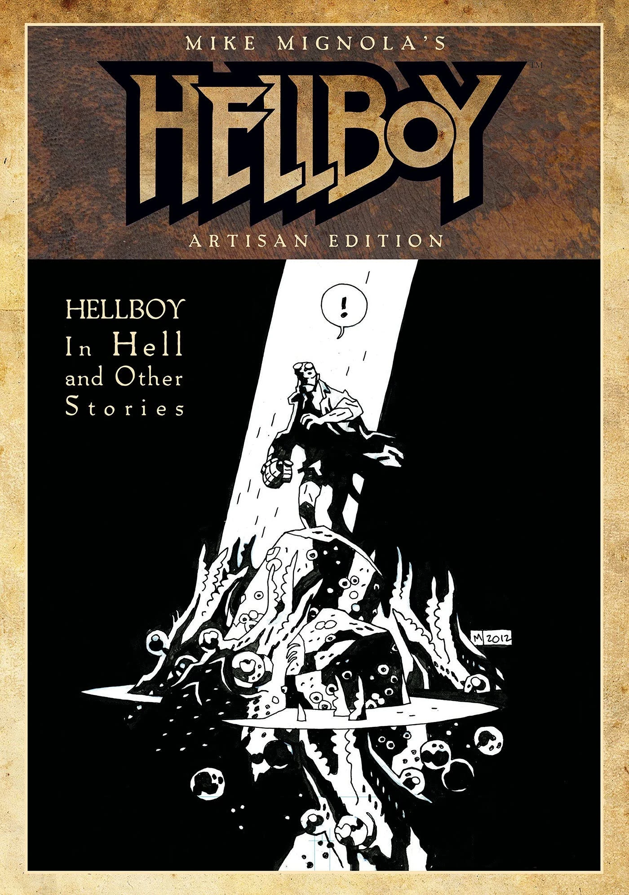
MIKE MIGNOLA
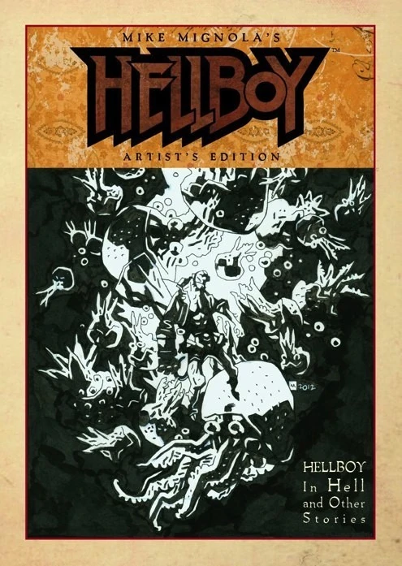
MIKE MIGNOLA

Hellboy: Into the Silent Sea
Studio Edition
March, 2018

<li>Hellboy: Into the Silent Sea</li>
<li>Extensive thumbnails, pencil preliminaries, and commentary</li>
<li>Additional content about The MonsterMen</li>

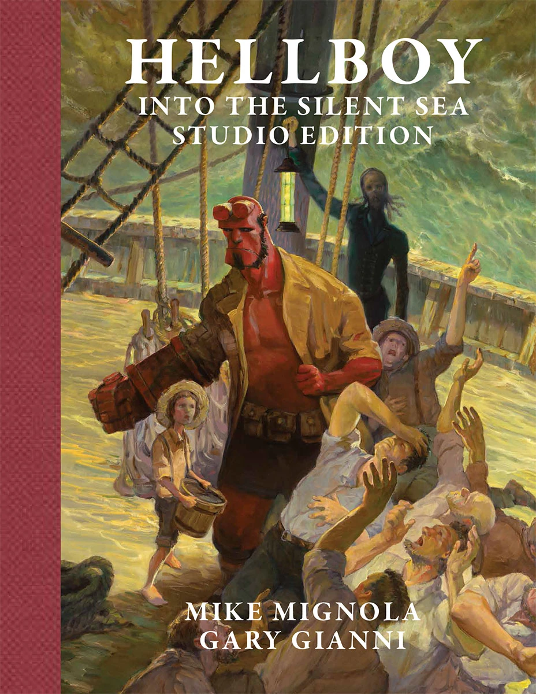
GARY GIANNI

Mike Mignola's
Hellboy in Hell
Artist's Edition – Volume 2
(Hardcover)
scheduled for
March 25, 2026 (Hardcover)

<li>Hellboy in Hell: The Death Card</li>
<li>Hellboy in Hell: The Hounds of Pluto</li>
<li>Hellboy in Hell: The Spanish Bride</li>
<li>Hellboy in Hell: For Whom the Bell Tolls</li>
<li>TBA</li>

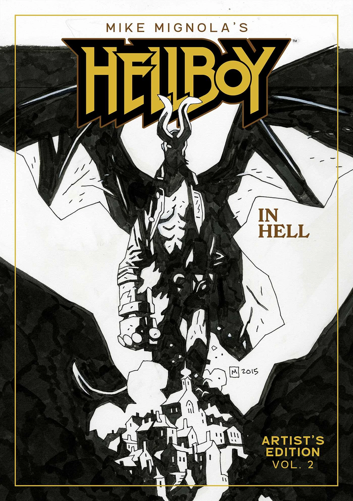
MIKE MIGNOLA

## Key Art / Cover Collections

These books feature select key art and covers from the [Hellboy Universe](/entry/The_Hellboy_Universe_Comics) books (mostly from Hellboy comics).

Title
Date Published
Cover

&#10;
Hellboy: The First 20 Years
March 19, 2014
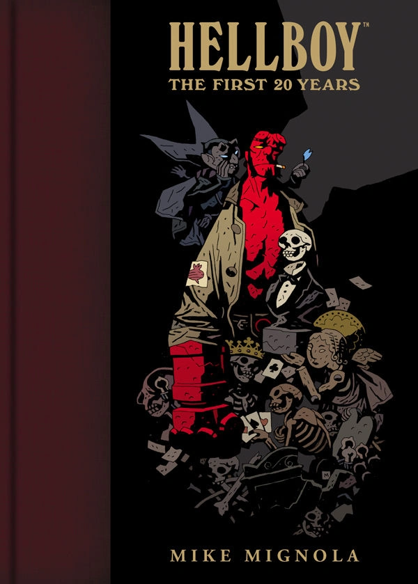
MIKE MIGNOLA

The Hellboy 100 Project
September 23, 2015
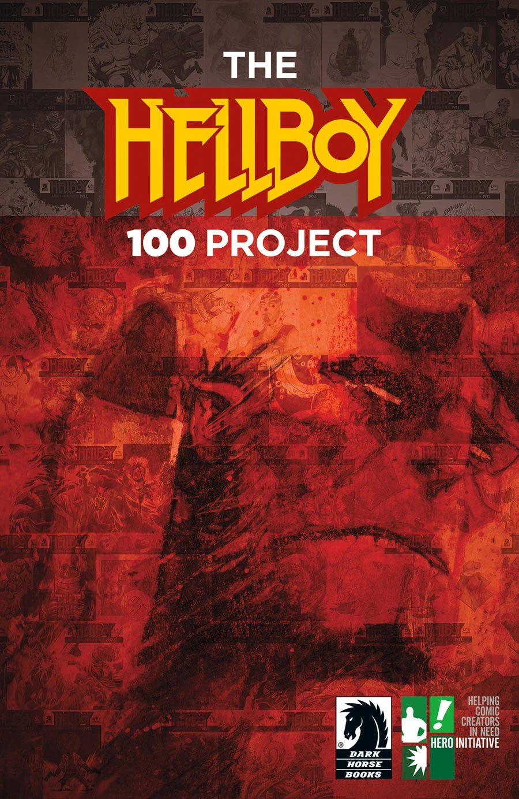
VARIOUS

Hellboy: 25 Years of Covers
July 3, 2019
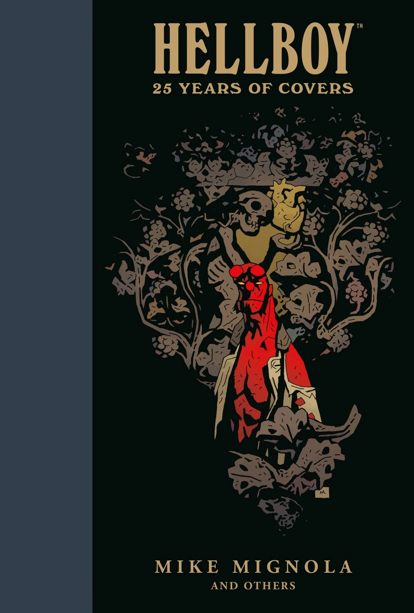
MIKE MIGNOLA

Hell, Ink, and Water: The Art of Mike Mignola
October 15, 2024
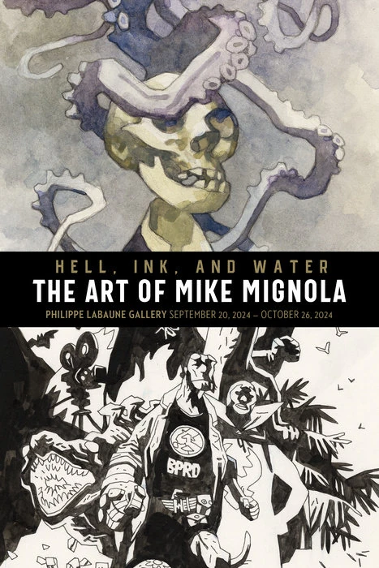
MIKE MIGNOLA

## Artists Collections

These collections feature all the works of one artist set in the [Hellboy Universe](/entry/The_Hellboy_Universe_Comics) and are published in an oversized hardcover format (similar to the [Library Editions](/entry/Hellboy_Library_Editions)).

Title
Date Published
Material Collected
Cover

&#10;
Hellboy Artists Collection: Richard Corben
May 7, 2024

<li>Being Human</li>
<li>Hellboy in Mexico</li>
<li>House of the Living Dead</li>
<li>The Bride of Hell</li>
<li>Makoma</li>
<li>Double Feature of Evil</li>
<li>The Mirror</li>
<li>The Crooked Man</li>

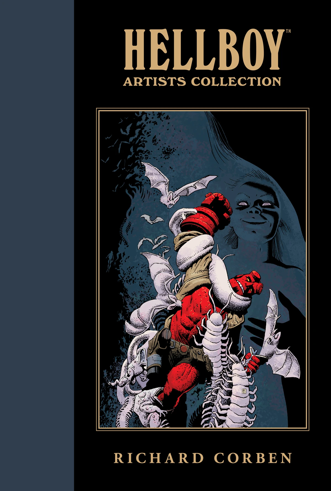
RICHARD CORBEN
