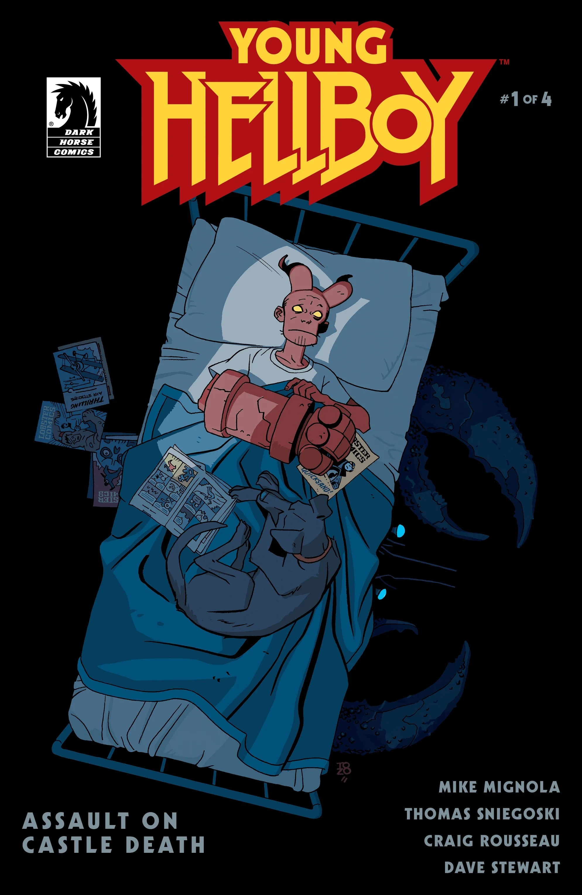
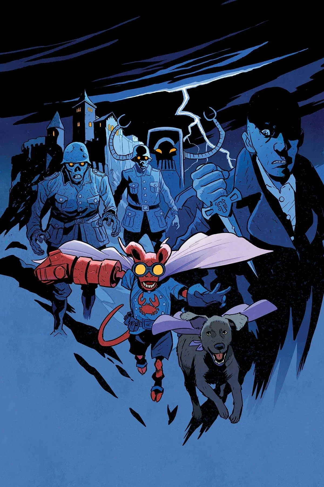
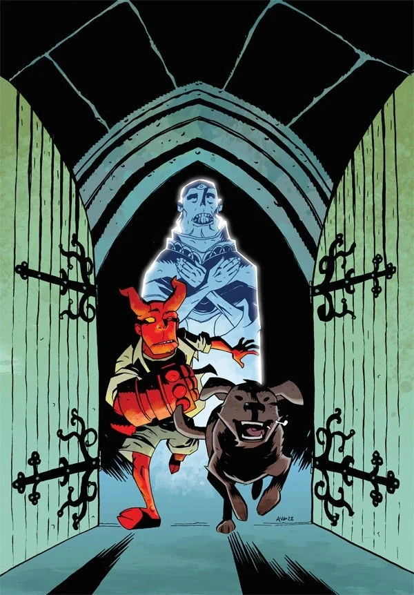
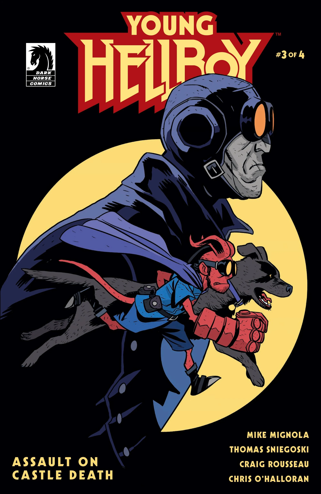
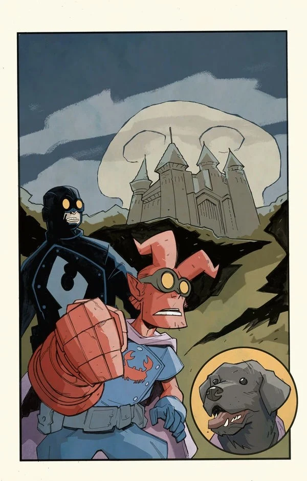
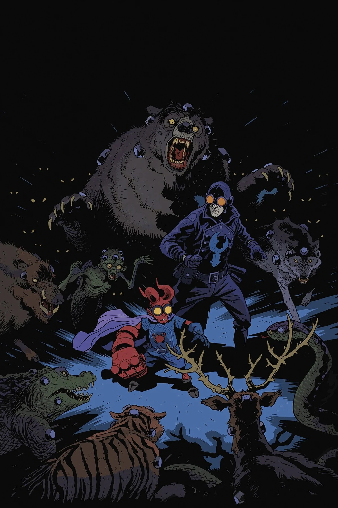
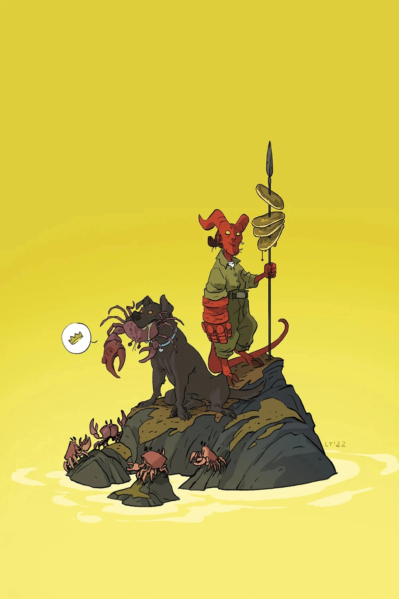

***Assault on Castle Death*** is a four-issue miniseries written by [Mike Mignola](/entry/Mike_Mignola) and Tom Sniegoski with art by [Craig Rousseau](/entry/Craig_Rousseau). It is the second story in the *[Young Hellboy](/entry/Young_Hellboy)* series.

## Synopsis

### Part One

Returned from their adventures on a secret island, [Hellboy](/entry/Hellboy_(character)) and the Professor move with the B.P.R.D. from New Mexico to Connecticut. The relocation is tough on Hellboy: is he just homesick, or have scrambled memories from the island gripped the supernatural whippersnapper? Meanwhile, word of Hellboy’s survival has also reached an unknown enemy, who failed to kill him once before but is determined not be foiled again…

### Part Two

As Hellboy struggles in the grip of a mysterious illness, a Brotherhood operative inside the B.P.R.D. brings an assassin within striking distance! But even with a fever, young Hellboy has an ace up his (pajama) sleeve… or is that a familiar calling card?

### Part Three

The feverish Hellboy, aka the Scarlet Crab, breaks into the ghoulish Castle Death accompanied by his dog Mac and a surprising but familiar face. But the castle holds strange and dangerous occult items that do not mix well with Hellboys hallucinations—especially when the shadowy Brotherhoods assassin makes his move!

### Part Four

Still in the grips of a fever-induced hallucination, Hellboy (AKA the Scarlet Crab), his dog Mac, and a friend straight out of pulp legend find themselves in the strange laboratory of Castle Death. While Hellboy is lost in his fantasy, the Brotherhoods assassin finally closes in!

## Gallery

Standard covers by [Matt Smith](/entry/Matt_Smith).

Issue \#1

Issue \#1 variant cover  
by [Tonci Zonjic](/entry/Tonci_Zonjic)

Issue \#2 variant cover  
by [Michael Avon Oeming](/entry/Michael_Avon_Oeming)

Issue \#3 variant cover  
by [Craig Rousseau](/entry/Craig_Rousseau)

Issue \#4 variant cover  
by Lissa Treiman

|Issue #1 variant cover by Tonci Zonjic

|Issue #2

|Issue #2 variant cover by Michael Avon Oeming

|Issue #3

|Issue #3 variant cover by Craig Rousseau

|Issue #4

|Issue #4 variant cover by Lissa Treiman
