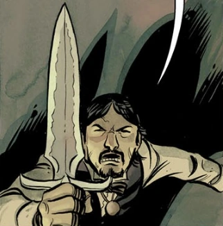

 The **Athame** is traditionally a black handled knife used in witchcraft.

## Background

A weapon of arcane and mystic importance in the shape of a knife

## History

### *[The Mysteries of Unland](/entry/The_Mysteries_of_Unland)*

Sir [Edward Grey](/entry/Edward_Grey) possessed an athame which was part of his supernatural paraphernalia. When he was investigating a murder in Hallam. In his room at the Glass Eel, Grey was attacked by three giant eels. Thinking that they were a form of demonic or spiritual entities, Grey brandish his athame and invoked a prayer to ward them off. The eels merely laughed at him stating his weapon and prayers were useless on them. Seeing the athame's mystical properties were moot, he instead used its physical properties as a knife to drive them back.

## Powers & Abilities

It has multiple uses in rituals of summoning and banishing. Its regarded as a symbol of power and commands respect in the netherworld.
