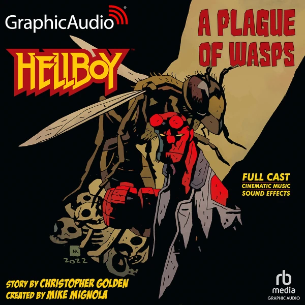
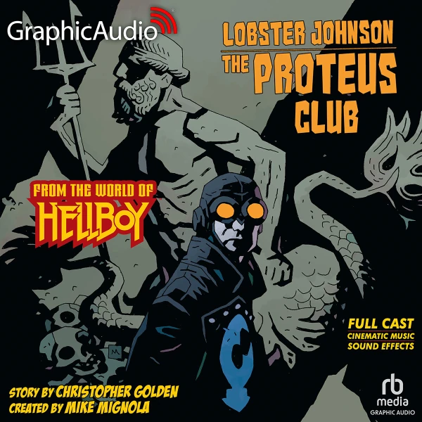
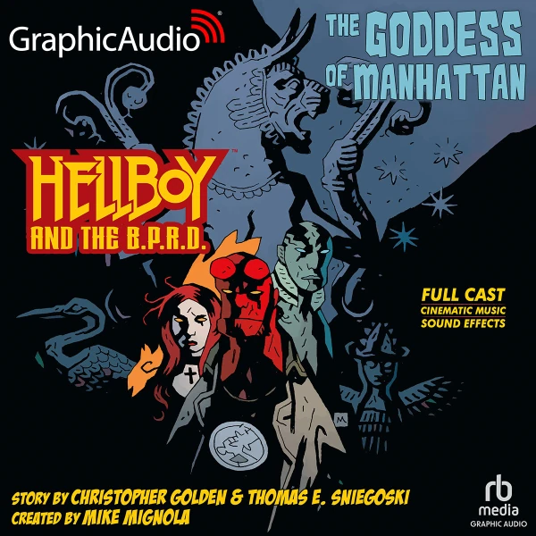

*This article is a stub. You can help Hellboy Wiki by expanding it.*

Audio dramas are stories told entirely via audio, featuring music, sound effects and a full cast playing the different roles in the narrative. In June of 2023 it was announced that the company Graphic Audio would be producing three audio dramas with original stories written by [Christopher Golden](/entry/Christopher_Golden) and [Thomas E. Sniegoski](/entry/Thomas_E._Sniegoski), all of these are adapted and directed by Scott McCormick, who also voices [Hellboy](/entry/Hellboy_(character)) in them. Other main cast members include Jasmine Hyde as [Anastasia Bransfield](/entry/Anastasia_Bransfield), Marni Penning as [Cynthia Tynan](/entry/Cynthia_Tynan), James Konicek as [The Lobster](/entry/The_Lobster), Torian Brackett as [Harry McTell](/entry/Harold_McTell), Zeke Alton as Juliane Thorne, Eric Messner as [Abe Sapien](/entry/Abraham_Sapien) and Amanda Forstrom as [Liz Sherman](/entry/Elizabeth_Sherman), among others.

## List of Audio Dramas

Title
Date Published
Author
Cover

&#10;
Hellboy: A Plague of Wasps
July 11, 2023
Christopher Golden

MIKE MIGNOLA

Lobster Johnson: The Proteus Club
October 24, 2023
Christopher Golden

MIKE MIGNOLA

Hellboy and the B.P.R.D.: The Goddess of Manhattan
September 10, 2024
Christopher Golden and Thomas E. Sniegoski

MIKE MIGNOLA

## Canonicity and Chronology

All three narratives are considrered canonical (part of the Hellboy Universe) and are intertwined between them, as they all feature the fictional Nazi secret society The Proteus Club.

The first one released, [Hellboy: A Plague of Wasps](/entry/A_Plague_of_Wasps), focuses on Hellboy and his then girlfriend, Anastasia Bransfield, dealing with an unusual infestation of wasps in Brazil. this story takes place in 1980, directly after the story [The Key to It All](/entry/The_Key_to_It_All) from [Hellboy in Love](/entry/Hellboy_in_Love) (also written by Christopher Golden).

The second one, [Lobster Johnson: The Proteus Club](/entry/The_Proteus_Club) is about The Lobster and his team aiding Cynthia Tynan and her new friend Sophie Lang to discover who is behind the disappearance of multiple people in New York. Like all other [Lobster Johnson](/entry/Lobster_Johnson_(series)) stories, this one takes places in the 1930s, specifically in April of 1933, which puts it at around the same time as [The Prayer of Neferu](/entry/The_Prayer_of_Neferu).

The last of the three, [Hellboy and the B.P.R.D.: The Goddess of Manhattan](/entry/The_Goddess_of_Manhattan), is a direct sequel to the Lobster Johnson audio drama, also taking place in New York and featuring some returning characters. This one takes place in 1993, 60 years after The Lobster and his team stopped The Proteus Club, putting it in the period while [Trevor Bruttenholm](/entry/Trevor_Bruttenholm) was lost in the arctic with the Cavendish Expedition and around the same time as stories like [Drums of the Dead](/entry/Drums_of_the_Dead) and [Makoma](/entry/Makoma_(story)). Despite the name, the production is mostly unrelated to the comic series [Hellboy and the B.P.R.D.](/entry/Hellboy_and_the_B.P.R.D.)

1.  [↑](#cite_ref-1) While the marketing material only says "early 90s", the specific year was confirmed by Christopher Golden via a private message on social media
