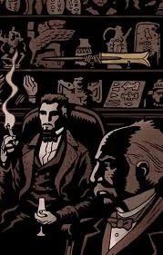

**August Swain** was a prominent member of the [Heliopic Brotherhood of Ra](/entry/Heliopic_Brotherhood_of_Ra) during the late nineteenth century, seemingly in charge of the Brotherhood's actions in London. On numerous occasions he met Sir [Edward Grey](/entry/Edward_Grey), including the 1879 investigation into the [Hyperborean](/entry/Hyperboreans) ghost affair. During this incident it is probable Swain ordered the death of a gentleman known as "the Captain" and the medium [Mary Wolf](/entry/Mary_Wolf), both allies of Sir Grey.

In 1882, Swain offered assistance to Sir Edward in his investigation of a Mr. Friedhof. Sir Edward declined the offer initially, but on discovery that Friedhof was actually a powerful vampire known as Giurescu, he reluctantly allied himself with Swain and the Brotherhood in order to defeat Girurescu and his vampire army.

## Trivia

- The design of Swain was based off the horror icon Christopher Lee, particularly his appearance in *The Devil Rides Out*.
