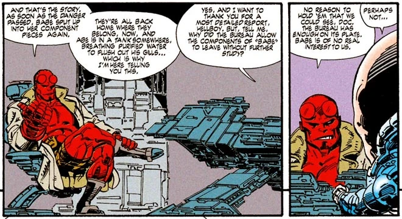

> 
>
> It's Byrne at his best: fantastic, fun, and furious! Featuring a special guest appearance by Abe Sapien of *Hellboy*, and a final page guaranteed to surprise, delight, and confuse fans everywhere!
>
> 
>
> —[Dark Horse Comics](/entry/Dark_Horse_Comics), issue solicitation

  
***Babe 2*** is a two-issue comic book miniseries, written and drawn by [John Byrne](/entry/John_Byrne). It is a sequel to the *Babe* miniseries, which itself is a spinoff from Byrne's series *Danger Unlimited*. *Babe 2* was published by [Dark Horse Comics](/entry/Dark_Horse_Comics) in 1995, under their "Legend" imprint; the series also crosses over with fellow Legend series *Monkeyman and O'Brien* and *[Hellboy](/entry/Hellboy_(series))*, prominently featuring [Abe Sapien](/entry/Abraham_Sapien) from the latter.

## Characters

- [Abe Sapien](/entry/Abraham_Sapien)
- [Hellboy](/entry/Hellboy_(character))

## Synopsis

The Shrewmanoid, leading a legion of giant cyborg alligators, attacks New York. Abe Sapien assists Babe in fighting them off; his identity is not revealed until the second issue, but he appears in both.

At the story's conclusion, Hellboy relates what took place to the Danger Unlimited team while an indisposed Abe recovers.

## Trivia

- This story is one of several crossovers between Dark Horse Comics' [Legend](/entry/Dark_Horse_Comics) creators. John Byrne, Art Adams, and [Mike Mignola](/entry/Mike_Mignola) initially planned for their comics to take place in a shared universe. Though these plans were soon abandoned, several of their early issues feature overlapping characters and scenarios.
  - The Shrewmanoid returns from Adams's *Monkeyman and O'Brien*; the two title characters appear in a flashback panel.
  - Abe Sapien and Hellboy make an appearance from Mignola's *[Hellboy](/entry/Hellboy_(series))* series.
- Abe introduces himself as a member of the Bureau for Paranormal *Investigation* and Defense (B.P.I.D.), rather than [Bureau for Paranormal *Research* and Defense](/entry/Bureau_for_Paranormal_Research_and_Defense) (B.P.R.D.).
  - Though Abe is not recognized by those he encounters, they have heard of Hellboy – to which he wryly remarks "almost everyone has".

## External Links

- *Babe 2* at the Dark Horse Database
- Babe 2 #1 at Dark Horse Comics
- Babe 2 #2 at Dark Horse Comics
