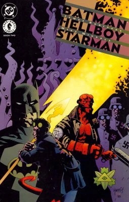

***Batman/Hellboy/Starman*** is a non-canonical, two-issue miniseries written by James Robinson with art by Mike Mignola and published by DC Comics. It features a crossover between Hellboy, a Dark Horse Comics property, Batman, and Starman, who are both DC Comics properties.

## Characters

### Featured Characters

- Batman (Bruce Wayne)
- [Hellboy](/entry/Hellboy_(character))
- Starman (Ted Knight)

### Supporting Characters

- James Gordon

### Villains

- The Joker
- [Knights of October](/entry/Knights_of_October)
  - Neo-Nazis and soldiers
  - Otto Dantz

### Other Characters

- Starman (Jack Knight)

## Locations

- Earth-7642
  - Earth
    - Gotham City
      - Gotham City Police Headquarters

## Synopsis

### Part One

After Golden Age Starman, Ted Knight, is kidnapped by neo-Nazi skinheads whilst giving a lecture on alternative energy sources, Batman and [Hellboy](/entry/Hellboy_(character)) team up to rescue him. The duo eventually track the kidnappers, a group calling itself the Knights of October, to a deserted airfield. The pair attempt a rescue mission. In the ensuing battle, the Knights of October leader, Dantz, escaped on board a small plane with the Knight still his prisoner. Hellboy vows to go after him, but Batman is called away to deal with an escaped Joker, so Ted’s son Jack Knight, the new Starman, joins Hellboy in his stead.

### Part Two

Batman bids farewell as Hellboy and Starman board Bruce Wayne’s private jet for the trip into the Amazon Rainforest, and as soon as they bail out of the plane over their target, they come under fire. Once they penetrate the defences, they learn that Dantz is using Knight’s scientific knowledge to reanimate the demonic Suggor Yogeroth. Hellboy invokes an ancient Lemurian incantation to dispel the demon and the duo are able to drive it back and release the captive Knight.

## Cover Gallery

Issue \#1
Issue \#2

|Issue #2
## External Links

- Entry at the DC Database
