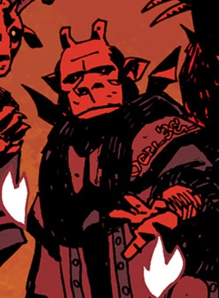

**Beleth** was a [demon](/entry/Demon) who was part of an evil trinity (alongside [Yomyael](/entry/Yomyael) and [Sytry](/entry/Sytry)).

## History

Beleth, [Yomyael](/entry/Yomyael) and [Sytry](/entry/Sytry) were a trinity of demons that had aided the Asiatic people in battle "for as long as men had placed faith in the dark behind stars". At some point they also fought against an entity called Mastema, probably an angel.

Peter the Great summoned Beleth and the two demons, hoping they would help him in the war against the Swedes in the Great Northern War, but demanded his future sons, his heart and his soul in return.

He was killed during by the lesser demons after the fall of Satan, alongside [Astaroth](/entry/Astaroth), Orabas, Suriel, [Shax](/entry/Shax), Usiel, Raum, Semyaza, [Moloch](/entry/Moloch), Belial, Dagon and [Beelzebub](/entry/Beelzebub).

## Lore

Beleth is a spirit of the Ars Goetia and is described as "mighty and terrible king of Hell", who governs over eighty-five legions of demons.

## Apperance

- (/entry/1946)
