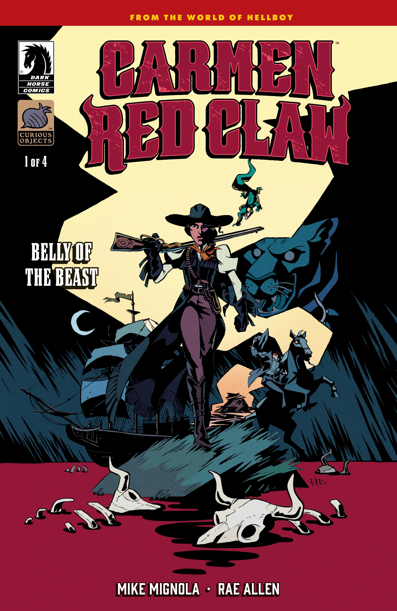
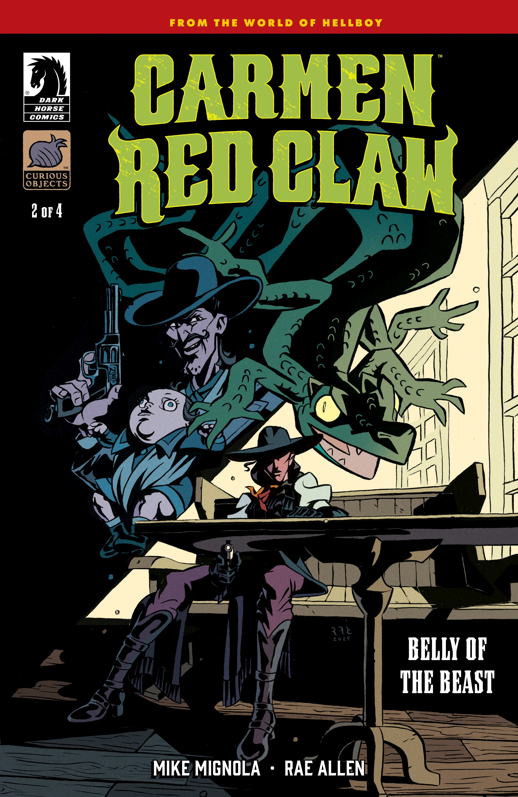
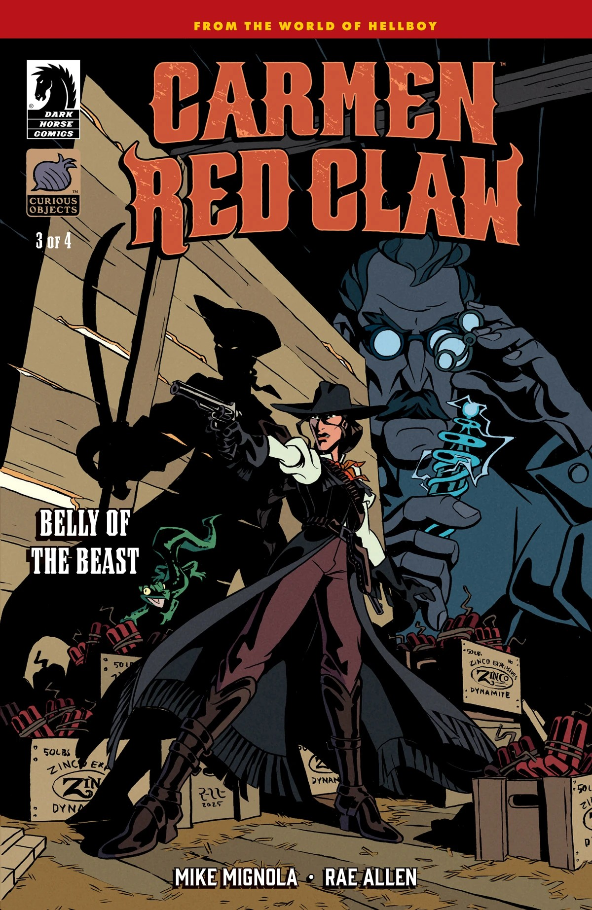
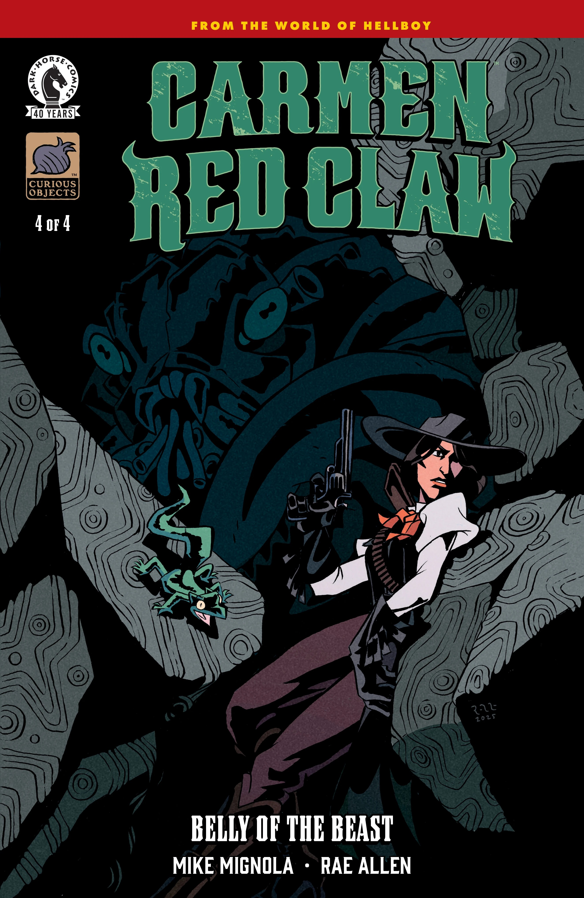
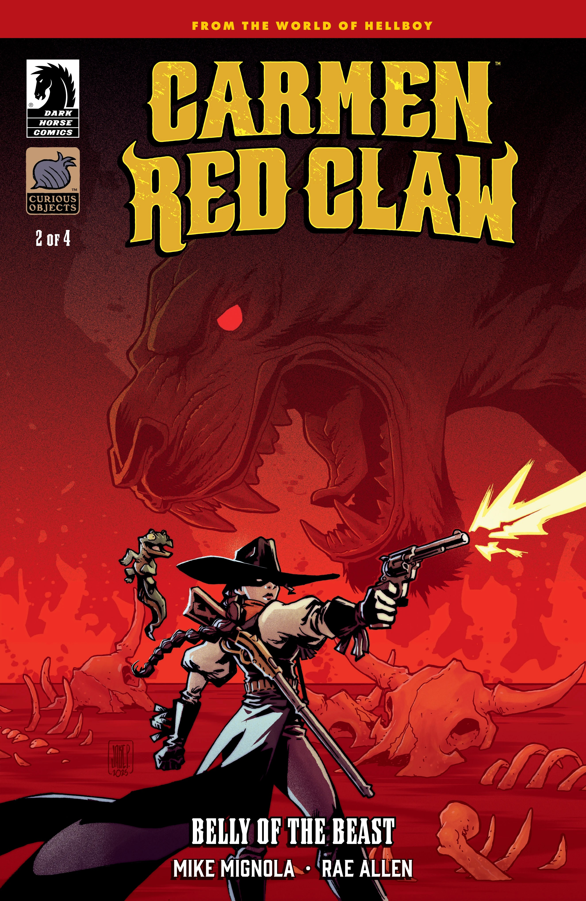
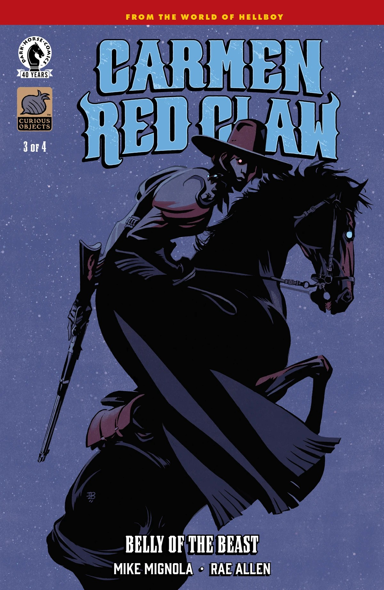
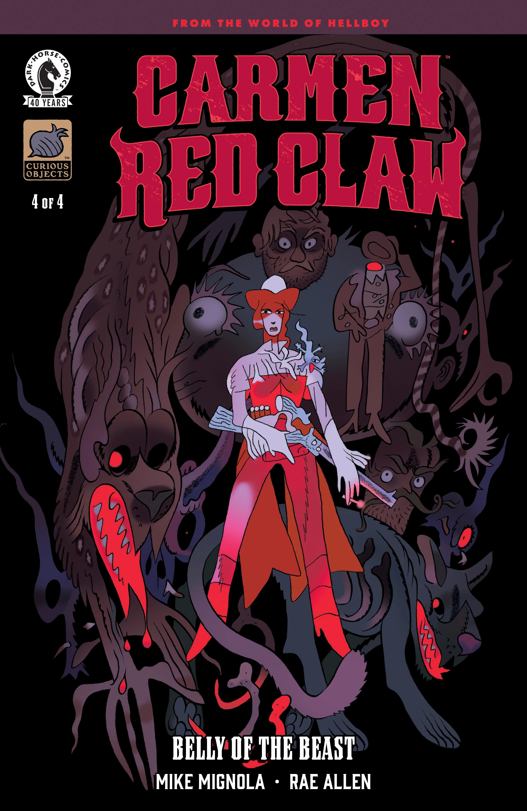

*This article is a stub. You can help Hellboy Wiki by expanding it.*

***Belly of the Beast*** is the first arc of *Carmen Red Claw* written by Mike Mignola and Rae Allen, and illustrated by Allen in her Hellboy Universe debut.

## Synopsis

### Part One

Supernatural gun-for-hire and shape-shifting descendant of the notorious El Bogavante, [Carmen Red Claw](/entry/Carmen_Red_Claw) faces a new type of monster when investigating supposedly cursed ranch land. Something is killing the cattle in the area, but Carmen has to find out if it’s really a beast to blame, or if humans are the real monsters here.

### Part Two

Cattle are still disappearing and cowboys are turning up without heads as Carmen ramps up her investigation of the supposed curse on the local ranch land.

### Part Three

Carmen channels her ancestor’s powers during an all-out brawl against chupacabras aboard a speeding train.

### Part Four

Carmen’s adversaries appeal to an ancient monster to help their cause in this explosive conclusion!

## Gallery

All covers by Rae Allen.

*Carmen Red Claw:  
Belly of the Beast* \#1

*Carmen Red Claw:  
Belly of the Beast* \#2

*Carmen Red Claw:  
Belly of the Beast* \#3

*Carmen Red Claw:  
Belly of the Beast* \#4

|Carmen Red Claw: Belly of the Beast #1

|Carmen Red Claw: Belly of the Beast #2

|Carmen Red Claw: Belly of the Beast #3

|Carmen Red Claw: Belly of the Beast #4

|Carmen Red Claw: Belly of the Beast #2 variant cover by Jake Parker

|Carmen Red Claw: Belly of the Beast #3 variant cover by Tonci Zonjic

|Carmen Red Claw: Belly of the Beast #4 variant cover by Benjamin Schipper
### Variant covers

*Carmen Red Claw:  
Belly of the Beast* \#1  
variant cover by Mike Mignola  
with colors by Dave Stewart

*Carmen Red Claw:  
Belly of the Beast* \#2  
variant cover by Jake Parker

*Carmen Red Claw:  
Belly of the Beast* \#3  
variant cover by Tonci Zonjic

*Carmen Red Claw:  
Belly of the Beast* \#4  
variant cover by Benjamin Schipper
