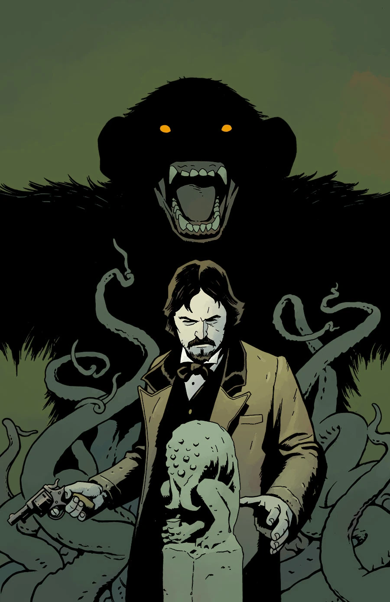

***Beware the Ape*** is a short story that was featured in *Dark Horse Presents* \#36.

## Publication History

This story was published in the final issue of the eighty-page iteration of *Dark Horse Presents*.

## Synopsis

Living legends Mike Mignola, Stan Sakai, and Jaime Hernandez all contribute to this final issue of *Dark Horse Presents*! Mignola and Ben Stenbeck deliver a new *Witchfinder* story, while Hernandez introduces Merlon the magician! This issue also features new stories— *Sunstroke* from Luciano Saracino and Juan Manuel Tumburús, a new *Clark Collins* tale from Kel McDonald, two hilarious new strips from Patrick Alexander, and a surprise-ending sci-fi story from Martin Conaghan and Jimmy Broxton!

## Gallery

|*Dark Horse Presents* \#36
cover by Ben Stenbeck
