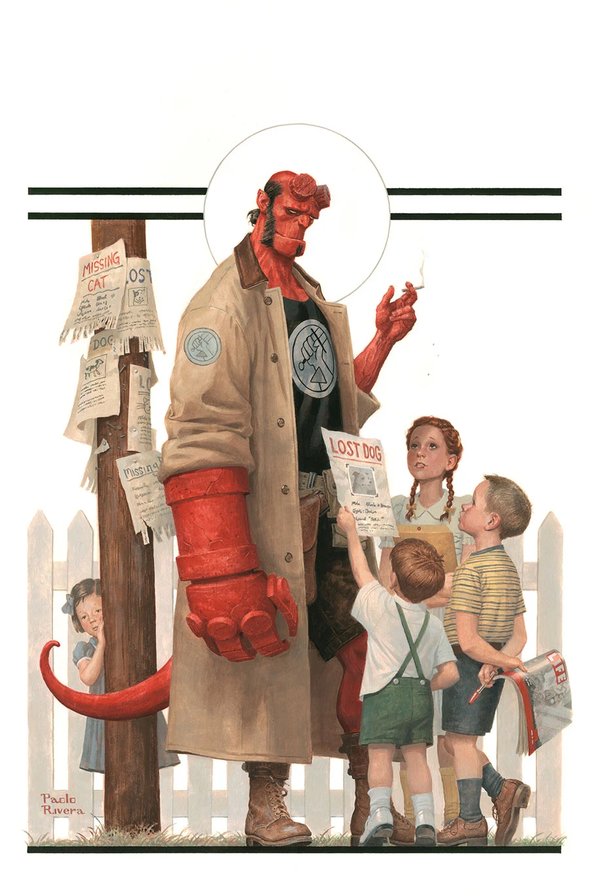
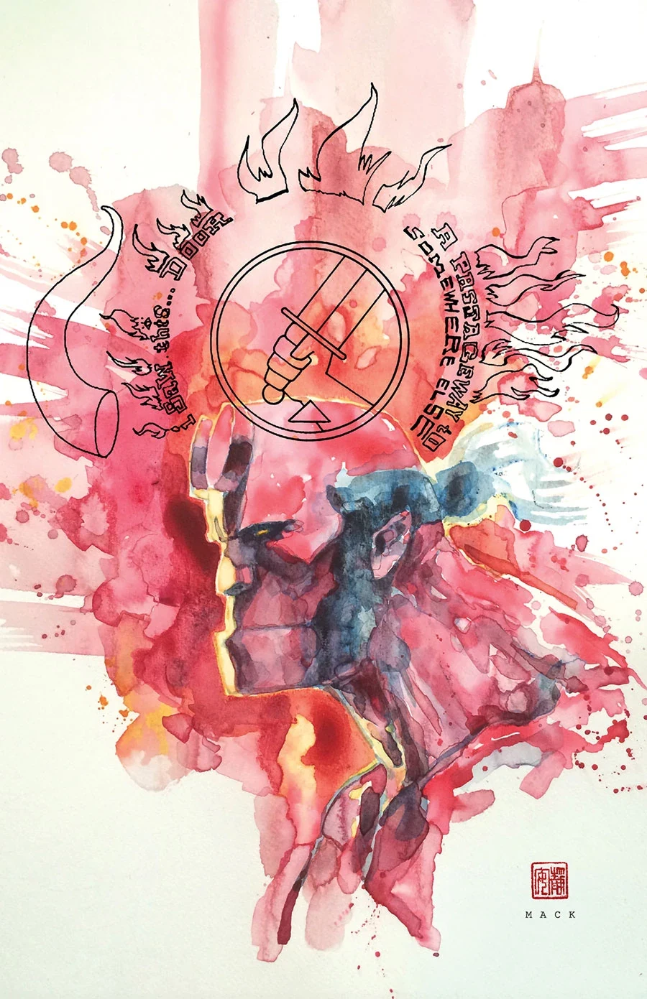
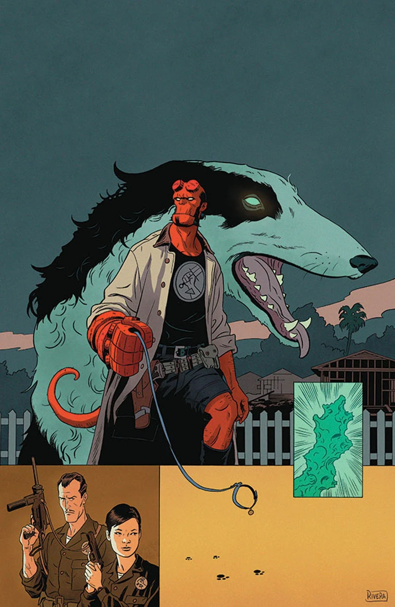
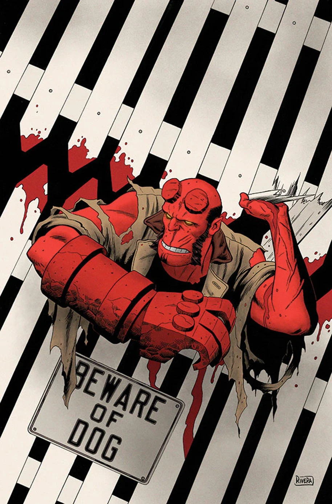

***Beyond the Fences*** is a three-issue story written by Mike Mignola and Chris Roberson, illustrated by Paolo and Joe Rivera. It is one of several stories making up *[Hellboy and the B.P.R.D.](/entry/Hellboy_and_the_B.P.R.D.): 1953*.

## Synopsis

### Part One

A mysterious creature hunts the children of an idyllic suburban town, and the [BPRD](/entry/Bureau_for_Paranormal_Research_and_Defense) get more than they bargained for when their investigation begins to seem strangely familiar.

### Part Two

Suburbia is torn apart when [Hellboy](/entry/Hellboy_%28character%29) faces off against a bizarre creature, while the BPRD tries to uncover who created such a monster—and why.

### Part Three

Man’s best friend becomes Hellboy’s worst nightmare in a Cold War–era mission.

## Gallery

Covers by [Paolo Rivera](/entry/Paolo_Rivera) unless otherwise stated.

|*1953* \#3

|*1953* \#3 variant
by [David Mack](/entry/David_Mack)

|*1953* \#4

|*1953* \#5
