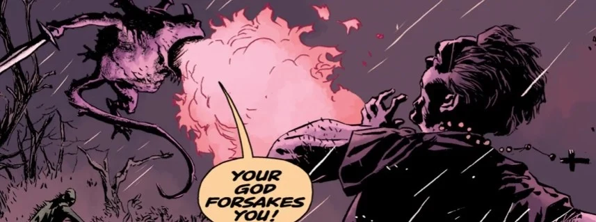
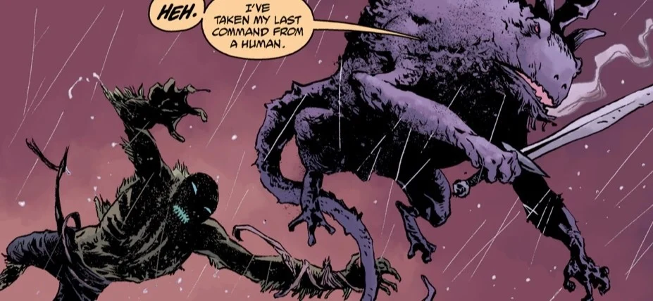
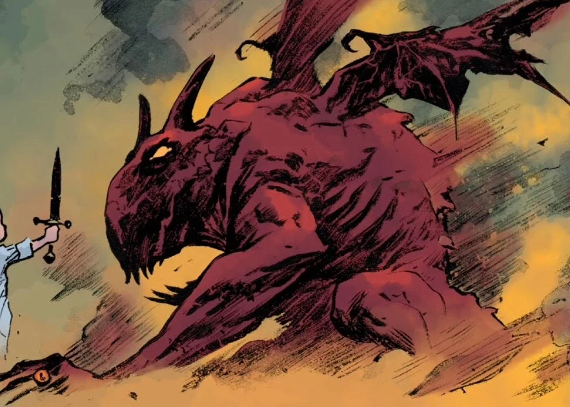

**Bifrons** is a [Demon](/entry/Demon) and Earl of [Hell](/entry/Hell).

## History

Bifrons was summoned by [Yomyael](/entry/Yomyael) (while possessing [Varvara](/entry/Varvara)) who sought to rebuild [Pandemonium](/entry/Pandemonium_(location)) on Earth.

Bifrons was skeptical of Yomyael, who had stolen the ring of now dead Duke of Hell [Amdusias](/entry/Amdusias). Bifrons had gotten his own ring from the late Prince of Hell [Beelzebub](/entry/Beelzebub). Yomyael reminded the Earl that she controls him through the same blade that [Hellboy](/entry/Hellboy_(character)) had used to kill [Satan](/entry/Satan).

Bifrons later led an aerial assault against the forces of the [B.P.R.D.](/entry/Bureau_for_Paranormal_Research_and_Defense) who seeked to wipe out the remaining demons in New York. The Earl notably battled with Liz Sherman, who eventually managed to kill the demon.

## Physical apperance

Bifrons appears as an enormous red, horned toad with wings.

## Lore

In demonology Bifrons is also an Earl of Hell, with sixty legions of demons under his command and his often tied to the Roman god Janus.

## Gallery

|

|

|Yomayel summons Bifrons
## Appearances

- [*Abe Sapien: A Darkness so Great*](/entry/A_Darkness_so_Great)
- [*B.P.R.D.: The Devil You Know—Pandemonium*](/entry/Pandemonium_(story_arc))
- [*B.P.R.D.: The Devil You Know—Ragna Rok*](/entry/Ragna_Rok_(story_arc)) (corpse)
