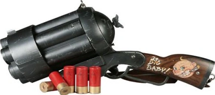

 The **Big Baby** is a specialized weapon used by [Hellboy](/entry/Hellboy_%28character%29) in the film *[Hellboy II: The Golden Army](/entry/Hellboy_II%3A_The_Golden_Army)*.

## Weapon specification

The Big Baby is an oversize, six-round gun with a lever action and top-break loading. It fires oversized shotgun shells which cause a small explosion on impact. Each chamber must be loaded separately, and a wind-up key mounted in the breach must be turned before firing in order to wind a spring that rotates the cylinder after each shot.

Due to its size, Hellboy may carry the weapon with both hands rather than just the [Right Hand of Doom](/entry/Right_Hand_of_Doom). It was used against [a Forest God](/entry/The_Last_Elemental). As shown in the Hellboy II film, it fires two rockets at a time.

## Rounds

The only known rounds are heavyweight shotgun shells, each with a baby bottle drawn on its casing and the words "SUCK ON THIS" engraved around the primer cap.

## See Also

- [The Samaritan](/entry/The_Samaritan)
