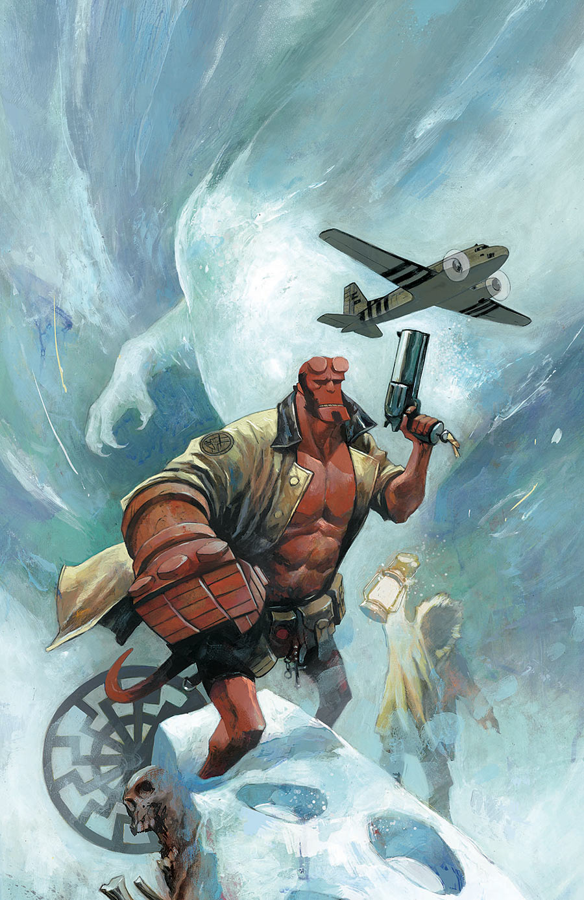

***Black Sun*** is a two-issue arc of *[Hellboy and the B.P.R.D.](/entry/Hellboy_and_the_B.P.R.D.): 1954* written by Mike Mignola and Chris Roberson, and illustrated by Stephen Green.

## Synopsis

### Part One

When an unknown creature attacks a research group on an Arctic expedition, Hellboy and the BPRD are sent to investigate. No longer the newbie, Hellboy thinks he can solve the mystery immediately, but what they find in the snow reveals something much bigger behind the beast.

### Part Two

Separated from the rest of the BPRD, Hellboy finds himself in the company of a familiar enemy with a new weapon — and plans to test it out on Hellboy.

## Gallery

Covers by [Mike Huddleston](/entry/Mike_Huddleston).

|*1954: Black Sun* \#1

|*1954: Black Sun* \#2
