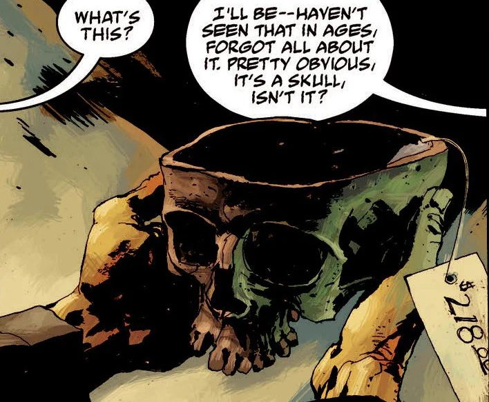

 After Blackbeard's head was placed upon a pole by the hunter who ended him, it was recovered by an old friend of the hunter's, and his skull was made into this near-legendary artifact. It was placed into various collections, including fraternities (such as Yale and Boston), and some private collections.

Aside from it being made of [Blackbeard](/entry/Blackbeard)'s skull, there's no [magical](/entry/Magic) benefit from this chalice. Blackbeard did sense certain things through it, and was able to call out to a psychic crook with it.
