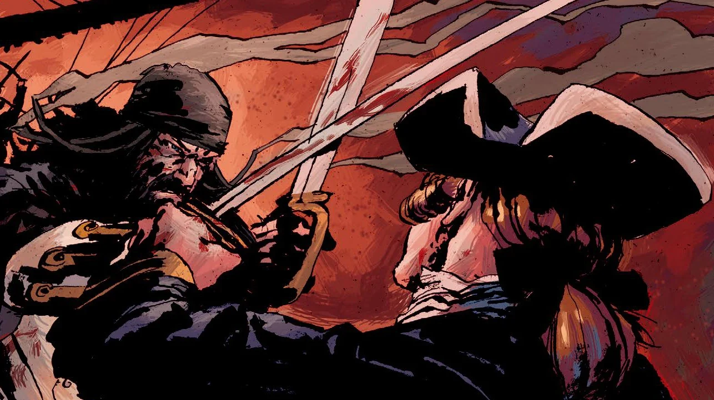

**Edward Teach**, a.k.a. **Blackbeard** was an English pirate who first set sail during the reign of Queen Anne. He is one of the most popular figures in pirate fiction, having provided inspiration for various ghost-stories, films (including the Pirates of the Caribbean series), games, novels and many other forms not listed.

Though much of what is known of him is fiction, in no small part of his own fabrication, he was a mortal man.

## Blackbeard in Hellboy

Edward Teach was a feared pirate with some supernatural powers. He featured as the main villain of the story [They That Go Down to the Sea in Ships](/entry/They_That_Go_Down_to_the_Sea_in_Ships). A psychically gifted man comes across his skull in an antique store, murders the owner and seeks to make a profit by aiding and commanding the dread pirate.

Things do not go as planned, the psychic's partner in crime kills him for the skull, but is in turn killed by Blackbeard's undead body. Hellboy and Blackbeard-expert Earl Reeds combat the unholy revenant who mistakes Hellboy for an agent of "[Old Scratch](/entry/Satan)". He was nigh unstoppable until a mixed mash of undead sailors (his former crew and foes) arrived and dragged him down to Davey Jones' locker.

## Powers and abilities

Blackbeard in life possessed an inhuman amount of stamina, he took myriad wounds before finally falling to a decapitating strike from a nameless highlander. Even then, his headless corpse swam after Maynard's boat that carried his head on the bowsprit.

As undead he had the same amount of stamina and then some, being able to withstand pretty much anything Hellboy threw at him. Including his [Right Hand of Doom](/entry/Right_Hand_of_Doom). He also was able to regenerate his head from the remnant of his skull that had been converted to a [Blackbeard's skull chalice](/entry/Blackbeard's_skull_chalice) . He also was able to restore his body and weapons to working order, firing a pistol at Hellboy from point-blank range.

## Trivia

- His skull had been used by several groups, including Boston and Yale university fraternities.
- He was at least aware that his resurrection had taken some time.
- He did offer Hellboy a chance to engage in piracy.

## Gallery

Undead Blackbeard fires at Hellboy

The skull--chalice once belonging to Blackbeard

## External link

Blackbeard on wikipedia
