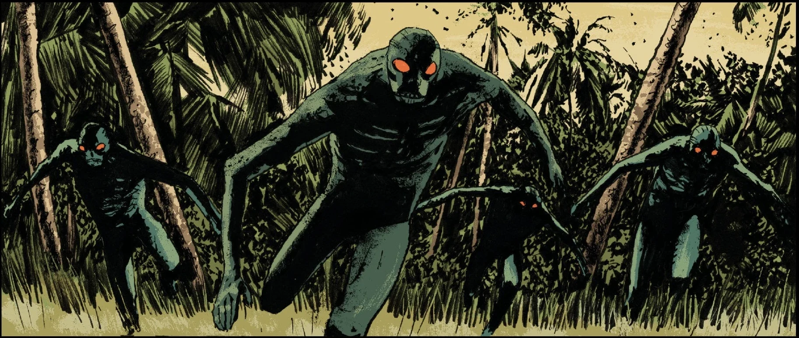

The **Bonji** are the new race of man, also known as **Ichthyo Sapiens** or as they call themselves the **First People**, that have become the dominant species on Earth, a thousand years after the fall of human civilization.

## Background

A thousand years ago, the corpse of [Abraham Sapien](/entry/Abraham_Sapien) who had been slain in battle with [Grigori Rasputin](/entry/Grigori_Rasputin) found its way into the seas. From his body, spilled many eggs that produced small tadpole like creatures. These creature would continue to evolve becoming more humanoid, and eventually rising as the new race of man, as foretold. The race of frog-like creatures emerged from the seas, to move towards the land where the encountered the the crystal containing the body of the [Vril](/entry/Vril) infused [Elizabeth Sherman](/entry/Elizabeth_Sherman).

Unlike their forebearer, the Bonji resemble humanoid frogs, similar to the [Frog men](/entry/Frog_monster) created by the [Ogdru Hem](/entry/Ogdru_Hem), albeit less brutish and savage.

## Culture

The Bonji are a peaceful society that live in the harsh yet beautiful world of the surface. Despite their primitiveness, they are aware that an earlier world existed before there's through the discovery of various artifacts and ruined cities they discovered deep in the earth. From their understanding the world before was ruled by [stick people](/entry/Human). Before the arrival of [Frankenstein](/entry/Frankenstein_(character)) and Lilja they had taken these discoveries and tales of a the civilization that predated theirs to be just a myth.

In their beliefs they believed that the world was stone and fire, until the deity known as the [Ughdra-Hesh](/entry/Ogdru_Jahad) came to the world to plant the first seeds of life, bringing rain and water of life. From the seeds they planted the Bonji emerged. It was believed that the Ughdra-Hesh stayed with the Bonji to watch over them until they slept and became mountains.

## Sources

1.  [↑](#cite_ref-1) [The Devil You Know](/entry/The_Devil_You_Know_(story_cycle)) Issue#15
2.  [↑](#cite_ref-2) [New World](/entry/New_World_(Frankenstein_story_arc)) Issue#2
