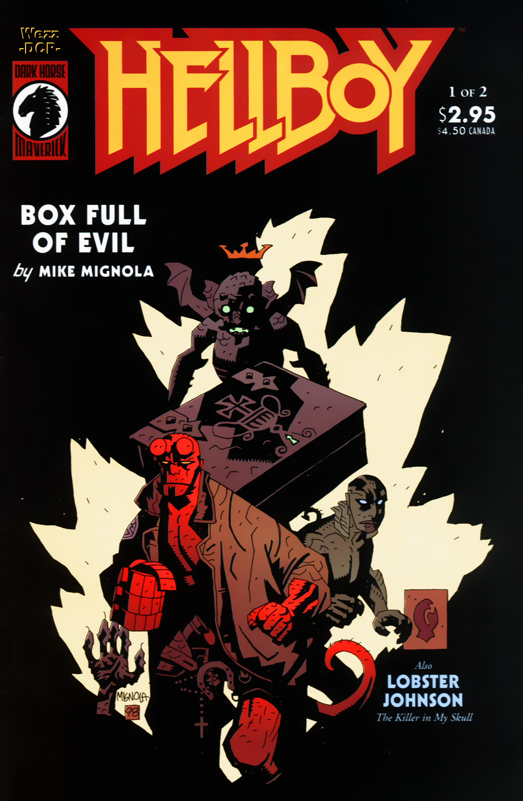
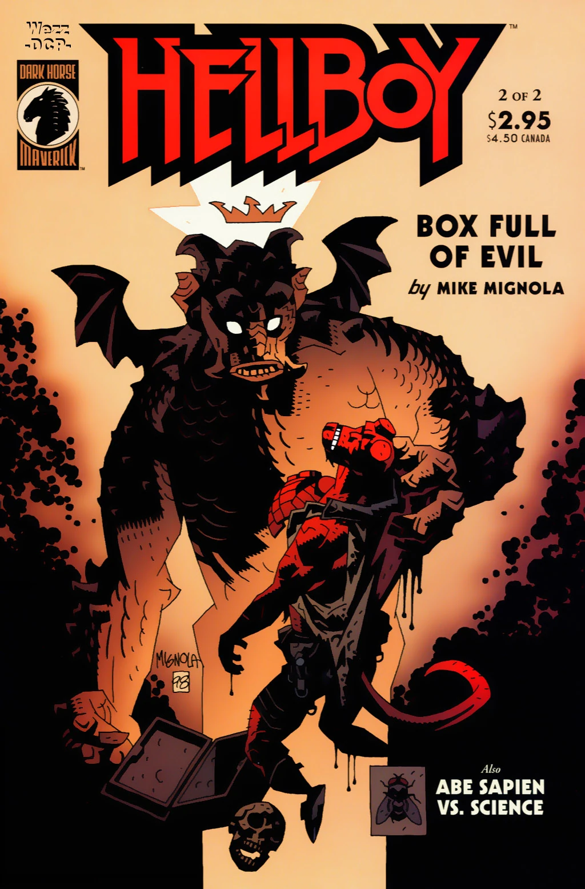

***Box Full of Evil*** is a two-issue miniseries written and drawn by [Mike Mignola](/entry/Mike_Mignola). It was the first story to reveal Hellboy's secret crown.

## Publication History

*Box Full of Evil* was first published as a two-issue miniseries from August to September 1999. Each issue contained a backup story—*[The Killer in My Skull](/entry/The_Killer_in_My_Skull)* (the first *[Lobster Johnson](/entry/Lobster_Johnson_%28series%29)* story) in issue \#1 and *[Abe Sapien versus Science](/entry/Abe_Sapien_versus_Science)* in issue \#2. A four-page epilogue was added to the story when it was collected in April 2000. The epilogue connected the story back to *[The Right Hand of Doom](/entry/The_Right_Hand_of_Doom)*.

## Synopsis

### Part One

The story opens with [Hellboy](/entry/Hellboy_%28character%29) and [Abe Sapien](/entry/Abraham_Sapien) investigating a strange break-in in an English house. The owner relates that a man entered his house, broke down a wall over the fire place and left with a metal box and a pair of tongs. Hellboy notices that the broken wall one had a portrait of St. Dunstan on it, and the owner tells him that the house had one been a convent. The owner also got a vision of a sinister looking house.

The Story cuts to the thief [Igor Bromhead](/entry/Igor_Bromhead), speaking to a couple in the sinister looking house. He explains that Dunstan caught a demon with his tongs and trapped it inside the metal box. The couple, a Count and Countess, give Bromhead all their worldly possessions as payment. The Countess opens the box, and what looks like a fly flies out of the box and into her mouth. Possessed by the demon, she turns her husband into a monkey, and tries to transform Bromhead. However he wears a talisman with the image of St. Dunstan, granting him protection. Using the demon's secret name, [Ualac](/entry/Ualac), he binds and commands it. Bromhead asks the demon for wealth and power, the demon tells him of a treasure hidden in the house and of a great power. He explains that the “Harbinger of Apocalypse” is alive, and has denied his fate, however he still wears an invisible crown. This being has great power and even the regents of hell must follow him. The scene changes and it is revealed that Hellboy is in fact the Harbinger.

Hellboy and Abe enter the house, and find the open box. The monkey shoots Abe and drags him away. At the same time Bromhead binds Hellboy, and using Ualac's help causes a crown to appear over Hellboy's head. Ualac takes the crown and Bromhead beats Hellboy with Dunstan's tongs. The issue ends with Abe chained to the wall, with the monkey standing over him.

### Part Two

The monkey stands over Abe and burns him with a red hot iron. Bromhead beats Hellboy almost to death, until Ualac tells him to stop. They must cut off Hellboy's hand before he is killed “lest his death bleed into it and poison it.” Ualac explains that the hand has the power to loose and command the [Ogdru Jahad](/entry/Ogdru_Jahad) and to bring the soldiers of hell to life. Ualac takes Dunstan's tongs and they transform into a sword.

Hellboy finds himself sitting below a tree, with [Dagda](/entry/Dagda), the goblin from *[The Corpse](/entry/The_Corpse)*, and [Sir Edward Grey](/entry/Sir_Edward_Grey) looking down on him. The goblin tells him that since he no longer wears the crown, his name is no longer Anung Un Rama. Back in the house, since Hellboy's name is no longer Anung Un Rama, he is now free of Bromhead's binding. He attacks Ualac, and shatters the sword.

Bromhead flees. Abe manages to free himself from the monkey. The monkey leaps at Abe, falls through a hole in the wall and lands on the treasure that Ualac mentioned earlier. Abe finds Bromhead and demands to know where Hellboy is. Bromhead locks himself in a room and invokes the demon [Astaroth](/entry/Astaroth) for help. Astaroth transforms the door of the room into a stone wall, protecting Bromhead. In the struggle Bromhead's talisman broke. With his protection broken, Astaroth turns the bottom half of Bromhead into a lizard.

Hellboy, still fighting Ualac, breaks off his horns and stabs Ualac with them. The demon leaves the body and turns back into the fly like creature he was in the beginning. Hellboy leaps to catch Ualac and falls outside. Astaroth confronts Hellboy and takes Ualac back to hell. Astaroth holds out the crown. Hellboy says that he will never bring the apocalypse. Astaroth responds that he will hold onto the crown in hell and await Hellboy.

Hellboy returns to the house and helps Abe. The final panel shows the count, turned into a monkey laying dead in the pile of treasure, with a crown on his head.

### Epilogue

[Kate Corrigan](/entry/%E5%87%AF%E7%89%B9%C2%B7%E8%80%83%E7%91%9E%E6%A0%B9)) meets Hellboy in a field. She tells him that Abe will be OK. Hellboy talks about how he ignores asking questions about who he really is. However, sometimes things happen, and he is forced to confront his identity, but that at least this time he will again ignore it. Hellboy lets go of the paper from *[The Right Hand of Doom](/entry/The_Right_Hand_of_Doom)* and it is snatched up in midair by a large black bird.

## Story Chronology

The exact date of this story is never stated. It must take place after *[The Right Hand of Doom](/entry/The_Right_Hand_of_Doom)* but before *[Being Human](/entry/Being_Human)*.

## Content

### Characters

#### [B.P.R.D.](/entry/Bureau_for_Paranormal_Research_and_Defense)

- [Abraham Sapien](/entry/Abraham_Sapien)
- [Hellboy](/entry/Hellboy_%28character%29)
- [Trevor Bruttenholm](/entry/Trevor_Bruttenholm) (Mentioned)
- [Katherine Corrigan](/entry/%E5%87%AF%E7%89%B9%C2%B7%E8%80%83%E7%91%9E%E6%A0%B9))

#### Other

- [Igor Bromhead](/entry/Igor_Bromhead)
- [Demons](/entry/Demon)
  - [Ualac](/entry/Ualac)
  - [Astaroth](/entry/Astaroth)
- Mr. Heath
- Count Guarino
- Countess Guarino
- [Ogdru Jahad](/entry/Ogdru_Jahad)
- [Daoine Sidhe](/entry/Daoine_Sidhe)
  - [Dagda](/entry/Dagda)
  - Goblin with Pipe
- [Edward Grey](/entry/Edward_Grey)[1]
- [Ogopogo](/entry/Ogopogo) (Mentioned)

### Locations

- England
  - Heath Residence (Druggan Hill)
  - Averbury Stone Circles (Wiltshire)
- Scotland
  - Guarino Residence (LockMaben)
- [Yggdrasil](/entry/Yggdrasil)
- [Hell](/entry/Hell)
  - [Pandemonium](/entry/Pandemonium_%28location%29) (Mentioned)
- Canada
  - Okanagan Lake (British Columbia) (Flashback)

### Noteworthy Artifacts

- Hand of Glory
- Box containing [Ualac](/entry/Ualac)
- Tongs of Saint Dunstan
- Painting/Amulet of Saint Dunstan
- [Malcolm Frost's](/entry/Malcolm_Frost) note on the [Right Hand of Doom](/entry/Right_Hand_of_Doom)

## Gallery

Covers by [Mike Mignola](/entry/Mike_Mignola).

 \#1

 \#2

 Cover

[1] Identity not yet revealed
