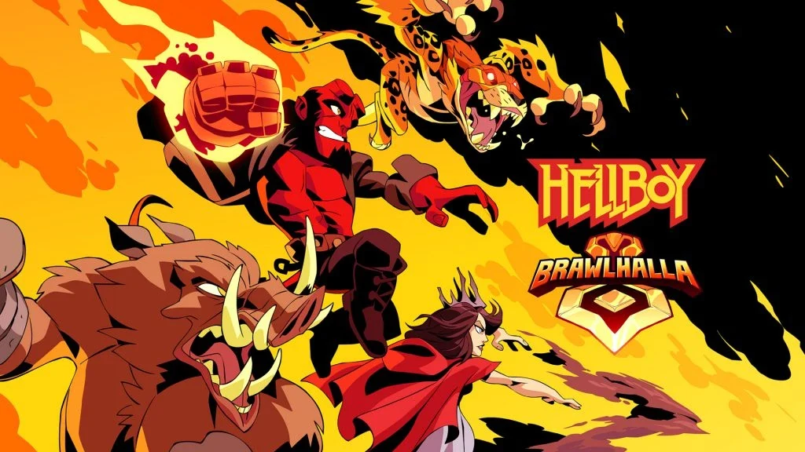
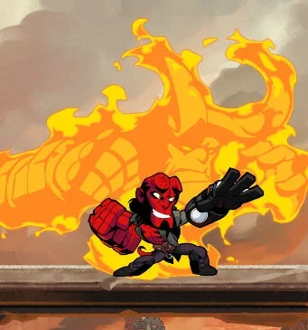
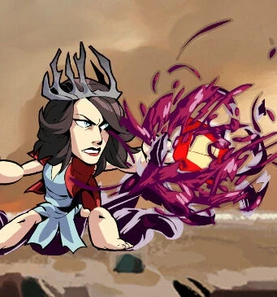
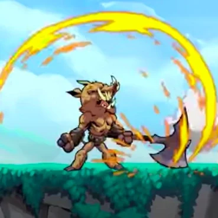
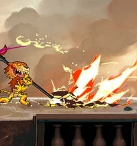
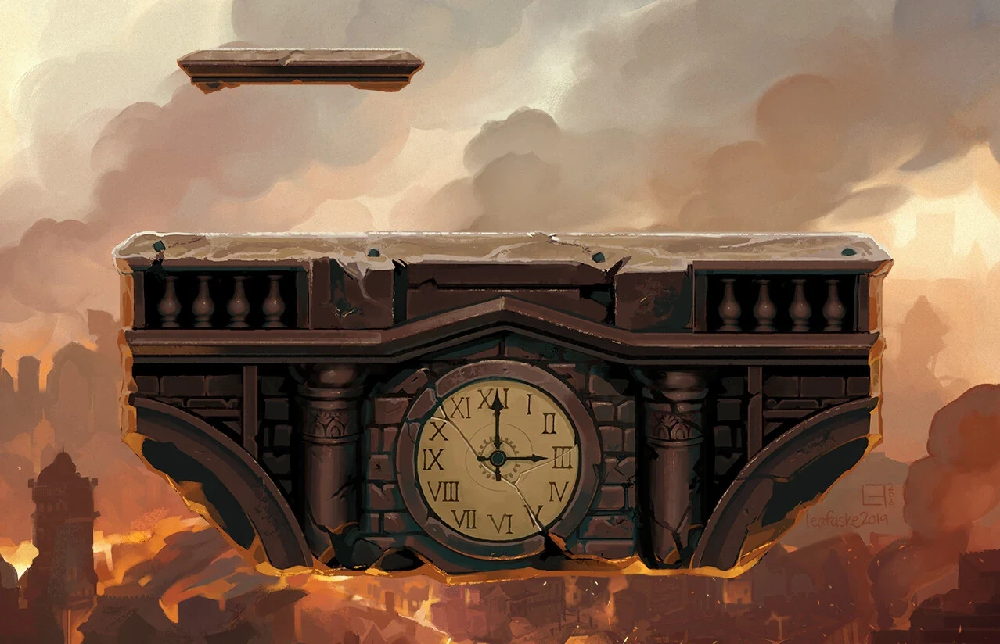
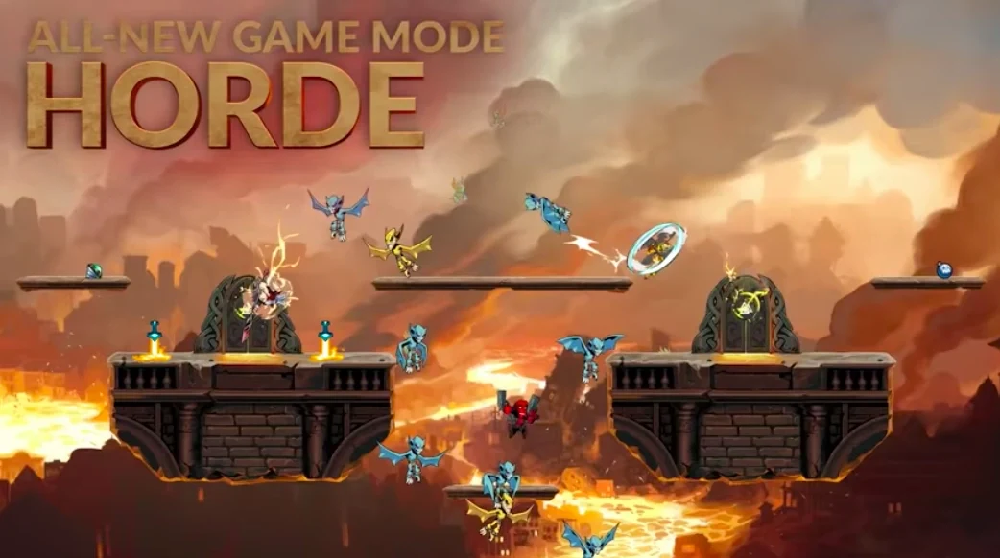

***Brawlhalla*** is a 2D platform fighter developed by Blue Mammoth Games and published by Ubisoft.

On April 10, 2019, a crossover event to promote [the 2019 film](/entry/Hellboy_(2019_film)) added several *[Hellboy](/entry/Hellboy_(series))*-themed elements to the game. Hellboy, Nimue, Gruagach and Daimio are 4 epic crossover skins that can be purchased for 300 Mammoth Coins (roughly \$10) for Hellboy, Nimue and Daimio, and 240 Mammoth Coins (roughly \$8) for Gruagach.

## Hellboy

[Hellboy](/entry/Hellboy_(character)) is an epic crossover skin for the character Cross. Hellboy uses Blasters (Samaratins) and Gauntlets (Apocalypse Hands) as his weapons. Hellboy has the same stats and signature (special) attacks as Cross, however the signature attack animations have been changed.

## Nimue

[Nimue](/entry/Nimue) is an epic crossover skin for the character Dusk. Nimue uses Spear (Crimson Pike) and Orb (Blood Shard) as her weapons. Nimue has the same stats and signature attacks as Dusk, however the signature attack animations have been changed.

## Gruagach

[Gruagach](/entry/Gruagach) is a crossover skin for the character Teros. Gruagach uses Axe (The Renegade) and Hammer (Heavy Hitter) as his weapons. Gruagach shares the same stats and signature attacks as Teros. He also uses the same signature animations as Teros.

## Daimio

[Benjamin Daimio](/entry/Benjamin_Daimio) is an epic crossover skin for the character Mordex. Mordex uses Gauntlets (Jaguar Claws) and Scythe (Lethal Edge) as his weapons. Daimio has the same stats and signature attacks as Mordex, however the signature attack animations have been changed.

## New Map

The Hellboy crossover event bought a new 1v1 map called 'Apocalypse'. The map is flat and features 1 soft platform.

## Podium and Avatar

The Hellboy crossover event bought a new Podium called 'Beast of Apocalypse', which features a statue of Hellboy in his demon form, featuring his sword. When a character is selected whilst this podium is equipped, a crown of flame appears atop the podium. The podium can be purchased for 240 Mammoth Coins.

The event also bought a new Animated Avatar called 'Crown of Flame'. The avatar features a bright yellow crown of flame and eyes and a hair of horns in front of a red background. The avatar can be purchased for 60 Mammoth Coins.

"Beast of Apocalypse" podium

"Crown of Flame" avatar

## Gamemode

The Hellboy crossover event bought a new game mode named 'Horde', where a team of up to 8 players would defend the doors of Valhalla from a horde of demons, and even Gruagach. The objective is to defend the doors before the time runs out of the demons break through.

## External Links

- "Hellboy Joins Brawlhalla" patch notes
