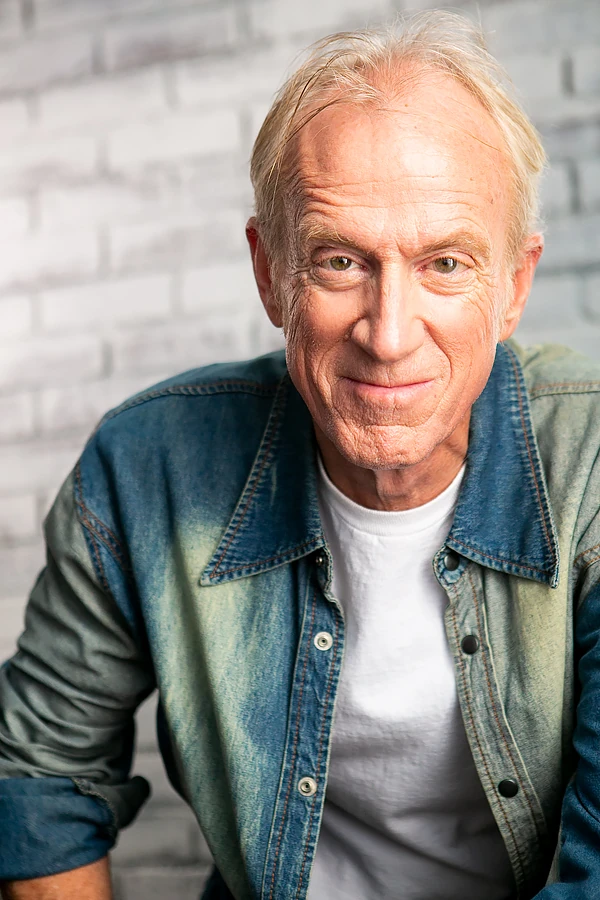

While born in the Continental US, Bruce Barker grew up in rural Alaska. In 2001, after a long career as a DJ and commercial producer in Radio, Bruce shifted his full-time focus to voiceover, opening the LA-based video/audio production company RightAfterThis.com.

Bruce voices hundreds of commercials per year, many gaining national distribution. He's appeared in a large number video games and has narrated many documentaries and audio books. Bruce has been often seen on-stage in local theatre, is the national on-camera spokesperson for Westminster Mint, and appeared as Thomas Berkus in the feature "Hollywood Road Trip" directed by Johnny Soto.

He's written and directed several short films as well, as listed here in the IMDb Filmography section.

He voices Hellboy in Netherrealm Studio's Injustice 2.
