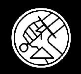
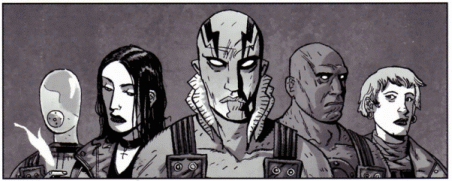

*For the Injustice 2 guest appearance, see [Bureau for Paranormal Research and Defense (Injustice)](/entry/Bureau_for_Paranormal_Research_and_Defense_(Injustice)).*

 The **Bureau for Paranormal Research and Defense** (**B.P.R.D.**) is an organization charged with protecting America and the world from the occult, paranormal and supernatural. It retains the services of several persons of "enhanced talents", including [Hellboy](/entry/Hellboy_%28character%29).

The B.P.R.D. originally appeared in the *[Hellboy](/entry/Hellboy_%28series%29)* comics, introduced in the first story arc *[Seed of Destruction](/entry/Seed_of_Destruction)* as the organization Hellboy and his compatriots work for. Hellboy quit the Bureau at the conclusion of the *[Conqueror Worm](/entry/Conqueror_Worm_%28story%29)* story arc, published in 2001; shortly after this, a standalone *[B.P.R.D.](/entry/B.P.R.D._%28series%29)* series began publication with the story arc *[Hollow Earth](/entry/Hollow_Earth)*. *Hellboy* and *B.P.R.D.* comics continued to run in parallel, with the events of one informing the other. Related series *[Hellboy and the B.P.R.D.](/entry/Hellboy_and_the_B.P.R.D.)* covers Hellboy's earliest days as a field agent in the 1950s.

## History

The B.P.R.D. was founded in late 1944 by Professor [Trevor Bruttenholm](/entry/Trevor_Bruttenholm) to combat various occult threats uncovered in operations against Nazi Germany. It initially had strong links to the United States Army Air Forces and was based at a military airbase in New Mexico. By 1947, the Bureau relocated to a custom built facility in Fairfield, Connecticut. It maintains strong links to various branches of the United States Armed Forces to this day. It is a private organization that receives funding from several major governments (mostly the United States and United Kingdom, although other countries like Canada, Japan, France, and Italy have been mentioned).

Professor Bruttenholm served as director until the late 1950s when he stepped down to return to field work. The current Director is [Dr. Thomas Manning](/entry/Tom_Manning). Since the 1970s, additional paranormal agents have joined the ranks, such as [Liz Sherman](/entry/Liz_Sherman), [Abraham Sapien](/entry/Abraham_Sapien), [Johann Kraus](/entry/Johann_Kraus), and [Ben Daimio](/entry/Ben_Daimio). This has become necessary to maintain the high profile of the Bureau, especially in light of the departure of their flagship agent, [Hellboy](/entry/Hellboy_%28character%29), in 2001.

The B.P.R.D. is a well known and respected organization that has excellent relations with most international governments and United States government agencies, with the exceptions of China and the CIA.

### [Plague of Frogs](/entry/Plague_of_Frogs_%28story_cycle%29)

The Bureau was initially the United States' only defense against an onslaught of [frog creatures](/entry/Frog_monster). Though the 'frogs' originally began operating on the East Coast, they spread west on both sides of the US-Canadian border. To cut costs, the Bureau moved from its long-time headquarters in Connecticut to an abandoned research facility in Colorado. This facility was last used to house Nazi scientists who defected to America after World War II. As such, the facility contains vast amounts of secret files that the B.P.R.D. has yet to explore.

The frog monster invasion reached its peak during the events of *[The Black Flame](/entry/The_Black_Flame_%28story%29)*. A Nazi madman called the [Black Flame](/entry/Landis_Pope) insinuated himself as the leader of the frogs, and together they raised [Katha-Hem](/entry/Katha-Hem) (one of the [Ogdru Hem](/entry/Ogdru_Hem), the 369 spawn of the [Ogdru Jahad](/entry/Ogdru_Jahad)) from the ground. The beast ran rampant across the American heartland until Liz Sherman used an [ancient artifact](/entry/Spiked_Cylinder) to amplify her pyrokinetic powers a thousandfold. After she burned Katha-Hem alive, the frog monsters dragged the Black Flame into a vast pit and the invasion came to an end.

### [Hell on Earth](/entry/BPRD%3F%E4%BA%BA%E9%97%B4%E5%9C%B0%E7%8B%B1))

The B.P.R.D. has recently become an international organization with support from the United Nations. This is due to the major [Ogdru Hem](/entry/Ogdru_Hem) activity occurring throughout the world. The Bureau has also been unable to rely on their enhanced talent agents as of late. Former Team Captain Ben Daimio fled the Bureau after causing the death of several agents. Agent Liz Sherman is currently missing following her destruction of the frog army and the Black Flame at Agartha. Agent Abe Sapien is currently on the run after awakening from a 4 month coma brought on by severe injuries. His time spent in a coma has left him transformed and his fellow agents even more suspicious of him and his role in the end of the world. Due to this lack of enhanced talent agents, the more traditional agents have had to step up as the world falls apart.

## Agents

Some notable BPRD agents. Left to right: [Johann Kraus](/entry/Johann_Kraus), [Liz Sherman](/entry/Liz_Sherman), [Abe Sapien](/entry/Abe_Sapien), [Roger](/entry/Roger), [Kate Corrigan](/entry/Kate_Corrigan).

### Enhanced Talents Agents

- [Hellboy](/entry/Hellboy_%28character%29) — World's Greatest Paranormal Investigator, Beast of the Apocalypse
- [Abe Sapien](/entry/Abe_Sapien) — icthyo-humanoid, formerly Langdon Caul
- [Liz Sherman](/entry/Liz_Sherman) — pyrokinetic
- [Johann Kraus](/entry/Johann_Kraus) — ectoplasmic physical medium (deceased)
- [Fenix Espejo](/entry/Fenix_Espejo) — psychic
- Dr. [Izar Hoffman](/entry/Izar_Hoffman) — psychic
- [Sidney Leach](/entry/Sidney_Leach) — psychically detects and manipulates metal (possibly retired)
- Captain [Ben Daimio](/entry/Ben_Daimio) — team leader, were-jaguar (deceased)
- [Roger](/entry/Roger) — [homunculus](/entry/Homunculus) (deceased)
- [Panya](/entry/Panya_%28character%29) — ageless mummy and psychic (deceased)
- [Ashley Strode](/entry/Ashley_Strode) — exorcist (deceased)
- [Ted Howards](/entry/Ted_Howards) — wields Hyperborean sword connected to [a prehistoric human](/entry/Gall_Dennar) (deceased)

### Human Agents

#### Present-day B.P.R.D.

- [Dr. Thomas Manning](/entry/Thomas_Manning) — director (deceased)
- [Dr. Kate Corrigan](/entry/%E5%87%AF%E7%89%B9%C2%B7%E8%80%83%E7%91%9E%E6%A0%B9)) — former liaison to enhanced talents agents, later field director (deceased)
- [Professor James Henry O'Donnell](/entry/J%C2%B7H%C2%B7%E5%A5%A5%E5%94%90%E7%BA%B3%E6%95%99%E6%8E%88)) — occult specialist (deceased)
- [Pauline Raskin](/entry/Pauline_Raskin) — former field agent, responsible for training new agents
- [Andrew Devon](/entry/Andrew_Devon) — field agent, later field director (deceased)
- [Carla Giarocco](/entry/Carla_Giarocco) — field agent (deceased)
- [Nichols](/entry/Nichols) — field agent
- [Rebecca Gervesh](/entry/Rebecca_Gervesh) — field agent
- [Agent Tian](/entry/Tian) — field agent (deceased)
- [Russell Enos](/entry/Enos) — field agent (deceased)
- [Joseph Vaughn](/entry/Joseph_Vaughn) — field agent (deceased)
- [Nastassja "Stazz" Hansen](/entry/Nastassja_Hansen) — field agent (deceased)
- [Salvatore Tasso](/entry/Salvatore_Tasso) — field agent (deceased)
- [Professor Trevor Bruttenholm](/entry/Trevor_Bruttenholm) — former director (deceased)

#### 1940s B.P.R.D.

- Professor Trevor Bruttenholm, director
- [Tim Clark](/entry/Tim_Clark)
- [Jacob Stegner](/entry/Jacob_Stegner), field agent (*[1947](/entry/1947)*, *[1948](/entry/1948)*)
- [Simon Anders](/entry/Simon_Anders), field agent (*[1947](/entry/1947)*, *[1948](/entry/1948)*, *[Vampire](/entry/Vampire_%28story%29)*)
- [Archibald Muraro](/entry/Archibald_Muraro), field agent
- [Margaret Laine](/entry/Margaret_Laine), secretary
- General [Norton Ricker](/entry/Norton_Ricker), U. S. Military
- Mac, the dog
- Dr. [Howard Eaton](/entry/Howard_Eaton) — (deceased) — (appears in [1946](/entry/1946), [Bishop Olek's Devil](/entry/Bishop_Olek%27s_Devil))
- [Frank Russell](/entry/Frank_Russell), field agent (deceased) — (appears in [1947](/entry/1947))
- [Gabriel Ruiz](/entry/Gabriel_Ruiz), field agent (deceased) — (appears in [1947](/entry/1947))

#### 1950s B.P.R.D.

- [Margaret Laine](/entry/Margaret_Laine), assistant director of operations
- [Woodrow Farrier](/entry/Woodrow_Farrier), field agent
- [Susan Xiang](/entry/Susan_Xiang), psychic field agent
- [Myron Linneberg](/entry/Myron_Linneberg), intelligence consultant (former CIA)
- [Jacob Stegner](/entry/Jacob_Stegner), field agent (deceased as of [1956](/entry/1956))
- Agent Gustafsson, field agent — (appears in [1956](/entry/1956))
- Agent Hendricks, field agent — (appears in [1956](/entry/1956))
- Agent Hinojosa, field agent — (appears in [1956](/entry/1956))
- Agent Murphy, field agent — (appears in [1956](/entry/1956))
- [Victor Koestler](/entry/Victor_Koestler), field agent - (active as of 1964)
- [Robert Amsel](/entry/Robert_Amsel), field agent (traitor) (deceased as of [1952](/entry/1952))

#### Supporting and/or background

- Dr. Matthew Roddel, scientist
- Dr. Michael Cobb, scientist
- Dr. Arnold Platt, scientist (deceased)
- Doris, medical doctor
- Peter, techie responsible for overseeing the Oannes' superhuman bodies
- Jim, techie
- Lloyd, mechanic — Wake the Devil
- Izzy Kemper, cult expert, linguist
- [Garrett Omatta](/entry/Garrett_Omatta), psychic medium
- Josh Ecton, psychic
- Agent Lashley, field agent — The Black Flame
- [Agent Navarro](/entry/Agent_Navarro), field agent — The Black Flame
- [Catlett](/entry/Agent_Catlett), field agent — War on Frogs
- Agent Swanson, field agent
- Agent Helton, field agent
- Agent Kinsley, field agent — Saturn Returns
- Agent Brandaux, field agent (deceased)- Wasteland
- Cris Peters, field agent (deceased) — The Pickens County Horror
- Agent Lehane, field agent (deceased) — The Abyss of Time
- [Bud Waller](/entry/Bud_Waller), field agent/mechanic (deceased) — Wake The Devil
- [Scott Clark](/entry/Clark), field agent (deceased) — Wake The Devil
- [Lieutenant Bradley](/entry/Lieutenant_Bradley), field agent (deceased) — War on Frogs \#2
- [Demers](/entry/Agent_Demers), field agent (deceased) — War on Frogs \#2
- Agent Varadi, field agent (deceased) — War on Frogs \#2
- Agent Kohler, field agent (deceased) — War on Frogs \#2
- Agent Whitcomb, field agent (deceased) — War on Frogs \#2
- Bernie D'Andrea, field agent (deceased) — War on Frogs \#2
- Agent Bama, field agent (deceased) — War on Frogs \#2
- Agent Ferguson, field agent (deceased)
- Agent Musgrove, field agent (deceased) — The Killing Ground
- Agent Holcombe, field agent (deceased) — The Killing Ground
- Agent Pratt, field agent (deceased) — The Drowning
- Agent Hampton, field agent (deceased) — The Drowning
- Agent Van Fleet, field agent (deceased) — The Drowning
- Wilson, pilot (turned into a [frogman](/entry/Ogdru_Jahad), presumed deceased) — Plague of Frogs

## In other media

Film adaptations prominently feature the B.P.R.D., typically portraying Hellboy as a member of the organization (he quits at the end of *[The Golden Army](/entry/Hellboy_II__The_Golden_Army)*, though serves as an agent for most of the film). In addition to portraying characters from the comics, adaptations commonly introduce original characters that serve as members of the Bureau.

### Agents

#### Animated

In *[Hellboy Animated: Sword of Storms](/entry/Hellboy_Animated%3A_Sword_of_Storms)*:

- [Hamilton](/entry/Agent_Hamilton), field agent (deceased)

#### 2004-2008 film series

Appearing in *[Hellboy](/entry/Hellboy_%282004_film%29):*

- [John Myers](/entry/John_Myers), Hellboy liaison in 2004, transferred to Antarctica sometime before 2008
- [Clay](/entry/Clay), field agent and former Hellboy liason (deceased)
- Agent Lime, field agent (deceased)
- Agent Moss, field agent (deceased)
- Agent Quarry, field agent (deceased)
- Agent Stone, field agent (deceased)

In *[Hellboy II: The Golden Army](/entry/Hellboy_II__The_Golden_Army):*

- Agent Flint, field agent (deceased)
- Agent Steel, field agent (deceased)
- Agent Marble, field agent (deceased)

#### 2019 film

In *[Hellboy](/entry/%E5%9C%B0%E7%8B%B1%E7%94%B7%E7%88%B5%EF%BC%9A%E8%A1%80%E7%9A%87%E5%90%8E%E5%B4%9B%E8%B5%B7)):*

- Michael Clark, field agent (deceased)
- Virginia Payne, field agent (deceased)
- Esteban Ruiz, field agent (deceased)
- Agent Madison, field agent
- Agent Strode, field agent
- Agent Taylor, field agent

#### *The Crooked Man* film

In *[Hellboy: The Crooked Man](/entry/Hellboy__The_Crooked_Man_%28film%29):*

- [Bobbie Jo Song](/entry/Bobbie_Jo_Song), field agent
