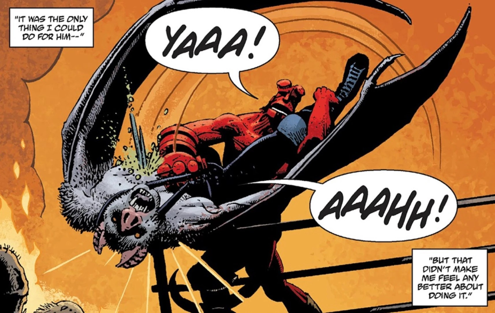

**Camazotz** was a Mayan bat god.

## History

The identity of the deity was later taken by [Esteban](/entry/Esteban), who was turned into a vampire-luchador. [Hellboy](/entry/Hellboy) accepted the challenge and battled his former friend, killing him by with a wooden stake.

Abe Sapien battled a creature once that might have been the ancient deity.

## Gallery

Esteban, the luchador who took the identity of Camazotz

|Esteban/Camazotz is killed by Hellboy
## Apperance

- [Hellboy in Mexico](/entry/Hellboy_in_Mexico_(story)) (Esteban's identity)
- [The Land of the Dead](/entry/The_Land_of_the_Dead) (Possibly the true Camazotz)
- [Hellboy (2019 film)](/entry/Hellboy_(2019_film))
