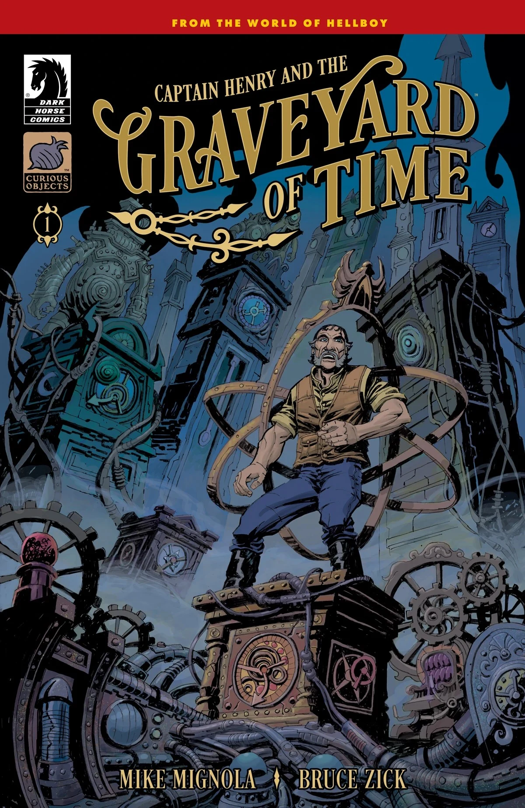
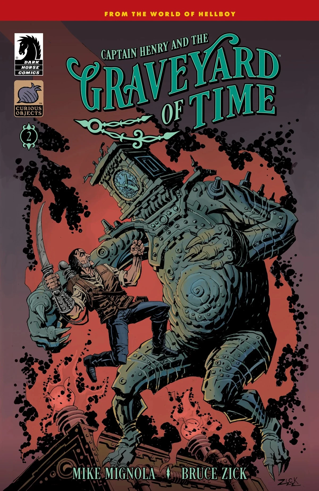
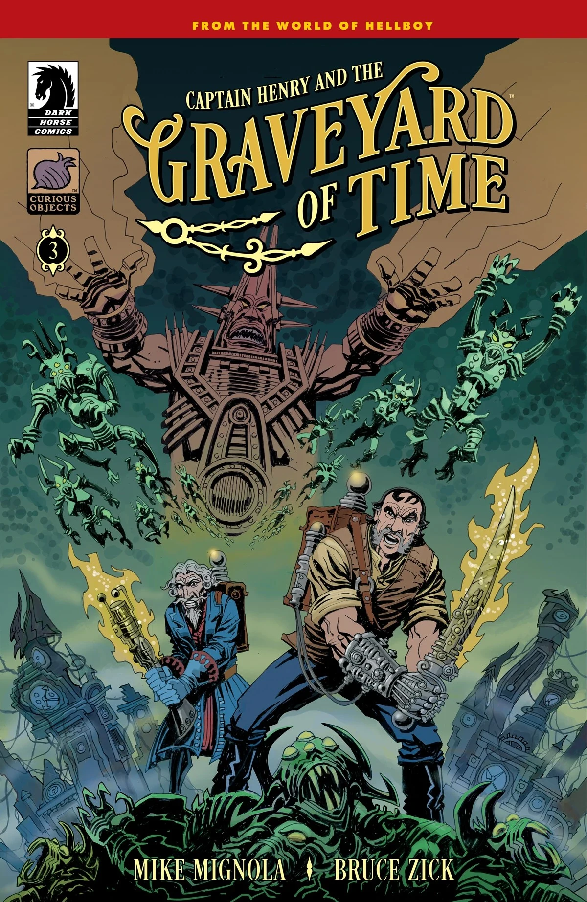
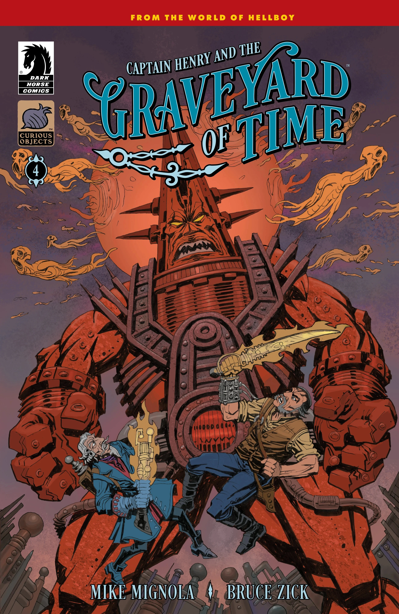
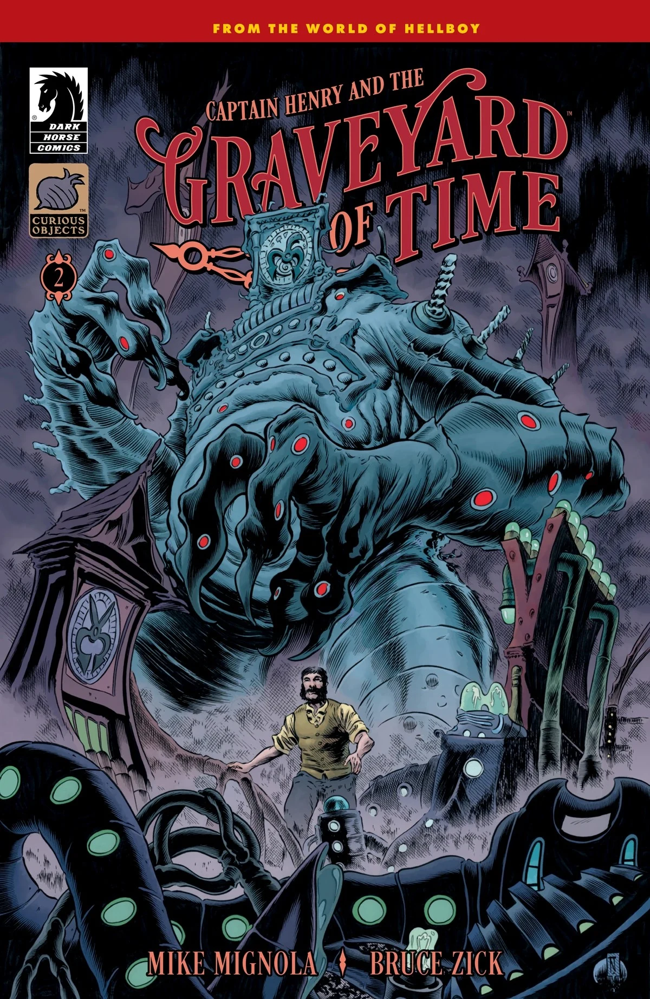
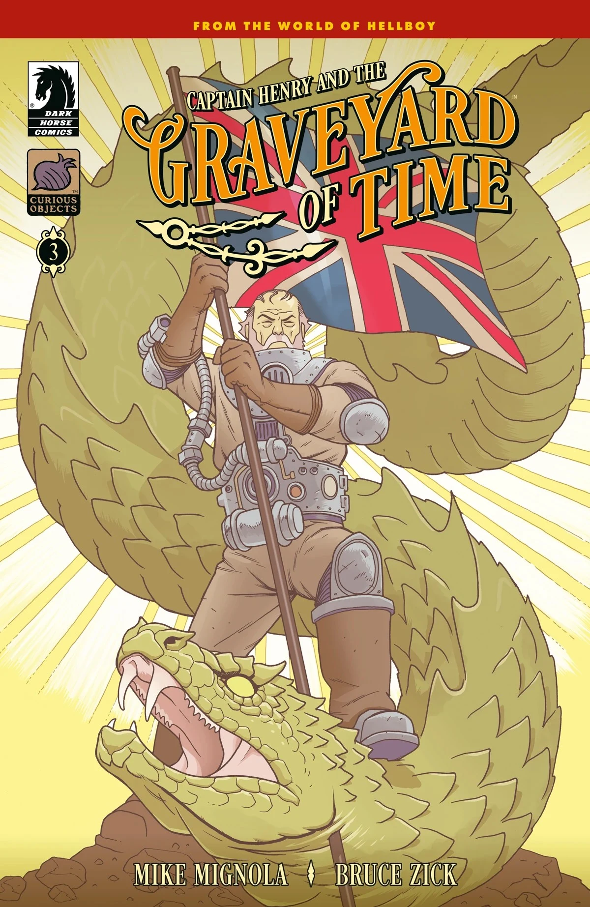
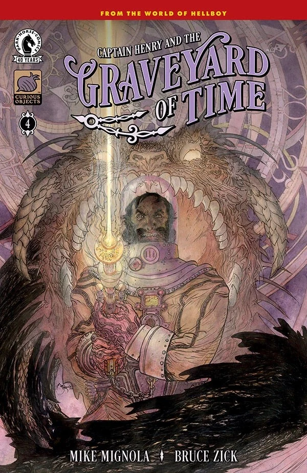

***Captain Henry and the Graveyard of Time*** is a four-issue miniseries written by [Mike Mignola](/entry/Mike_Mignola) and Bruce Zick and also illustrated by Zick in his Hellboy Universe debut. The story focuses on [Sir Edward Grey](/entry/Edward_Grey) and the Whittier family.

## Synopsis

### Part One

An intrepid time traveler voyages to a new dimension, but the monsters he finds there may be less of a danger than time itself.

### Part Two

The wayward Captain discovers he isn’t alone on the mysterious planet when he meets another traveler. But while others have been trapped—none have been able to leave.

### Part Three

The Captain and his fellow stranded travelers are attacked by a legion of monsters when the Time King orders them to be destroyed.

### Part Four

Captain Henry battles the Time King and his minions in his final hope to defeat the evil ruler and return to where—and when—he came from.

## Gallery

All covers by Bruce Zick.

*Captain Henry and the Graveyard of Time* \#1

*Captain Henry and the Graveyard of Time* \#2

*Captain Henry and the Graveyard of Time* \#3

*Captain Henry and the Graveyard of Time* \#4

|Captain Henry and the Graveyard of Time #1

|Captain Henry and the Graveyard of Time #2

|Captain Henry and the Graveyard of Time #3

|Captain Henry and the Graveyard of Time #4

|Captain Henry and the Graveyard of Time #2 variant cover by Troy Nixey

|Captain Henry and the Graveyard of Time #3 variant cover by Ben Stenbeck

|Captain Henry and the Graveyard of Time #4 variant cover by Michael Kaluta
### Variant covers

*Captain Henry and the Graveyard of Time* \#1  
variant cover by Mike Mignola  
with colors by Dave Stewart

*Captain Henry and the Graveyard of Time* \#2  
variant cover by Troy Nixey

*Captain Henry and the Graveyard of Time* \#3  
variant cover by Ben Stenbeck

*Captain Henry and the Graveyard of Time* \#4  
variant cover by Michael Kaluta
