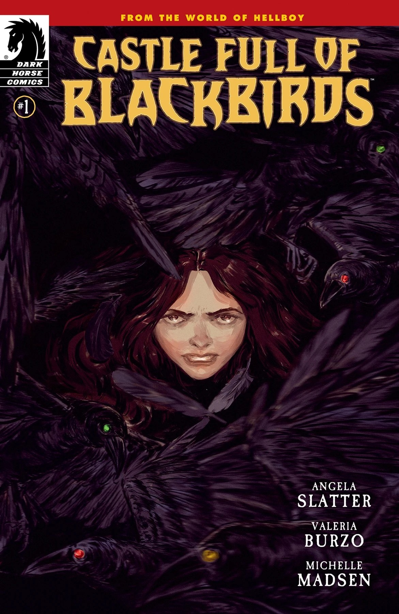
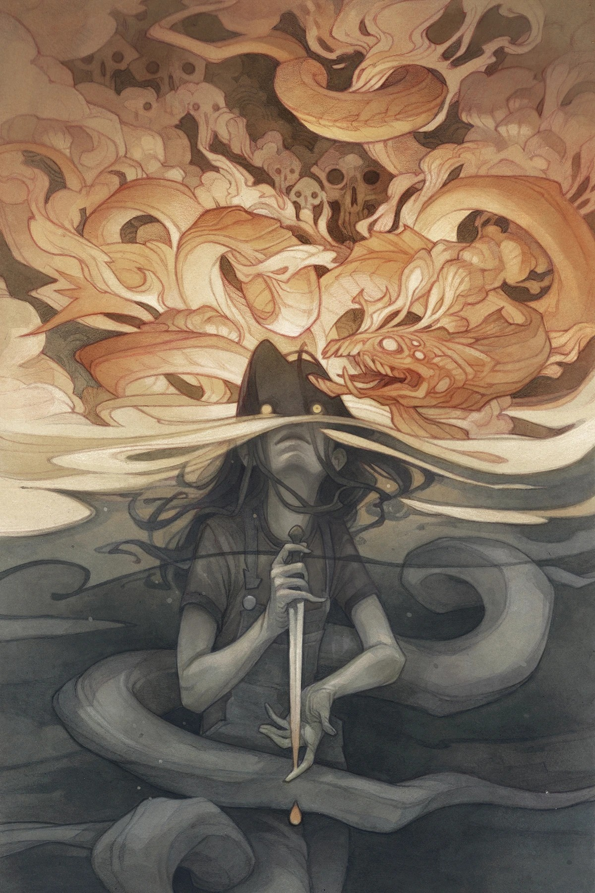
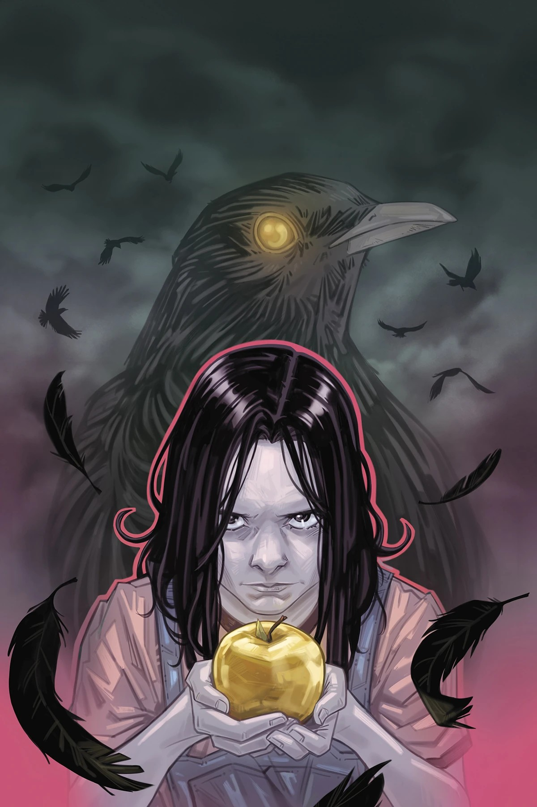
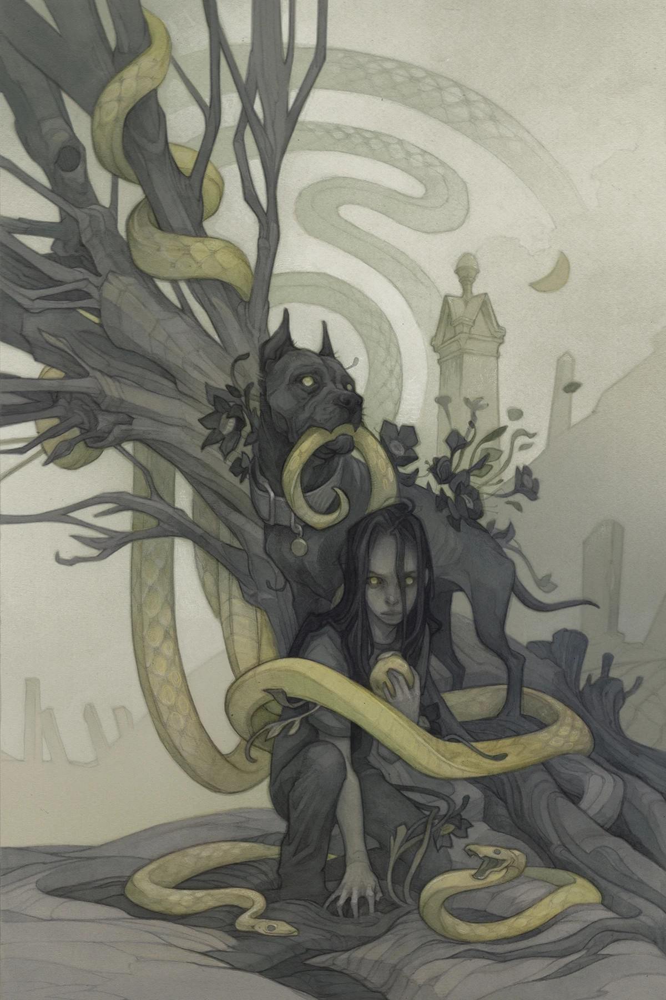
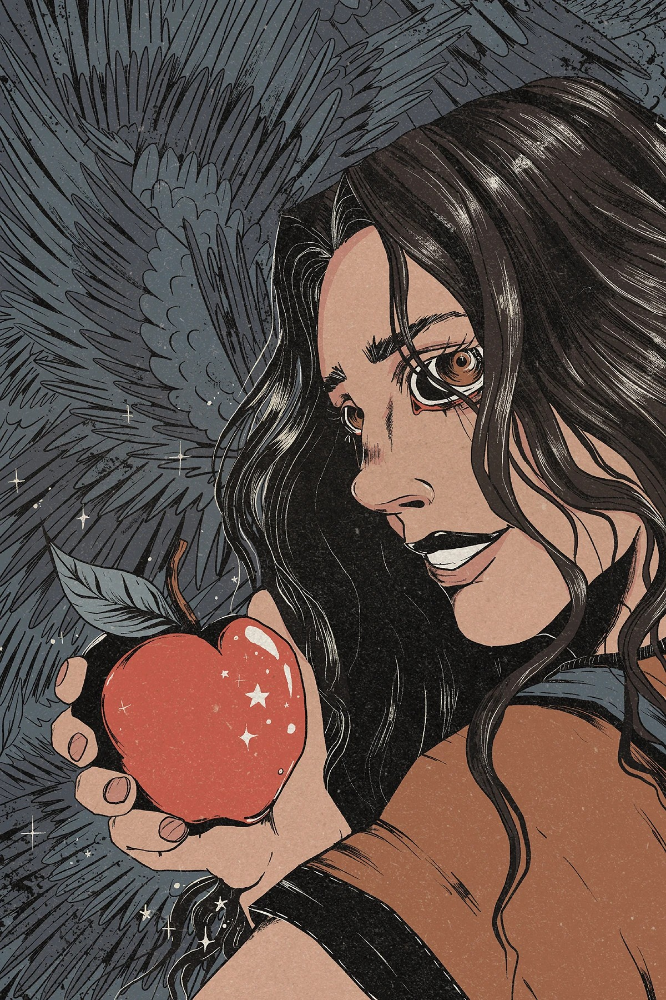
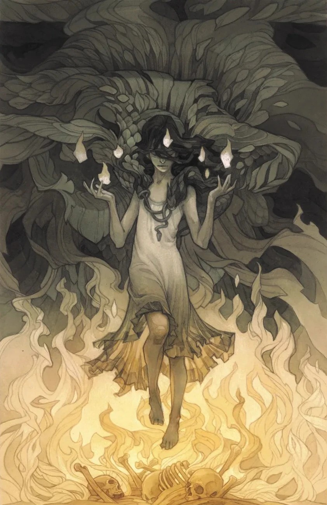
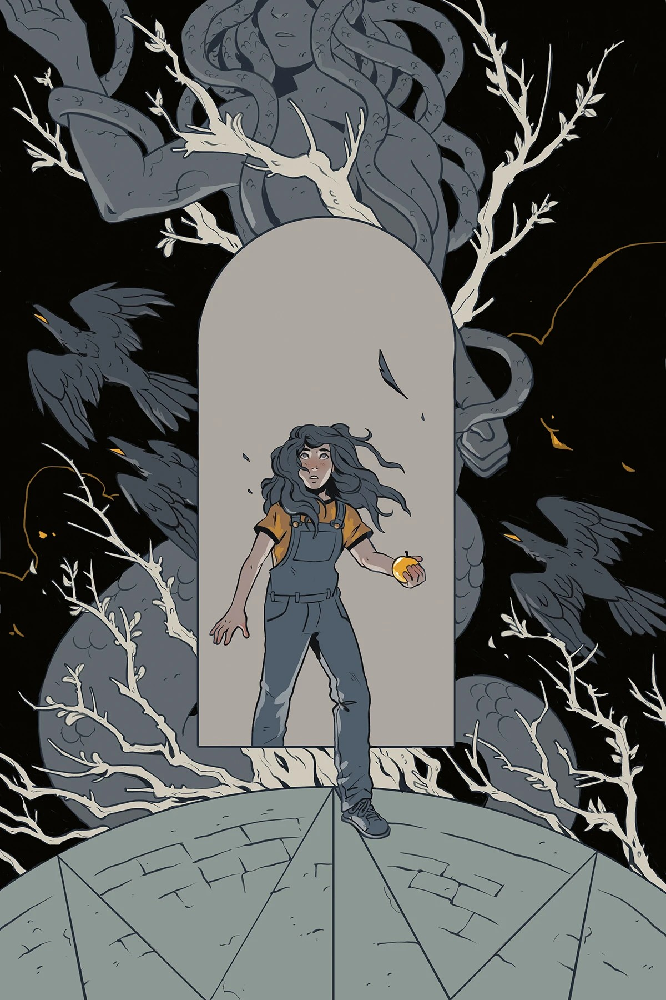

***Castle Full of Blackbirds*** is a four-issue miniseries written by [Angela Slatter](/entry/Angela_Slatter) and drawn by [Valeria Burzo](/entry/Valeria_Burzo). It is Slatter's debut as a comics writer, and both Slatter and Burzo's debut in the Hellboy Universe. The story follows [Sara May Blackburn](/entry/Sara_May_Blackburn) to the Linton School for Girls after the events of *[Hellboy and the B.P.R.D.: The Return of Effie Kolb](/entry/The_Return_of_Effie_Kolb)*.

## Publication History

*Castle Full of Blackbirds* was announced June 2022. When asked about bringing Slatter into the Hellboy Universe for the story, he said, "I DID know that as it was a book about a young girl, I wanted a female perspective. Someone who would bring something new to the *Hellboy* world while still playing with the history and mythology we’ve created for the place."

## Synopsis

### Part One

When Sara May Blackburn headed for New York after the events of *Hellboy and the B.P.R.D.: The Return of Effie Kolb*, she had one goal in mind: find the mysterious Miss Brooks at the Linton School for Girls, and ask her what she knows about the mysterious powers that have plagued Sara May her whole life. But as is often the case with these things, the answers are not as simple as all that. Sara is in for an education in more than just reading, writing, and arithmetic at the Linton School.

### Part Two

Sara May Blackburn begins her special training with the mysterious Ms. Brooks at the Linton School for Girls. As she learns more about her special powers, she's faced with new and dangerous challenges—but could they be a distraction from something more than magical education that's going on at the mysterious school?

### Part Three

Sara May expands her magical education in bigger but riskier ways as her lessons take a turn for the dangerous. And in the shadows, conspiracies begin to take shape. But what do they mean for the young witch?

### Part Four

As Sara May approaches the end of her first year at the Linton School for Girls, the truth of Miss Brooks, the headmaster, and the disappearances of her fellow students seems even more mysterious and frightening than before! But when Sara begins to pull at new threads to uncover the real story, the fate of the school could end up hanging in the balance.

## Gallery

Standard covers by [Wylie Beckert](/entry/Wylie_Beckert).

Issue \#1

Issue \#1 variant cover  
by Vanesa Del Rey

Issue \#2 variant cover  
by Marianna Strychowska

Issue \#3 variant cover  
by Evangeline Gallagher

Issue \#4 variant cover  
by A.H. Szabla

|Issue #1 variant cover by Vanesa Del Rey

|Issue #2

|Issue #2 variant cover by Marianna Strychowska

|Issue #3

|Issue #3 variant cover by Evangeline Gallagher

|Issue #4

|Issue #4 variant cover by A.H. Szabla
