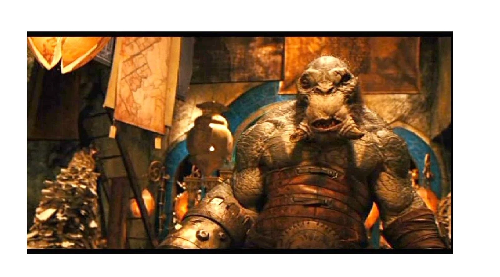

Cave trolls are strong dimwitted creatures. Prince Nuada used Wink as a helper when he looked for the golden army. Cave Trolls have mechanic smarts though.

They live in caves with many technology and buildings.

They are quite intelligent in building but not so smart in many other things.

They are powerful and they were on top of every Corinth creatures (ogres, Trolls, Cyclops, etc.).

They ate fleshy creatures and had strong mandibles for when in danger.
