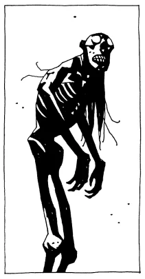

The Caypor is a Brazilian demon which inhabits the border of the rain forest, and protects children by frightening them away from the dangers within. It was featured in the novel *[Hellboy: The Bones of Giants](/entry/Hellboy__The_Bones_of_Giants_(prose_novel))*.

## Description

It appears as a tall, cadaverous, humanoid with red bark-like skin and long hair. Its mouth is filled with jagged, moss encrusted teeth. Each digit on its hands and feet are tipped with sharp claws, durable enough to rend even Hellboy's skin. They also have a thick sap in place of blood.

## Abilities

At will these creatures may become invisible to the human eye, though certain supernatural beings such as Hellboy can still perceive them. Being forest demons they have some degree of command over plant life. For instance one individual was shown to grow a number of trees to adulthood, all in a matter of seconds. Caypors have a form of rapid plant-like regeneration and can regrow broken limbs in moments. However they have a particular vulnerability to fire and electricity. It also possess incredible strength and agility, shown when performing complex acrobatic attacks. They are also capable of human speech, specifically Portuguese.

## History

[Hellboy](/entry/Hellboy_(character)) encountered one of these creatures in a Virginian amusement park. A group of Brazilian mothers summoned it there when they grew concerned that their children were preferring American culture above their own. He dealt it a number of seemingly fatal blows before realizing its fantastic regenerative powers made them all ineffectual. Hellboy ultimately overcame this by charging its body with a massive amount of electricity, causing it to burn to death.
