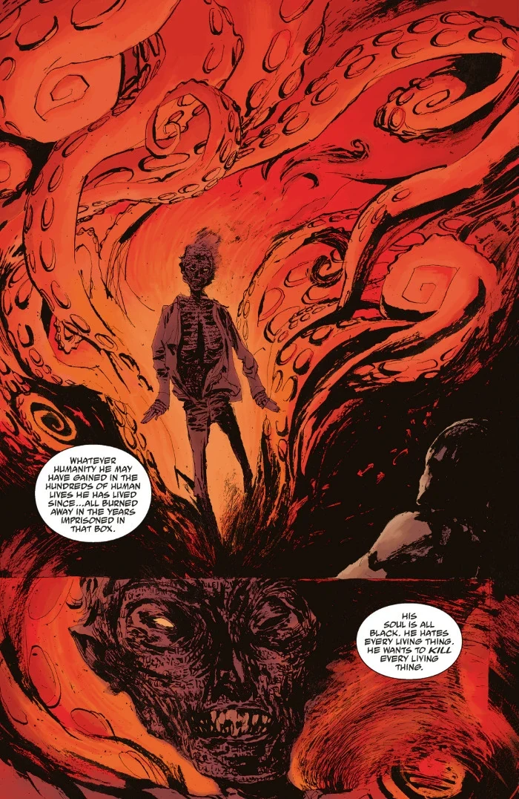

Cedu-Barra was a [Hyperborean](/entry/Hyperboreans) wizard and priest of the Secret Fire.

## Background

Once a priest of Hyperborea, Cedu-Barra escaped its destruction and fled south to [Atlantis](/entry/Atlantis). There using his craft he made himself second only to the city's king. However Atlantis eventually reached the end of its days, as the corruption of the Black Goddess brought ruin to the city. The priest was forced to flee again, but this time with a group known as the Six Devils. Together they fled to [Lemuria](/entry/Lemuria) where the second race of mankind was born. There he died, but the his creatures were prepared for this and carried his spirit to find a new body for it to inhabit among the new race of man. Cedu-Barra and his creations would continue this cycle passing his spirit into another host and hid behind the identities of many influential shamans, pharaohs and kings of mankind.

In the 18th century the next host his devils selected was [Epke Vrooman](/entry/Epke_Vrooman), a Dutch warlock. However Vrooman had an enemy that was closing behind him. When the devils fled London with Vrooman by ship they were caught up by [Edward Grey](/entry/Edward_Grey). Before the Witchfinder interrupted, the devils succeeded in transferring their master's spirit in Vroom, but were unable to wake him as the occultist stabbed Vrooman with a magic dagger of old magic trapping Cedu-Barra into the body. The ship eventually sank off the coast of Saint-Sebastian.

Some time after the crashing of the coffin containing Vrooman's body washed ashore, where it was found by the Sea Witch. Though awake, Cedu-Barra was powerless as a dead man, and begged the witch to remove the blade and free him. However the Sea Witch believed that whatever good the ancient spirit did in his lives, did more evil. It was her belief that her [father](/entry/Water_Spirit) sent Cedu-Barra to keep the Hyperborean locked away.
