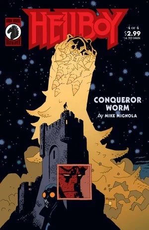

*This article is about the [Ogdru Hem](/entry/Ogdru_Hem). For the comic miniseries see*[Conqueror Worm (story)](/entry/Conqueror_Worm_%28story%29)*.*

The **Conqueror Worm** was one of the 369 [Ogdru Hem](/entry/Ogdru_Hem), the children of the [Ogdru Jahad](/entry/Ogdru_Jahad) & the main antagonist in [*Hellboy: Conqueror Worm*.](/entry/Conqueror_Worm_%28story%29)

## History

### Past

The Conquer Worm was one of the three-hundred and sixty-nine [Ogdru Hem](/entry/Ogdru_Hem), the spawn of the ancient [Ogdru Jahad](/entry/Ogdru_Jahad). The being was defeated by God's angels, but the only the Worm's body was destroyed, while its spirit was banished into outer space.

The spirit was discovered by the Nazis in 1939, who wanted to contact the being and use it to defeat the Allies. The Nazis send the body of recently deceased Dr. Ernst Oeming, hoping the spirit would use it as a vessel. The corpse was sent into space with a capsule but was halted by legendary vigilante Lobster Johnson.

In 1939, the Nazis, eager to establish a decisive advantage against the Allies in World War II (the same eagerness that led to their funding of [Project Ragna Rok](/entry/Project_Ragna_Rok)), somehow made contact with malevolent entities in space (what [Hellboy](/entry/Hellboy_%28character%29) half-facetiously called "space ghosts"), who promised that, if a dead body was sent into space for one of them to inhabit, it would return to Earth with the power to crush their enemies.

The Nazis sealed the corpse of the recently assassinated Dr. [Ernst Oeming](/entry/Ernst_Oeming) into a space suit and launched it aboard a space capsule from Hunte Castle in Austria, but the project was halted by [Lobster Johnson](/entry/Lobster_Johnson).

### Present

Sixty-one years later, [Herman von Klempt](/entry/Herman_von_Klempt) entered Hunte Castle and reactivated the old equipment, sending the recall signal to bring Dr. Oeming's capsule back to Earth. When it landed, the Conqueror Worm emerged. The Worm emitted a gas that could instantly transform people into [frog monsters](/entry/frog_monster), which it then devoured to grow in size and strength.

A representative of the alien race that monitored the Ogdru Jahad's prison warned Hellboy and [Roger](/entry/Roger) that, if it was not stopped, it would become powerful enough to destroy all life on Earth, and then summon the Ogdru Jahad from their prison.

The Worm was defeated by Hellboy, Roger, and the ghost of the Lobster, using a power cell given to Hellboy by the alien.

[Grigori Rasputin](/entry/Grigori_Rasputin), who had led von Klempt to Hunte Castle in the hopes of awakening the Ogdru Jahad, was vexed by the Worm's defeat, and [Hecate](/entry/Hecate), inhabiting the iron maiden that had killed [Ilsa Haupstein](/entry/Ilsa_Haupstein), mocked that no matter what Rasputin tried, the only force that could release the Ogdru Jahad was the [Right Hand of Doom](/entry/Right_Hand_of_Doom), which remained in Hellboy's possession, and Hellboy remained outside of Rasputin's control. Rasputin flew into such a rage that he exploded into bone fragments.

The Conqueror Worm had similar abilities to [Sadu-Hem](/entry/Sadu-Hem), which had appeared at [Cavendish Hall](/entry/Cavendish_Hall) and reappeared during the [Plague of Frogs](/entry/Plague_of_Frogs).

## Powers and Abilities

- **Biological manipulation**: It can warp flesh on a cellular and genetic level, most notably through its breath, which transmutes humans into monstrous frog creatures.
- **Supernatural durability and resilience**: Ogdru Hem are notoriously difficult to destroy with conventional weapons and are highly resistant to damage.
- **Possession** (as a spirit): The worm's spirit can possess a physical vessel, as it did with the corpse of Dr. Ernst Oeming.

- **Corrupting breath**: The Conqueror Worm's most direct weapon is its mutagenic breath, a gas that instantly transforms humans into its minions.
- **Massive size and strength**: Once it begins to consume its frog monster minions, the worm grows to an immense size, using its physical body as a devastating weapon.

## Gallery

## Trivia

The Conqueror Worm takes its name from the [poem of the same name](/entry/wikipedia%3AThe_Conqueror_Worm) by Edgar Allan Poe. It was also used as the American title of the British horror film *Witchfinder General*, starring Vincent Price (which also served as an inspiration for the character of [Henry Hood](/entry/Henry_Hood)).
