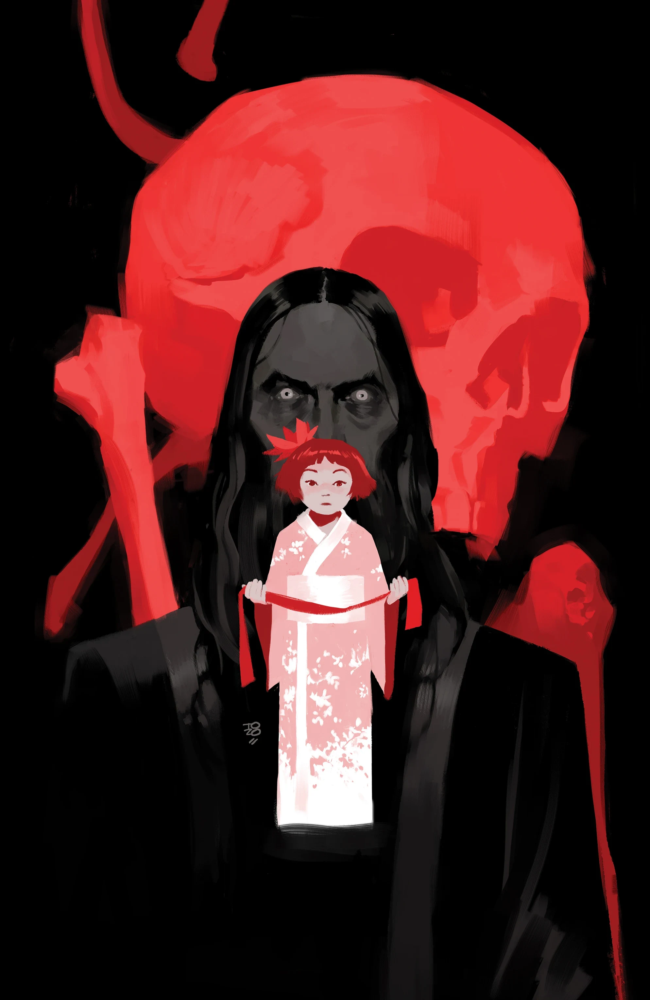
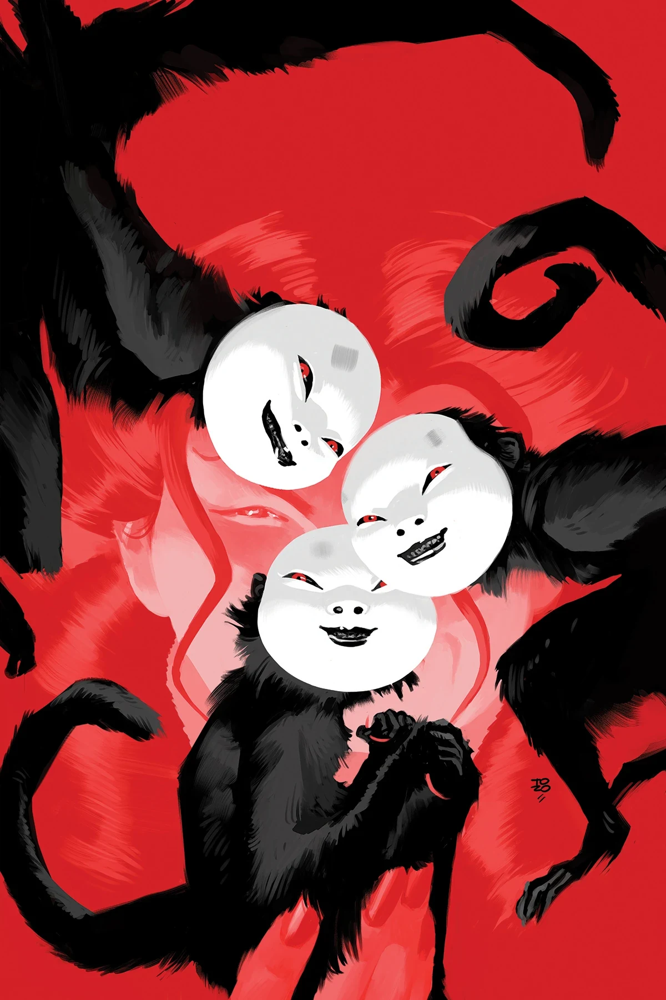
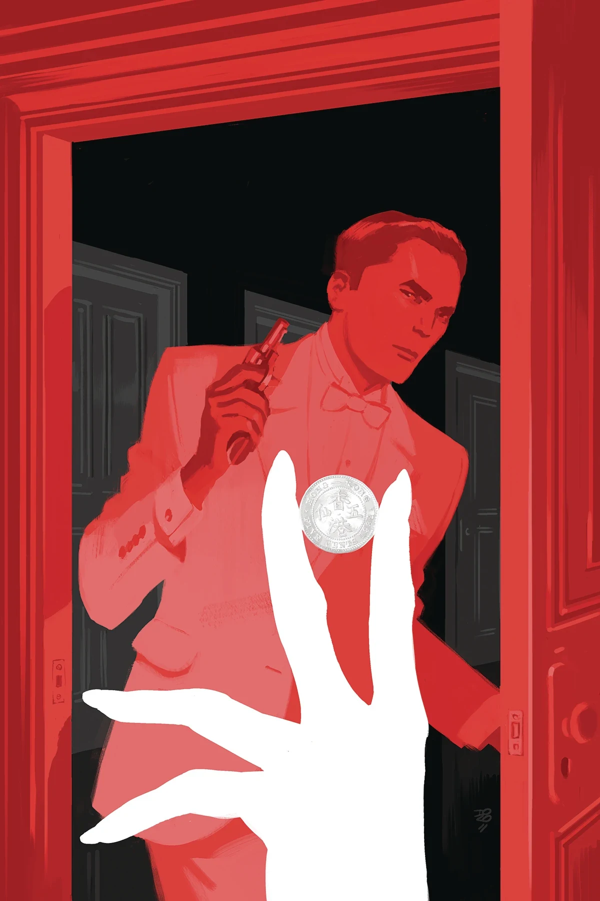
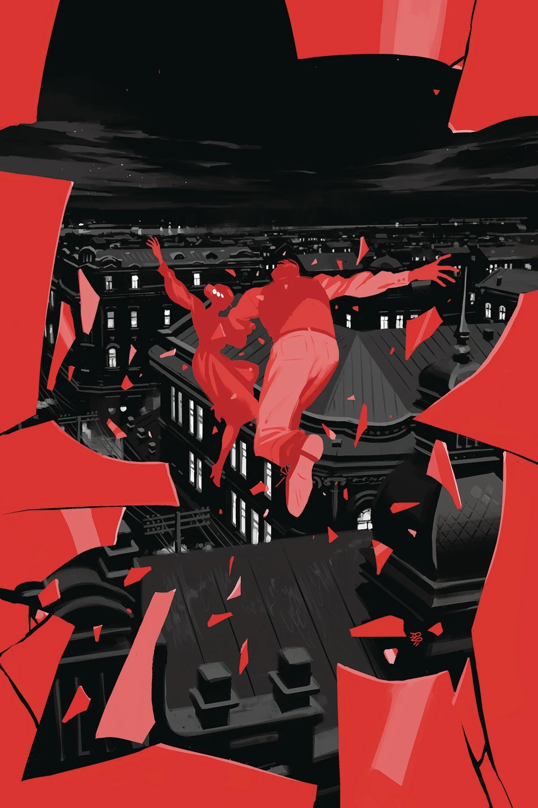
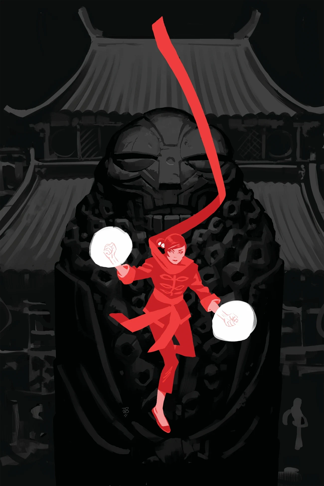

***Crimson Lotus*** is a five-issue miniseries about [Yumiko Daimio](/entry/Yumiko_Daimio). It is [Mindy Lee](/entry/Mindy_Lee)'s Hellboy Universe debut.

## Publication History

The *Crimson Lotus* miniseries was revealed for San Diego Comic-Con 2018 as a part of the 25th Anniversary of Hellboy announcements.

## Synopsis

### Part One

Before she became [Lobster Johnson](/entry/The_Lobster)’s biggest foe, the Crimson Lotus was a young girl whose family was caught up in the Russo-Japanese war. Thirty years later, the Lotus exacts her revenge with terrifying international ramifications, and two spies must try to chase her through China before they become flies in her web.

### Part Two

Secret agent Dai and the man he is protecting take a tumultuous train ride across Japanese-occupied China only to be faced with new allies... and new enemies.

### Part Three

The Crimson Lotus strikes again! Shocked by the news of an agent’s death, spies Shengli and Dai must parry the Lotus again when they discover she is even closer than they thought. And can the pair avoid getting caught between Japanese soldiers and the Lotus herself?

### Part Four

A run-in with the Crimson Lotus leads one agent to realize they’re being kept in the dark by the other, while the question of what the Lotus is after looms larger than ever.

### Part Five

Caught between a deadly company of Japanese soldiers and the deadlier Crimson Lotus, Dai and Shengli must stop the powerful witch before she creates a worldwide catastrophe.

## Gallery

Covers by [Tonci Zonjic](/entry/Tonci_Zonjic).

