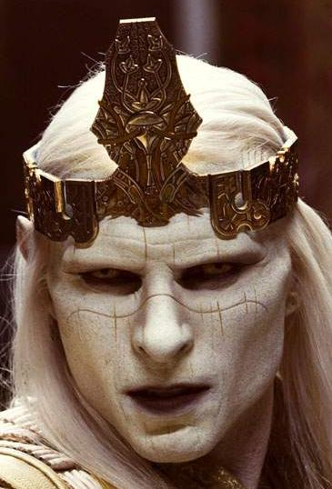

Prince [Nuada](/entry/Nuada) wearing the Crown

The **Crown of Bethmora** is a relic that was featured in *[Hellboy II: The Golden Army](/entry/Hellboy_II%3A_The_Golden_Army)*.

## Background

Long ago, when man declared war on magical creatures, the Goblins of Bethmora created the crown to enable those of ancient bloodlines like that of [King Balor](/entry/King_Balor) to command [The Golden Army](/entry/The_Golden_Army). After the battle ended with Balor arranging a peaceful coexistence between his kind and man, he divided the crown into three pieces with one third given to the humans while he kept the other two pieces. Only Balor's son [Nuada](/entry/Nuada) considered this an error as he enter an imposed exile.

## History

Millennia later, Nuada resurfaces to declare war on mankind for their crimes against the Earth, Nature and all kinds of magical beings. The prince's crusade begins first with assembling the scattered pieces of the crown to have the Golden Army wipe out humanity. The first piece is reclaimed in New York City at a private auction house. Later he enters the court of his father, King Balor and murder him for his fragment. His sister [Nuala](/entry/Nuala) possessing the last piece of the crown escapes and enters the protection of the B.P.R.D.

However Nuada eventually finds her and invades the Bureau with ease, but was unable to retrieve the fragment as Nuala had hidden it and he was forced to retreat from the Bureau security agents.

It was Abe Sapien that brought the last piece of the crown to Nuada in exchange for Nuala's safety but the elf prince betrayed him and activated the Golden Army in the ruins of Bethmora. Despite their attempts the B.P.R.D agents were unable to truly destroy the Golden Army as they would rebuild themselves. Seeing no alternative Hellboy declared a challenge to Nuada, as only one of royal blood could challenge the right to wear the crown. Hellboy, being through his paternal lineage as the son of [the Fallen One](/entry/Azzael) -a king or prince of Hell-, was able to challenge Nuada and win the crown. [Liz Sherman](/entry/Liz_Sherman) then proceeded to melt it so its power could not be used to awaken the Golden Army.

## Trivia

- In the novelization of Hellboy: The Golden Army, the auctioneer dated the artifact from the early 1st century.
