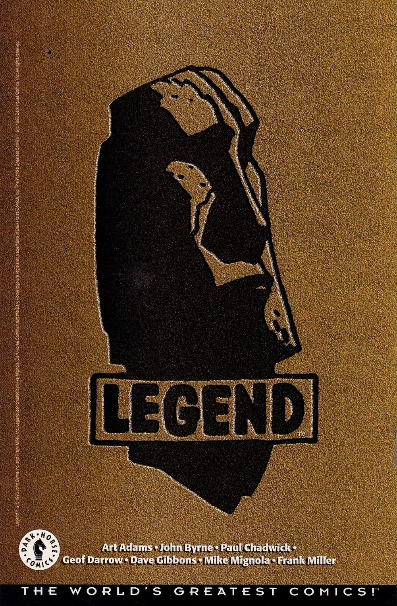

**Dark Horse Comics** is an American comic book publisher founded by Mike Richardson in 1986.

Since 1994, Dark Horse has published [Mike Mignola](/entry/Mike_Mignola)'s *[Hellboy](/entry/Hellboy_(series))* comics.

## History

### Legend

In 1994, Dark Horse started the "Legend" imprint. Inspired by Malibu Comics' Image, Legend focused on creator-owned work, promoting original series by a stable of high-profile comic creators. Mignola's *Hellboy* became one of the imprint's first titles. Other Legend creators included [John Byrne](/entry/John_Byrne), Art Adams, Frank Miller, Dave Gibbons, and Geof Darrow.

> 
>
> **Danger Unlimited** was my second title for the newly minted Legend imprint, and the one that was to be part of a "shared universe." *DU* would inhabit the same world as **Hellboy** and **Monkeyman and O'Brien** \[...\] Legend was not a "universe." Only one little corner of the whole was to be seen as cohesive. And, as noted, even that just barely.
>
> 
>
> —[John Byrne](/entry/John_Byrne), foreword to **Danger Unlimited** TPB, January 2009

  
Three Legend creators initially planned for their comics to exist in a shared universe – [John Byrne](/entry/John_Byrne)'s *Danger Unlimited*, Art Adams's *Monkeyman and O'Brien*, and Mike Mignola's *Hellboy* – though it should be noted that much of the Legend line was standalone, with other creators adamant that their work remain independent. Examples of this three-way collaboration include:

- [The Torch of Liberty](/entry/The_Torch_of_Liberty) (from Byrne's *Danger Unlimited*) appears in *Hellboy: [Seed of Destruction](/entry/Seed_of_Destruction)*.
- [Hellboy](/entry/Hellboy_(character)) appears in a flashback in *Danger Unlimited* \#4 alongside [the Torch of Liberty](/entry/The_Torch_of_Liberty) and other heroes.
- Byrne's *[Babe 2](/entry/Babe_2)* miniseries (set in the world of *Danger Unlimited*) features [Abe Sapien](/entry/Abraham_Sapien) in a prominent role, joining forces with Babe against the Shrewmanoid (a villain from Adams's *Monkeyman and O'Brien*). Hellboy also makes a cameo in the last page of the story.
- Dr. Robert Carson (from Byrne's *Danger Unlimited*) was mentioned in *[The Chained Coffin](/entry/The_Chained_Coffin)*.

The publications also had non-canonical crossovers:

- *Monkeyman and O'Brien* was published as a back-up in *Hellboy: Seed of Destruction* \#1–4. The content of the actual stories did not overlap.
- Hellboy appeared in John Byrne's Next Men #21, portrayed as a fictional comic book character in the *Next Men* universe.

However, Mignola and Byrne both recall that this idea quickly became problematic – the difficulties of coordination and organization swiftly outweighed any benefits, and it was better that they each have their own universes. As a result, elements of these crossovers have been minimized or excised from *Hellboy* continuity (going unmentioned in supplemental material like *[Hellboy: The Companion](/entry/Hellboy%3A_The_Companion)*):

- The Torch of Liberty has not made a notable reappearance since *Seed of Destruction*. Later depictions of the Hellboy Incident tend to minimize or wholly omit his presence at the event.
- Most reprints of *Seed of Destruction* not only do not include the *Monkeyman and O'Brien* backups, but also remove the promotional text from the issue covers and obscure Adams's illustrations of the duo with the [B.P.R.D.](/entry/Bureau_for_Paranormal_Research_and_Defense) logo.
- The mention of Dr. Robert Carson was excised from later publications of *The Chained Coffin*.

Original *[Seed of Destruction](/entry/Seed_of_Destruction)* cover, promoting *Monkeyman and O'Brien*.

Reprinted cover, sans *Monkeyman and O'Brien*.

Compared to *Seed of Destruction* \#1 (1994), *[Hellboy and the B.P.R.D.](/entry/Hellboy_and_the_B.P.R.D.): (/entry/1952)* \#1 (2014) minimizes the Torch's presence.

Beginning with the 1998 reprint, *[The Chained Coffin](/entry/The_Chained_Coffin)* no longer mentions Dr. Carson.

By 1998, Legend had been retired.

## External Links

- Dark Horse Comics
- Dark Horse Comics on Wikipedia
- Dark Horse Database wiki
