**Dave Johnson** is an Eisner-winning comics artist (2002, *100 Bullets*). He did covers for [*Abe Sapien*](/entry/Abe_Sapien_%28series%29), [*Lobster Johnson*](/entry/Lobster_Johnson_%28series%29), and [*B.P.R.D.*](/entry/B.P.R.D._%28series%29) from October 2009 to August 2013, and for *[Hellboy and the B.P.R.D.](/entry/Hellboy_and_the_B.P.R.D.)* from November 2018 to March 2019.

## Cover Art

### *Abe Sapien* issues

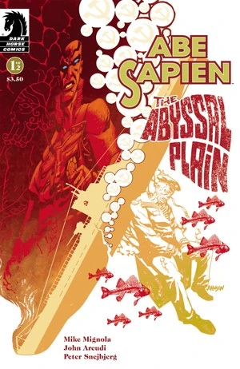

|*Abe Sapien: The Abyssal Plain* \#1

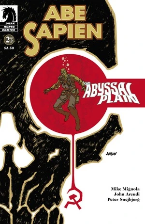

|*Abe Sapien: The Abyssal Plain* \#2

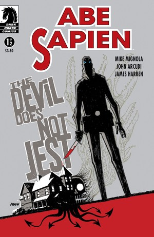

|*Abe Sapien: The Devil Does Not Jest* \#1

|*Abe Sapien: The Devil Does Not Jest* \#2

### *B.P.R.D.: Hell on Earth* issues

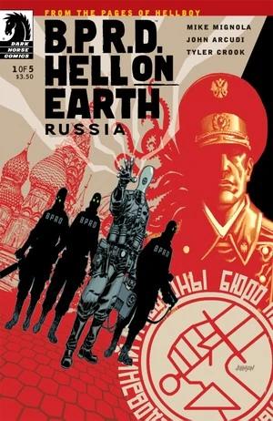

|*B.P.R.D. Hell on Earth: Russia* \#1

|*B.P.R.D. Hell on Earth: Russia* \#2

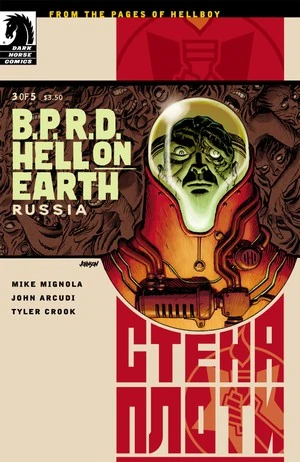

|*B.P.R.D. Hell on Earth: Russia* \#3

|*B.P.R.D. Hell on Earth: Russia* \#4

|*B.P.R.D. Hell on Earth: Russia* \#5

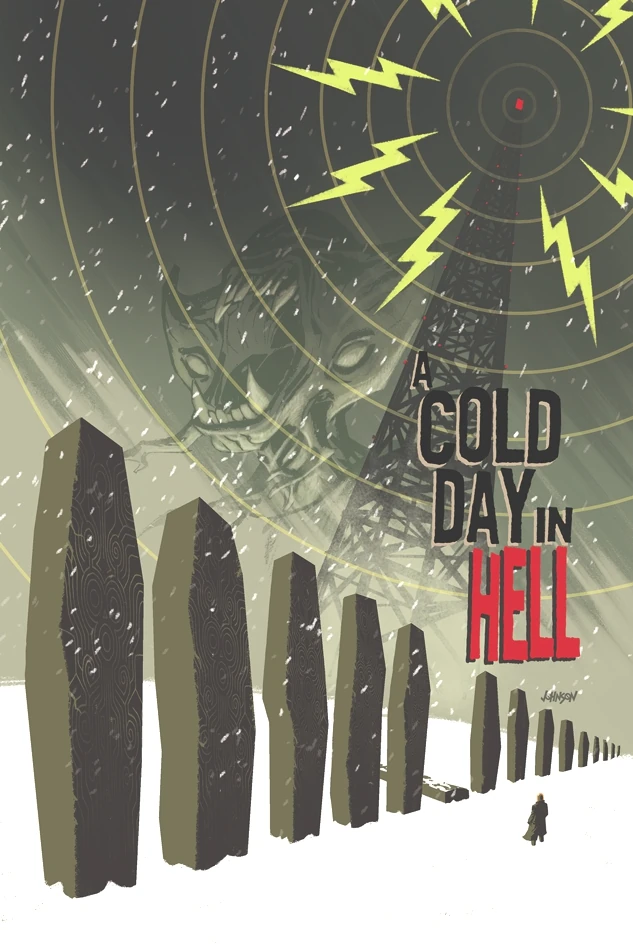

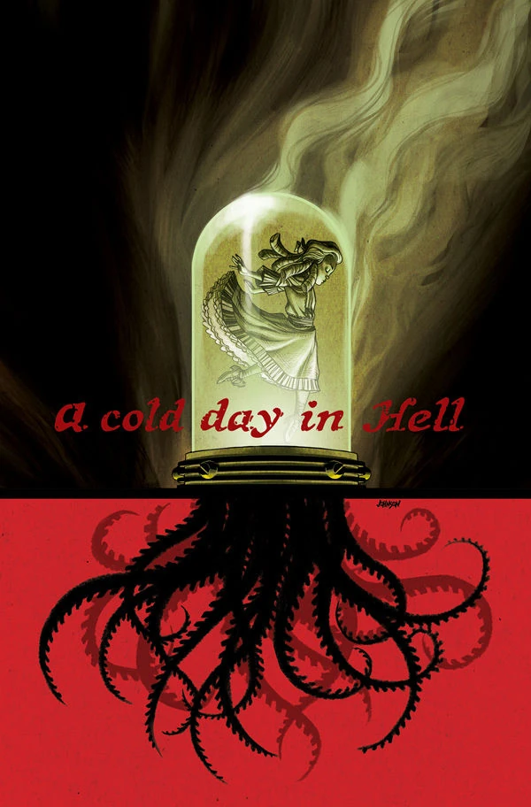

|*B.P.R.D. Hell on Earth: A Cold Day in Hell* \#2

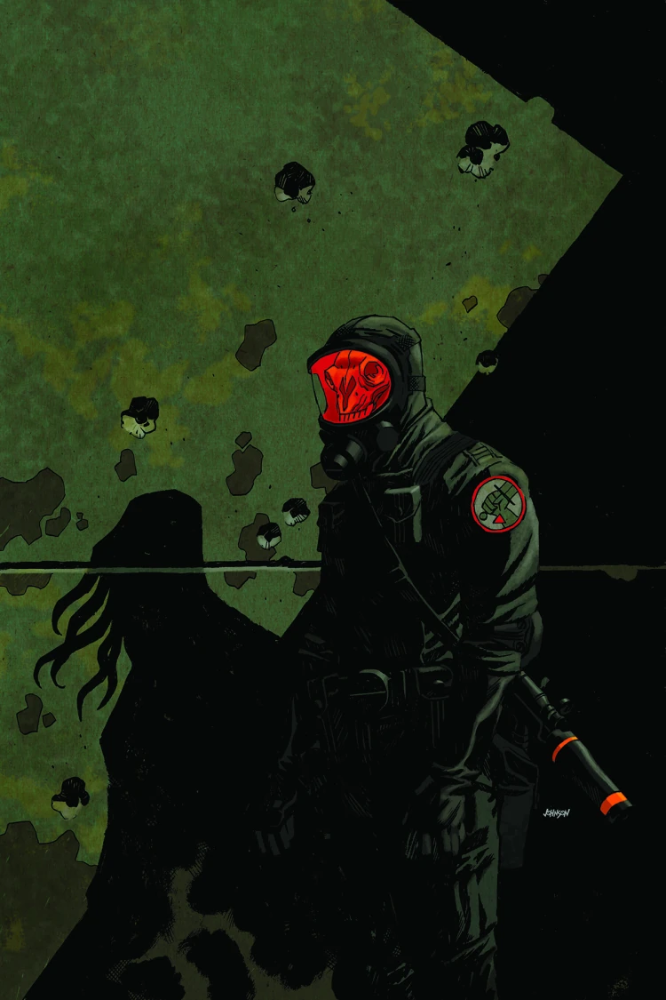

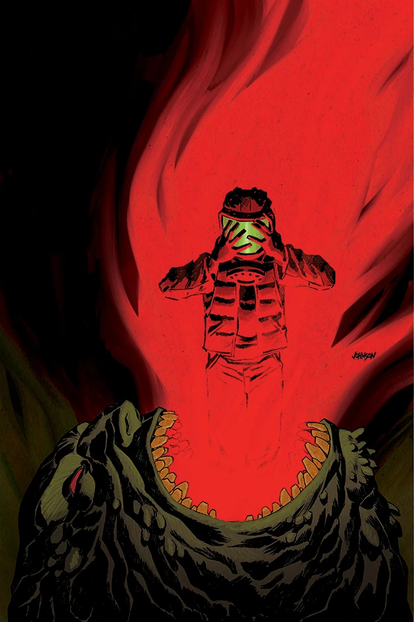

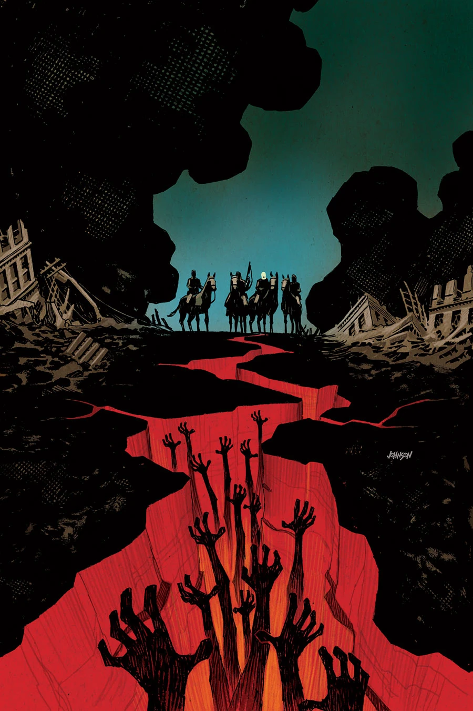

### [*Lobster Johnson: The Burning Hand*](/entry/The_Burning_Hand)

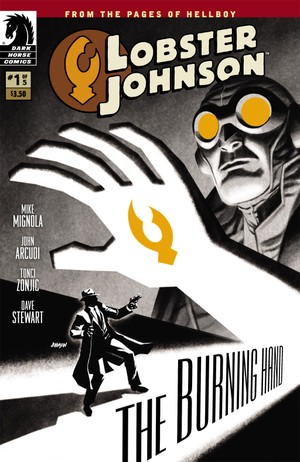

|*Lobster Johnson: The Burning Hand* \#1

|*Lobster Johnson: The Burning Hand* \#2

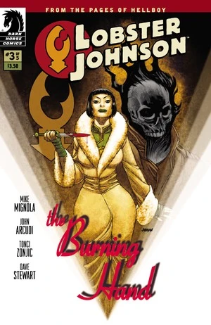

|*Lobster Johnson: The Burning Hand* \#3

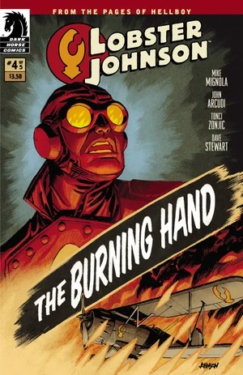

|*Lobster Johnson: The Burning Hand* \#4

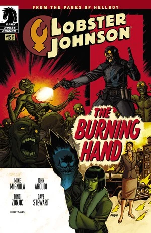

|*Lobster Johnson: The Burning Hand* \#5

### [*B.P.R.D.: 1948*](/entry/1948)

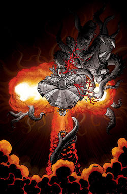

|*B.P.R.D.: 1948* \#1

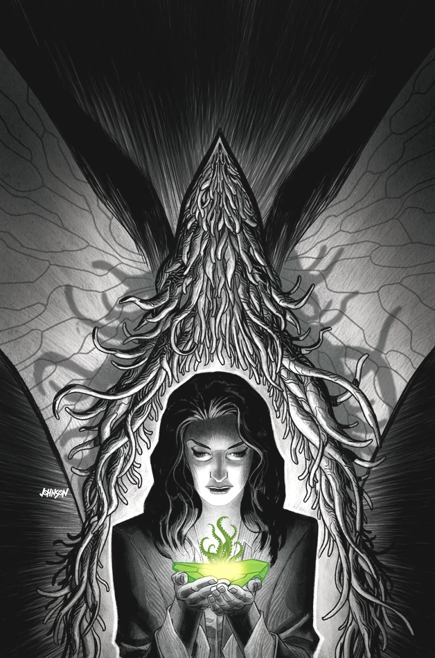

|*B.P.R.D.: 1948* \#2

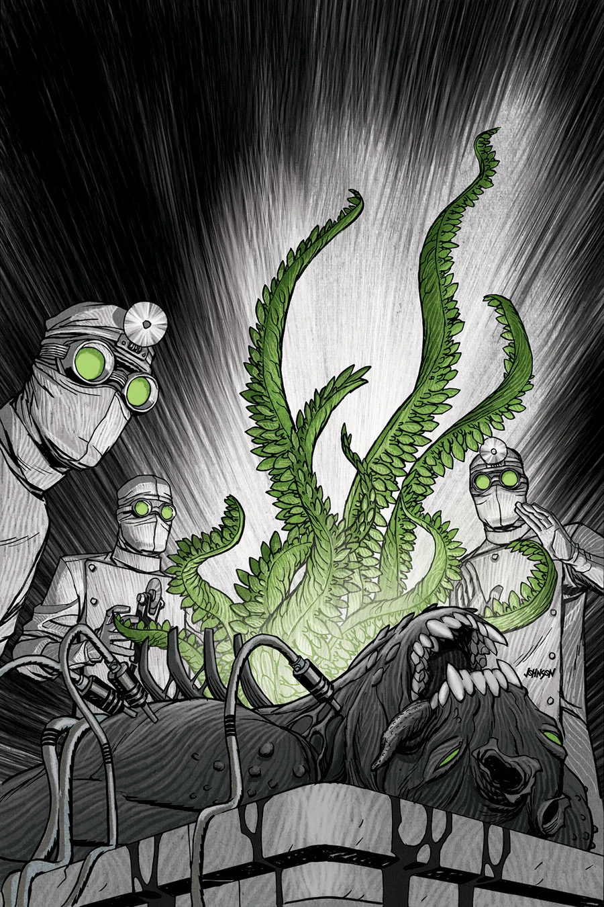

|*B.P.R.D.: 1948* \#3

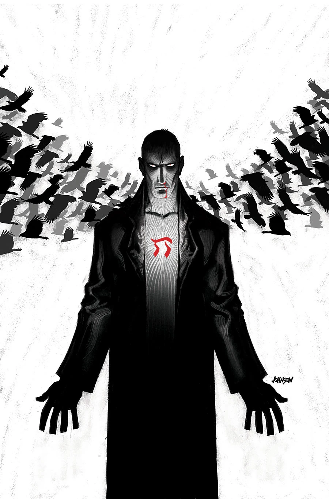

|*B.P.R.D.: 1948* \#4

|*B.P.R.D.: 1948* \#5

### [*Hellboy and the B.P.R.D.: 1956*](/entry/1956)

## External Links

- [**Comic Book DB:** Dave Johnson](http://www.comicbookdb.com/creator.php?ID=452)
