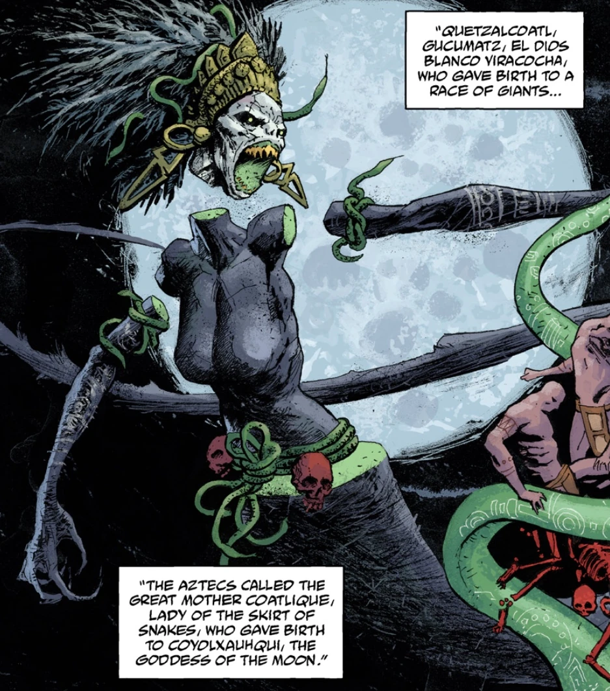
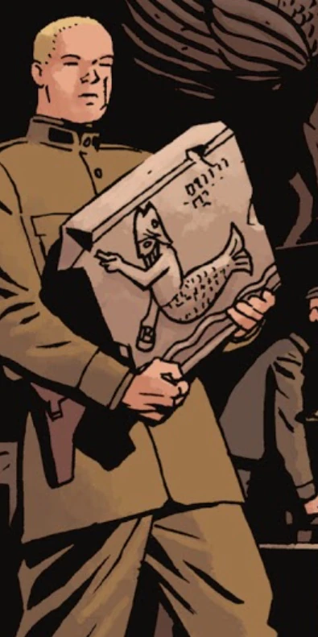
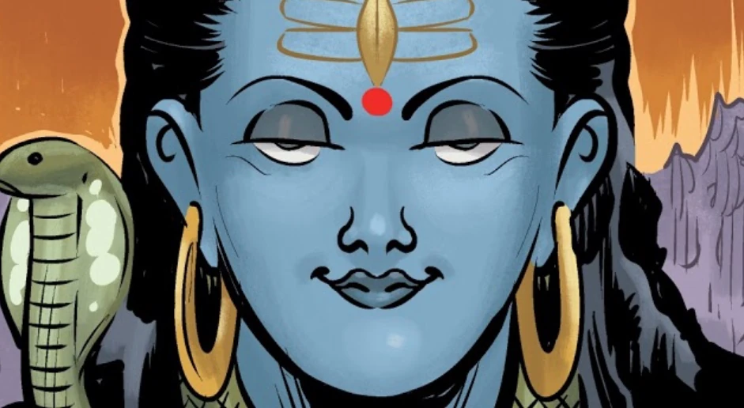
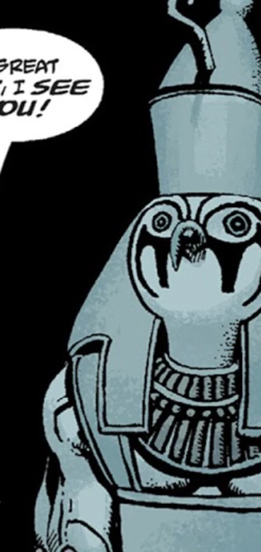
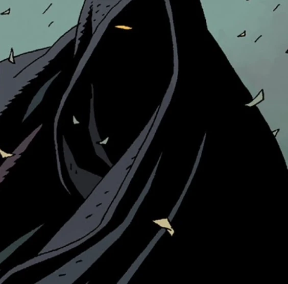
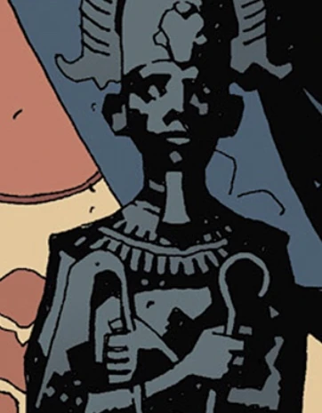

**Deities**, also known as **gods** or **goddesses**, are powerful beings worshipped by [humans](/entry/Human) and other lesser beings.

The most powerful and first god was the self-created and omnipotent power simply known as [God](/entry/God). The other gods are usually viewed as lesser gods, fallen watchers, [demons](/entry/Demon), [fairies](/entry/Fairies), [Ogdru Hem](/entry/Ogdru_Hem), [aliens](/entry/Aliens) or exaggerated humans.

## List of Hellboy Universe Deities

### Abrahamic

[God](/entry/God), creator of the universe and all within it.

[Jesus Christ](/entry/Jesus_Christ)

Satan, leader of demons

### Akan

[Ananse](/entry/Ananse)

### Aztec

[Cipactlhem](/entry/Cipactlhem), actually an [Ogdru Hem](/entry/Ogdru_Hem)

[Quetzalcoatl](/entry/Quetzalcoatl), actually an [Ogdru Hem](/entry/Ogdru_Hem)

### Babylonian

Ereshkigal, possibly an antithesis to God, possible creator of Hecate and the Ogdru Jahad

### Canaanite

[Moloch](/entry/Moloch), actually a [Demon](/entry/Demon).

### Celtic

[Dagda](/entry/Dagda), actually a [Daoine Sidhe](/entry/Daoine_Sidhe)

### Egyptian

[Nu](/entry/Nunn-Jahad), actually an [Ogdru Jahad](/entry/Ogdru_Jahad).

[Sebek](/entry/Sebek)

[Thoth](/entry/Thoth), actually the last King of the [Hyperboreans](/entry/Hyperboreans).

[Anubis](/entry/Anubis) possibly an Egyptian god of the underworld

### Greek

[Aphrodite](/entry/Aphrodite)

[Erinyes](/entry/Erinyes), servants of Pluto

Eros

[Hecate](/entry/Hecate), possibly an avatar of Ereshigal

### Mayan

[Vucub Caquix](/entry/Vucub_Caquix) actually an [Ogdru Hem](/entry/Ogdru_Hem)

### Norse

[Thor](/entry/Thor)

### Slavic

[Domovoi](/entry/Domovoi)

[Leshii](/entry/Leshii)

[Perun](/entry/Perun)

### Roman/Greek

[Cloacina](/entry/Cloacina)

[Pluto](/entry/Pluto), actually a fallen Watcher.

The Greek Olympians

## Mentioned and seen through art or a vision

### Coatlicue

Coatlicue was an Aztec deity, who was described as the great mother and a snake goddess of the moon. She was only mentioned and seen in a vision within [Abe Sapien: The Shape of Things to Come](/entry/The_Shape_of_Things_to_Come) within the context of Mesoamerican creation and eschatology, so whether she actually exists is unknown.

She might have been an Ogdru Hem, since [Vucub Caquix](/entry/Vucub_Caquix) and [Cipactlhem](/entry/Cipactlhem) were confirmed to be ones in the same story, though she could also just be an avatar of Hecate as well, similar to Kali.

### Dagon

Dagon was a Philistine deity of fertility and in fact was a demon, who was mentioned in [The Spanish Bride](/entry/The_Spanish_Bride). He was likely turned into a demon, as the Philistines were enemies of the ancient Israelites and as a possible reference to Paradise Lost.

After the death of [Satan](/entry/Satan) and [Astaroth](/entry/Astaroth), the slave-demons started to revolt against their masters, killing many of them. Dagon is mentioned by three surviving demons, alongside [Rumael](/entry/Rumael), [Shax](/entry/Shax), Usiel, Raum, Semyaza, [Moloch](/entry/Moloch) and Belial.

Dagon has often been depicted as a fish-man (similar to [Oannes](/entry/Atum)), though this is often seen as as translation-error, that was then popularised by works of fiction such as John Milton's *Paradise Lost* or H.P. Lovecraft's *Cthulhu-mythos*.

### Durga

Durga is the Hindu goddess of motherhood as well as victory of good over evil. She was depicted in her classical form within an issue of [Occult Intelligence](/entry/Occult_Intelligence).

He name has been also referenced by exorcists, such as [Ota Benga](/entry/Ota_Benga) during the events of [*B.P.R.D.: 1947*](/entry/1947) and [Ashley Strode](/entry/Ashley_Strode) during the events of [*B.P.R.D.: The Devil You Know—Pandemonium*](/entry/Pandemonium_(story_arc)). Her name was mentioned alongside other deities and beings, such as God, Jesus Christ, Archangel Michael, Indra, Agni, Baal-Hadad, Marduk, Ea, Shamash, Utu, Anu, Zeus and Taranis. Ota Benga seemed to think all of them were simply other names for God.

### Horus

**Horus** was an Egyptian deity of kingship and the sky. He was notably referenced in the story The House of Sebek, where he was both mentioned and seen as a statue.

Within the story Horus was mentioned by a crazed gift shop clerk, claiming to be the Pharoh Thesh, who prayed to a statue in of the deity. This happened in the Temple of [Sebek](/entry/Sebek), which angered the other deity and who then devoured him. Hellboy referred to Horus as "the one with the bird-head".

Whether Horus actually exists in any form within the Mignola-verse is unknown, but it seems likely as the crazed gift shop clerk's prayers to the god seemed to anger the very real Sebek. Members of the [Osiris Club](/entry/Osiris_Club) also sometimes dressed as Horus during the ceremonies and rituals.

### Odin

Odin was one of the old norse deities and the father of [Thor](/entry/Thor).

In [The Wild Hunt](/entry/The_Wild_Hunt) Odin its mentioned by [Astaroth](/entry/Astaroth), alongside King Vold and Herne, as the possible leader of the Wild Hunt during [Ragna Rok](/entry/Ragna_Rok). King Vold was later shown riding at the head of the Wild Hunt.

During the events the Fury, as [Hellboy](/entry/Hellboy_(character)) approached Nimue, the witches present thought him to be Odin, since he wore a robe and had only one eye, which was characteristic of the old deity. In truth Hellboy had given up his one eye for the [Baba Yaga](/entry/Baba_Yaga_(character)), so that he could sneak through Nimue's army undetected.

As Hellboy was in in [Hell](/entry/Hell), his uncle [Astaroth](/entry/Astaroth) mocked him for his missing eye, stating that at least Odin had gotten knowledge after giving one his own up.

### Osiris

Osiris was the Egyptian god of the underworld, fertility and kingship, who was also the father of Horus.

The Osiris Club is named after him, which was a splinter group forming the larger [Heliopic Brotherhood of Ra](/entry/Heliopic_Brotherhood_of_Ra) on the September 2nd, 1866. A statue of the god was often seen in the headquarters of the club, and he was possibly tied with the enigmatic spirit of [Larzod](/entry/Larzod), who was tied to the founding of the organisation.

The members of the Osiris Club likely seemed to achieve godhood similar to their namesake, mainly by harnessing the power of the Ogdru-Jahad, which ended in disaster for them in the end.

### Ra

So Anum-Ra plugged out his own eye and send it to the Nun to seek for his lost children, and there it shone it's light upon all hidden things...

Ra was an important solar and creator deity from Egyptian mythology, that was worshipped by the Heliopic Brotherhood of Ra, who invoked him as either Amun-Ra or Atum-Ra.

In the 2019 film-adaptation of the comics, when Trevor Bruttenholm is discussed the Osiris Club and Heliopic Brotherhood of Ra with Hellboy, the demon claimed he had encountered Ra in the underworld and described the god as someone who would drool quite a bit while talking.
