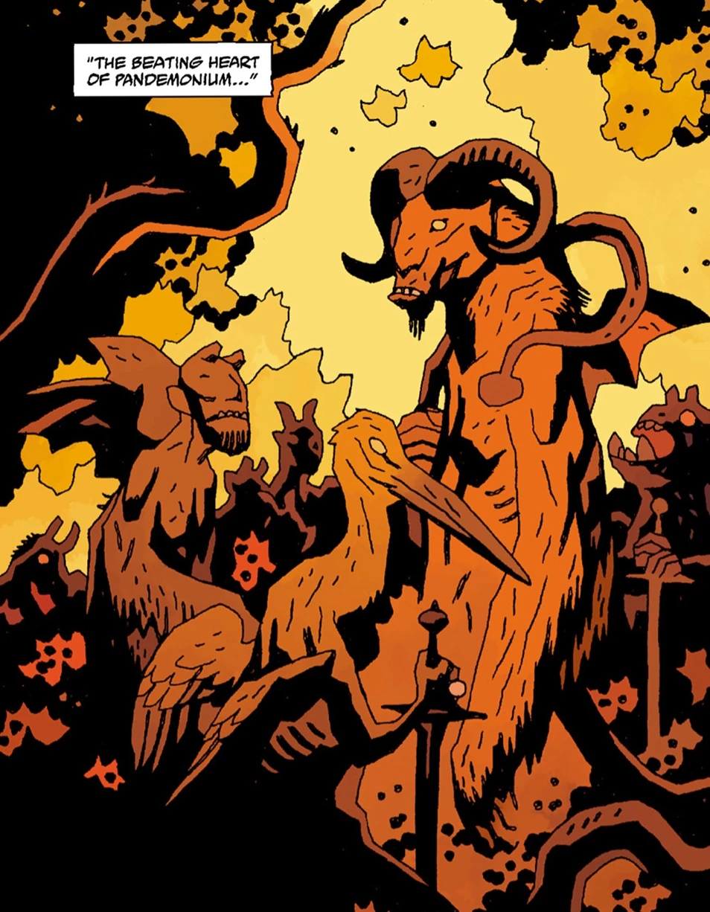

*For the Injustice 2 guest appearance, see [Demon (Injustice)](/entry/Demon_(Injustice)).*

Lucifer, Astaroth, Beelzebub… Attend me now and I will have no fear of the bottomless pit…. for thou art with me… Lilith, Queen of Shadows, walks at my right hand… Belial and his legions at my back… Azael and all his legions before me… Sammael, who tempted Eve in Paradise, is with me… Leraje, who sows discord between nations, he is with me… Sallos, who enflames the hearts of men, he is with me… Labolas, author of bloodshed and manslaughter, he is with me… Focalor, who commands the winds and sea, to drown men and wreck ships, he and all his legions are with me… I will be exalted until the heights of Pandemonium, city of flies… And I will exalted on the Earth… for thou art with me.

**Demons** are a race of supernatural beings who delight in evil, violence, and chaos. Demons reside in [Hell](/entry/Hell) but can travel to and from the Earth. They do this frequently so as to cause all manners of mischief and evil upon the human race.

## Hierarchy

There are numerous ranks and titles amongst demons. The chief amongst them is [Satan](/entry/Satan), the ruler of Hell who rebelled against [God](/entry/God) and was cast into the Abyss to forever dwell in chains and fire. However, Satan refused to be bound by his fate and declared himself a king while building up his city of Pandemonium. Satan has spent the last 2000 years sleeping in his chamber underneath [Pandemonium](/entry/Pandemonium_(location)), before his murder by [Hellboy](/entry/Hellboy_(character)).

Below Satan, the hierarchy amongst demons is believed to be:

- Grand Duke
- King-commands 85+ legions
- Prince-commands 60 legions
- Duke-commands between 29 and 60 legions
- Marquis-commands between 30 and 40 legions
- Earl
- Knight
- Minor demon-0 legions

## History

### Origins

The demons were originally angels, but as [God](/entry/God) asked them to bow down to [humanity](/entry/Human), they rebelled. They were led by Satan, who sought to become a new God, but they were all cast down to Hell.

In Hell the demons battled the original fallen angels, the Watchers, enslaving them and using them to built the city of [Pandemonium](/entry/Pandemonium_(location)).

For centuries demons have tried and managed to get humans to sin or sell their soul and come to Hell. They often serve as the masters of witches, promising magical powers and worldly gifts.

### Hellboy's arrival in Hell

When Hellboy died, his inevitable arrival into Hell stirred chaos amongst his demonic kin. Pandemonium itself had emptied out as the aristocracy fled in all directions to escape him, In doing so, the lords let their slaves see their fear, and in so doing the slave demons began to rebel against their masters. High-ranking demons such as [Shax](/entry/Shax), Usiel, Raum, Semyaza, [Moloch](/entry/Moloch), Belial and Dagon, all were turned upon and slain by their servants. Hellboy then ends up killing Satan, then afterwards witnesses [Astaroth](/entry/Astaroth) and his own brothers devoured by Leviathan.

With Satan dead and Pandemonium silent, the demon Yomyael visited Hell to claim the dagger Hellboy had used to commit the murder. With what remaining power was left on it, she set loose the Watchers upon which the capital city of Hell stood to pit them against one of the seven [Ogdru Jahad](/entry/Ogdru_Jahad) who had recently arrived on Earth. Without the Watchers, Pandemonium slowly sank into the Lake of Fire. Though Pandemonium seemingly remained for the slaves to claim, it did not last long as Gamori, punished by the Furies, followed the river of blood all the way back to its source. The sight of Satan's slit throat caused her to scream, bringing down the city all around the slaves. With Pandemonium submerged, the heart of Hell was snuffed out forever.

The remaining high-ranking demons, led by [Beelzebub](/entry/Beelzebub), gathered at his castle and planned a counter-attack. Hellboy arrived, as a ginormous towering demon, followed by countless slave demons. Hellboy vanquished both [Leviathan](/entry/Leviathan) and [Behemoth](/entry/Behemoth_(Demon)), while Beelzebub and his followers were killed by the vengeful slaves.

### Pandemonium on Earth

The three last high-ranking demons, [Yomyael](/entry/Yomyael), [Balam](/entry/Balam) and [Bifrons](/entry/Bifrons), managed to bind the slave-demons and summoned them on Earth. They sought to rebuild Pandemonium on Earth and rule over humanity. This plan fell through though, and all three were killed by the [B.P.R.D.](/entry/Bureau_for_Paranormal_Research_and_Defense), though some of the slaves survived.

### Ragna Rok

All remaining demons fell under the influence of the [Ogdru Hem](/entry/Ogdru_Hem), transforming into flaming-headed creatures similar to the spawn of Katha-Hem. They, alongside the Hammerheads and Frog monsters, started to hunt after the remnants of humanity, trying to wipe them out.

### Extinction

The demons, alongside all monsters created by the Ogdru Hem, perished when the [Ogdru Jahad](/entry/Ogdru_Jahad) were killed by the [Osiris Club](/entry/Osiris_Club).

## Appearance

There is much variation as to how demons appear.  While most appear to follow some basic patterns such as glowing eyes, horns, and wings this is subject to change as demons are shape-changers and can appear in the form of man, beast, or some cross between.

The more minor demons seem to have a uniform appearance. They are smaller creatures with red skin, horns, wings, and a skull-like face.

## Abilities

- Magic
- Immortality or Longevity
- Shape-changing
- Flight

## Known Demons

- [Astaroth](/entry/Astaroth) - Grand Duke of the Infernal Regions (deceased)
- [Azzael](/entry/Azzael) -  Prince of Sheol (imprisoned alive for eternity)
- [Gamon](/entry/Gamon) - son of Azzael (deceased)
- [Lusk](/entry/Lusk) - son of Azzael (deceased)
- [Gamori](/entry/Gamori) - daughter of Azzael
- [Hellboy](/entry/Hellboy) - son of Azzael, half human, Beast of the Apocalypse
- [Marchosias](/entry/Marchosias) - Prince of Hell
- [Agares](/entry/Agares) - Prince of Hell (deceased)
- Semyaza - Prince of Hell (deceased)
- Orabas - Prince of Hell (deceased)
- Suriel - Prince of Hell (deceased)
- [Beleth](/entry/Beleth) - Prince of Hell (deceased)
- [Iblifika](/entry/Iblifika) - Marchosias' Princess
- [Amdusias](/entry/Amdusias) - Duke of Hell
- [Shax](/entry/Shax) - Marquis of Hell
- [Andras](/entry/Andras) - Marquis of Hell (deceased)
- [Yomyael](/entry/Yomyael) - 7th Lord of Hell and Former member of demonic trinity and former director of the Russia's [Special Sciences Service](/entry/Special_Sciences_Service) (deceased)
- [Balam](/entry/Balam) - King of Hell
- [Bifrons](/entry/Bifrons) - Earl of
- [Berith](/entry/Berith)
- [Gusion](/entry/Gusion)
- [Marbas](/entry/Marbas)
- [Sytry](/entry/Sytry)
- [Moloch](/entry/Moloch) - "*The Abomination of the Children of Ammon*"
- [Asmodeus](/entry/Asmodeus) - (deceased)
- [Sybacco](/entry/Sybacco)
- [Leviathan](/entry/Leviathan)
- [Mammon](/entry/Mammon)
- [Haborym](/entry/Haborym)
- [Eligos](/entry/Eligos) - former Duke of Hell and Knight of the Order of the Fly (imprisoned by Sir Edward Grey)
- [Ualac](/entry/Ualac) - minor demon and temporary Beast of the Apocalypse (imprisoned by Astaroth)
- [Jeremiah Witkins](/entry/Jeremiah_Witkins) (deceased)

## Gallery of demons

Satan, leader of demons

Astaroth, Duke of Hell

Azzael, Prince of Sheol and father of Hellboy

Yomyael, seventh lord of hell

Gamori, sister of Hellboy

Lusk, brother of Hellboy

Gamon, brother of Hellboy

Balam, Marquis of Hell

Bifrons, Earl of Hell

Marchosias, Prince of Hell

Iblifika, Princess of Hell

Asmodeus, King of Demons

Ualac, Lesser demon

Leviathan

Beelzebub, Prince of Hell

Shax, Marquis of Hell

Andras, Marquis of Hell
