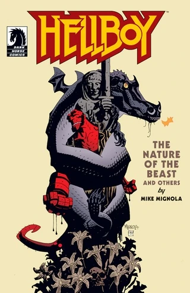
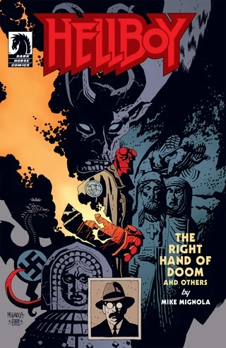
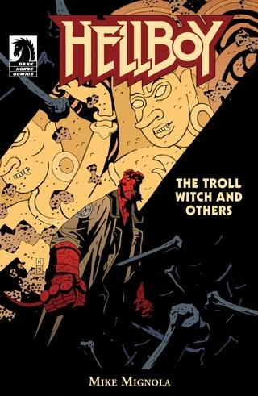

While the digital versions of the trade paperback collections and [omnibus editions](/entry/Omnibus_Editions) are identical to their print counterparts, the digital single issues can be different. Older stories are often missing back-up material or letters columns (such as *[Hellboy: Seed of Destruction](/entry/Seed_of_Destruction)*, where the digital editions do not include Art Adams's *Monkeyman and O'Brien* four-part back-up story).

## Print versus Digital Issues

**NOTE:** *This section is very incomplete. Any assistance would be appreciated. Information on whether there is a letters column or not would be very helpful.*

Issue
Missing Material from Print Version

&#10;
Hellboy: Seed of Destruction
#1

<li>Who are Monkeyman and O'Brien? (Part 1)</li>

#2

<li>Who are Monkeyman and O'Brien? (Part 2)</li>

#3

<li>Who are Monkeyman and O'Brien? (Part 3)</li>

#4

<li>Who are Monkeyman and O'Brien? (Part 4)</li>

Hellboy: The Wild Hunt
#2

<li>How Koshchei Became Deathless (Part 1)</li>

#3

<li>How Koshchei Became Deathless (Part 2)</li>

#4

<li>Baba Yaga's Feast</li>

#5

<li>MonsterMen: O Sinner Beneath Us! (Part 1)</li>

#6

<li>MonsterMen: O Sinner Beneath Us! (Part 2)</li>

#7

<li>The Burial of Katharine Baker</li>

## Digital Exclusive Issues

Before Dark Horse made the trade paperback and omnibus editions available digitally, they primarily relied on digital bundles collecting the individual issues of a miniseries or story arc. However, the *Hellboy* series has many short stories which did not originate in the single issue format. Dark Horse's solution was to group these short stories together to create a collection roughly the length of a single issue.

Cover
Title
Release Date
Collects

&#10;

Hellboy:
The Chained Coffin /
The Baba Yaga
April 4, 2011

<li>The Chained Coffin</li>
<li>The Baba Yaga</li>

Hellboy:
The Nature of the Beast
and Others
April 26, 2011

<li>Pancakes</li>
<li>The Nature of the Beast</li>
<li>King Vold</li>
<li>Heads</li>

Hellboy:
The Right Hand of Doom
and Others
April 26, 2011

<li>Goodbye Mister Tod</li>
<li>The Vârcolac</li>
<li>The Right Hand of Doom</li>

Hellboy:
The Vampire of Prague /
Dr. Carp's Experiment
May 4, 2011

<li>The Vampire of Prague</li>
<li>Dr. Carp's Experiment</li>

Hellboy:
The Troll Witch
and Others
May 4, 2011

<li>The Troll Witch</li>
<li>The Penanggalan</li>
<li>The Hydra and the Lion</li>

B.P.R.D.:
Casualties
July, 2011 (Retailer Exclusive)
March 1, 2012 (DH Digital)

<li>Casualties</li>

B.P.R.D.:
War on Frogs #5
October 5, 2011

<li>Revival (expanded version)</li>
