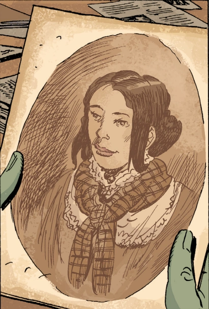
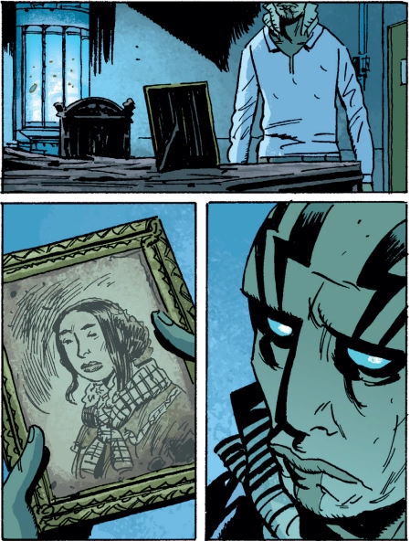

> "My love. The world *is* beautiful. Beautiful... But for me it was *too* hard." - Edith Howard

**Edith Howard** is a minor character in the B.P.R.D. story cycle, as [Langdon Everett Caul's](/entry/Abraham_Sapien) wife. She mainly appears in [The Dead](/entry/The_Dead), when [Abraham Sapien](/entry/Abraham_Sapien) goes looking into his past. She is shown or mentioned in passing in other issues. Edith married Langdon in 1861, and died in 1865.

## History

After Langdon Everett Caul quit sailing under [Elihu Cavendish](/entry/Elihu_Cavendish), he settled down in Littleport, Rhode Island and built a mansion. It took him around eight years to finish (1853-1861). Once it was done, Langdon married Edith, who was a local girl. On February 22, 1865, Langdon was reported missing. Edith did not respond well, allegedly going mad and throwing herself into the ocean a month after her husband failed to return home. Her body was never recovered.

Years later, Abe goes looking into his past, after a near-death experience reminds him he once was Langdon Everett Caul. He and Kate travel to Littleport, where a woman at a library is able to give them details about Langdon and his wife, as well as give Abe a picture of Edith herself.

Abe returns to the Caul house, and Edith's ghost tries to persuade him to stay with her. Abe experiences an illusion of his old life as Langdon, in the house he built, with Edith holding him, as a storm rages outside- threatening to topple the Caul house into the sea. Eventually, Abe forces her to uncover a mirror and face the truth. The illusion fades to the sun shining once again, and Edith's spirit fades away.

It is never said that Edith ever left Littleport, as she grew up, married, and died there.

Abe keeps a photo of her on his side table in his room at the B.P.R.D. Headquarters.

## Personality

Edith was described as not being stable at the best of times. She is convinced the world is too hard, too cruel, and couldn't bear to be without her husband. She loved her husband dearly, and wished to stay with him forever, going to great lengths to try and convince him to do so.

1.  [↑](#cite_ref-1) [The Dead](/entry/The_Dead)
2.  [↑](#cite_ref-2) [The Black Flame (story)](/entry/The_Black_Flame_(story))
