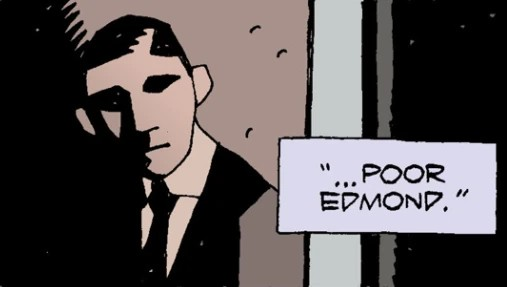

**Edmond Aickman** was a Danish professor of folklore.

## History

Edmond Aickman worked in Copenhagen, where he became a close friend and colleague of [Trevor Bruttenholm](/entry/Trevor_Bruttenholm).

### *[King Vold](/entry/King_Vold_%28Story%29)*

In 1956, he requested [Hellboy's](/entry/Hellboy_%28character%29) assistance, and Bruttenholm was happy to oblige. In Copenhagen, Aickman tricked Hellboy into summoning [King Vold](/entry/King_Vold_%28character%29), who, according to myth, would give great riches to anyone who managed to evade or subdue his hunting dogs. Hellboy did so, with difficulty, but was knocked unconscious. Aickman claimed that he was responsible for the victory, and claimed his reward. Seeing through the lie, King Vold dropped a shower of gold coins, but Aickman caught one and it burned right through his hand, leaving a hole behind. Upon hitting the ground, the gold coins immediately turned into lumps of coal.

Aickman was last seen begging on the streets of Copenhagen, with a bandage covering the hole in his hand. Bruttenholm lamented that his old friend had succumbed to greed.

### *[The Bones of Giants](/entry/The_Bones_of_Giants_%28comic_miniseries%29)*

In February 1988, Hellboy and [Abraham Sapien](/entry/Abraham_Sapien) returned to Scandinavia after an earthquake uncovered a gigantic skeleton holding [Mjollnir](/entry/Mjollnir), the Hammer of [Thor](/entry/Thor). Unexpectedly, the hammer fused to Hellboy's [stone hand](/entry/The_Right_Hand_of_Doom) as soon as he picked it up. Seeking out the nearest authority on Norse mythology, Hellboy and Abe looked up Professor Aickman, who had relocated to Stockholm. At first, the meeting did not go well. Aickman's daughter, [Pernilla](/entry/Pernilla_Aickman), who had heard about the King Vold incident from her father, believed that Hellboy still held a grudge against her father for tricking him. Hellboy assured the Aickmans that this was not true (noting grimly that Edmond had gotten the worst of the deal).

Aickmann welcomed Hellboy and Abe into his home, but disappeared during the night, leaving them to be attacked by [Svartalves](/entry/Svartalves) (dark elves). They tracked Aickmann to [Djurgården](https://en.wikipedia.org/wiki/Djurg%C3%A5rden), the former royal gardens of the Swedish monarchy, where they saw him enact a ritual with the Tankard of Thrym, a drinking glass rumored to contain the power of the King of the Frost Giants. This proved to be a mistranslation: Aickmann's act of drinking his own blood from the Tankard caused [Thrym](/entry/Thrym) to resurrect, rising from his grave beneath the gardens. The giant picked up Aickmann and drained the life out of him, dropping him on the ground afterwards.

Holding her father's dead body, Pernilla reflected that she had many happy memories of her father, who infused her with the same love for folklore and mythology. Yet she always knew he had a secret streak of greed, either for riches or for power, which had always led him towards self-destruction. After Edmond's funeral, Pernilla joined Hellboy and Abe in tracking Thrym to his lair in the mountains.

## Gallery

|A photo of an young Edmond Aikman.
## Trivia

- The photograph of the young Aikman appears to be a reference to the late [H.P. Lovecraft](https://en.wikipedia.org/wiki/H._P._Lovecraft), a 20th century horror writer whose works have influenced the Hellboy and B.P.R.D.-comics.
