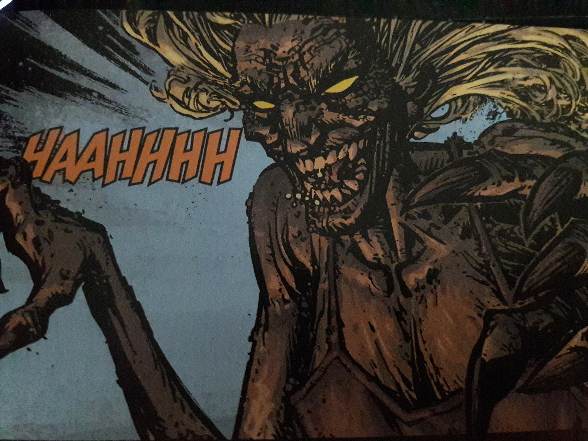
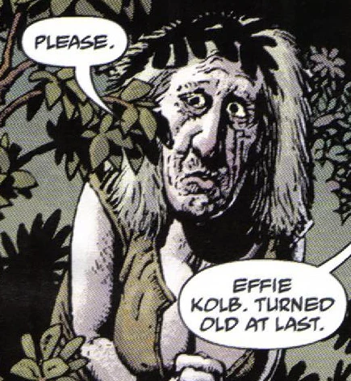

**Effie Kolb** was the right-hand woman, chief supporter, and main [witch](/entry/Witches) of [Miser Witkins](/entry/Jeremiah_Witkins).

## Story

Effie is the first witch [Tom Ferrell](/entry/Tom_Ferrell) ever met, having taught Tom about the pleasures of female companionship along with tricking him into forming a pact with her master Witkins, whose sorcery maintains her youthful appearance. When Tom returns to Virginia in 1958, Effie taunts him, revealing that she turned his elderly father into a horse with a magic bridle, then rode him until he died of exhaustion. During the standoff between Witkins and Tom at the old church in "The Hurricane", Effie dances seductively among Wikins's minions, inviting Tom to embrace the dark side, and her, once again.

After Witkins is finally destroyed, Tom and Hellboy find Effie skulking outside his mansion, her body now reflecting its true age. Feeble and helpless, she pleads for mercy, but receives little from Tom, who forces the magic bridle into her mouth, turning her into a nag. To add insult to injury, [Hellboy](/entry/Hellboy_%28character%29) paints a warning on Effie's side to keep people away from her, thus ensuring that the bridle will never be removed, and she will spend the rest of her known life as a nag. 

### [The Return of Effie Kolb](/entry/The_Return_of_Effie_Kolb)

By 1967, Effie has returned, having through unknown methods removed the bridle, worse for wear due to the purge of witches done by Tom Ferrell and [Reverend Watts](/entry/Reverend_Watts) after Hellboy initially left. She began to haunt and threaten the elderly Tom.

## Powers and abilities

Effie Kolb worked as a recruiter for the Crooked Man over the years, bringing many women to witchcraft and their souls to her master. Aside from having vast knowledge of witchcraft she exhibited the ability to ride a horse (actually Tom's transformed father) against his will, leap from his back to a great height and evade Hellboy's gunfire.

The ugly truth.|164x164px

Her most prominent power is her retained youthfulness, she looks to be in her teens, but is at the end revealed to be much, much older. It is possible she crafted the [Magic horse's bit](/entry/Magic_horse%27s_bit), with or without the aid of the Crooked Man.

### Personality

Effie looks like a hillbilly belle, but has a pretty nasty personality. She thought it fun to ride Tom's father to his death, make light of Tom's plight and of others' misfortune. Without her youth or powers she is not very courageous though, trying to throw herself on the tender mercies of her foes.

## In other media

Effie Kolb appears in the film *[Hellboy: The Crooked Man](/entry/Hellboy__The_Crooked_Man_%28film%29)*, played by [Leah McNamara](/entry/Leah_McNamara).

## Trivia

- Reverend Watts knew her when she was actually young, she was no good then either.
- Some ghost and witch stories feature a farmer Kolb. Go figure.
- She does very little magic that the reader sees but is given a lot of respect by other witches.
