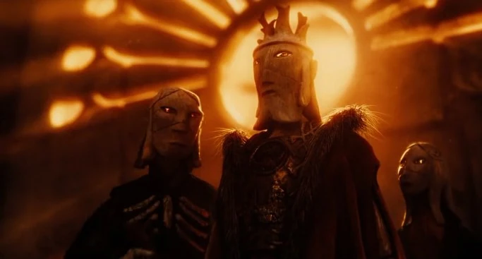
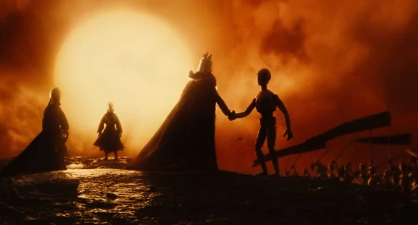
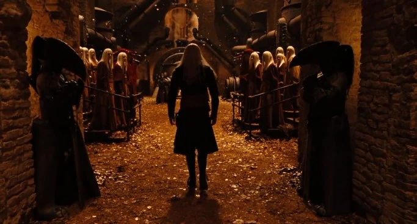
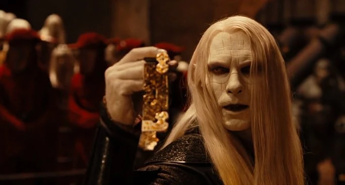
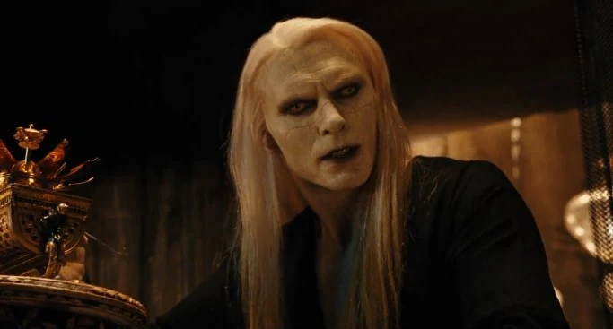
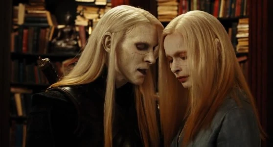
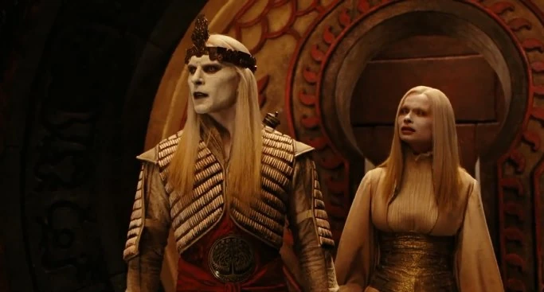
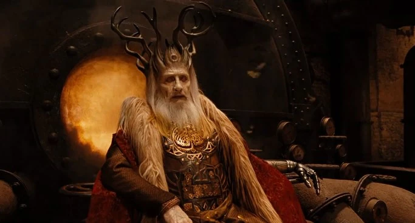
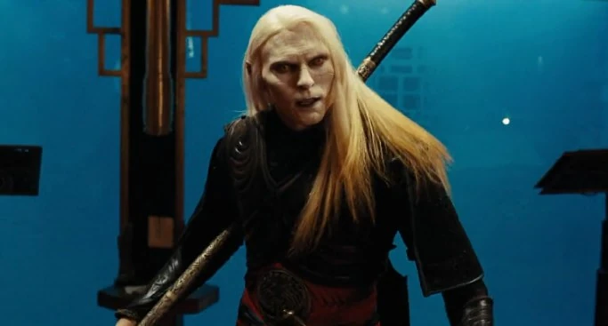
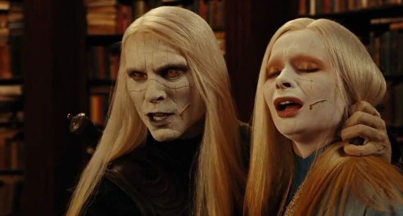

**Elves** are a type of magical creature featured in *[Hellboy II: The Golden Army](/entry/Hellboy_II%3A_The_Golden_Army)*, modeled after the [Daoine Sidhe](/entry/Daoine_Sidhe) from the Hellboy comics. Their appearances often range from beautiful and very human to a strikingly unusual one.

## History

### Ancient Times

Elves are known to have existed even in the time of ancient Egyptians, having existed alongside [humans](/entry/Human). Then when humans become consumed by their greed, it causes a war that threatens the magical creatures as they are drove further into their territories. The ruler of elves - king [Balor](/entry/Balor) - grew desperate in his attempts to save his people. All seemed lost, until a Goblin blacksmith offered the king to build an [army of invincible mechanical warriors](/entry/The_Golden_Army). The king's son, Prince Nuada, convinced his father to accept the offer. Shortly after the Golden Army was built with the [Crown of Bethmora](/entry/Crown_of_Bethmora) allowing Balor to command the army. However, Balor learned the Golden Army were more dangerous as he witness them kill the human army without any remorse.

This convinces Balor to forge a truce with the humans where they would keep control over cities while the fairy folk remain the forests and wilds. To cement the truce, the golden army was sealed underground in [Bethmora](/entry/Bethmora) while one third of the crown is given to the humans while remaining two were kept by king Balor and his daughter [Nuala](/entry/Nuala). As the Elves follow their terms of the truce, only Nuada believed that humans would eventually broke their vows and enters exile with the intention to return when his people needed him most.

### Modern Times

Millennia later, Balor and his court reside under New York City. The monarch still honors the truce between humans and elves, though he acknowledges that what humans do is their nature as much of his territory was taken by them. However, Balor learns of Nuada having murdered humans at an auction house where the piece of the Crown of Bethmora was held.

Nuada attended his father's court to obtain two remaining pieces of the crown while attempting to rally his kin to join him. Balor attempts to reason with his son one last time before being left with no option to sentence Nuada to death. Though Nuala accepted her own death because of their link, expressing remorse in the aftermath of his actions, Nuada refuses to accept his fate as he fights through the Butcher Guards to kill Balor and take the crown fragment in his father's possession. By that time, Nuala escaped and fled to the Troll Market for the map leading to Bethmora.

While in the Troll Market, Nuala crosses paths with the [B.P.R.D.](/entry/Bureau_for_Paranormal_Research_and_Defense) as they were searching for clues regarding the events at the auction house. Hellboy had a confrontation with the troll [Mr. Wink](/entry/Mr._Wink) and killed him, with Nuada learning of his friend's death as he unleashes the last forest elemental to kill Hellboy. Through the attempt on Hellboy's life failed, Nuada manages to instill in Hellboy's mind that humanity will never accept him.

Nuada later uses his link to Nuala to locate headquarters, infiltrating it with little difficulty while learning his sister hid the final crown piece. Before he could find it, Nuala triggers the alarm and Nuada spirits her away to Bethmora after mortally wounding Hellboy, telling Abe to bring the crown piece if he ever wants to see Nuala again.

At Bethmora, once Abe arrives with the last crown piece, Nuada revives the Golden Army to destroy the BPRD agents before Hellboy openly declares a challenge for the right to the crown. As Hellboy is the son of the [fallen one](/entry/Azzael), Nuada is forced to accept the challenge and loses. Warning Hellboy to kill him, Nuada attempts to kill the demon from behind before Nuala stabs herself in the heart to end her brother's life at the cost of her own. The fate of the Elves with the last of their royal family death is unknown.

## Description

The elves seem to be inspired by the aos sí of Gaelic mythology and the elves of Germanic mythology; races of semi-divine beings endowed with magical powers, which they use both for the benefit and the injury of mankind, rather than the small, impish creatures of popular culture.

### Appearance

In the films, elves very much resemble [humans](/entry/Human), although they possess ghostly-white skin that resembles wood or marble. Their faces are etched with strange designs. They also have long silvery hair ending in gold and have eye color ranging from amber to sienna. Their ears are leaf-shaped and pointed. Born of the earth, Elves turn to stone when they die, thus returning to it.

### Abilities

It is not certain what skills Elves possess, or if they possess any generally special skills at all.

#### Long lifespan

Elves seem to have a degree of immortality. In the film, the king and his children were said to be alive since the dawn of the earth, meaning they are extremely long lived. Unlike Tolkien's elves, they do get older and do not stay forever young and beautiful, as witnessed by king Balor's appearance. However they are not immortal and can be killed by conventional means.

#### Physical abilities

[Prince Nuada](/entry/Nuada) of Hellboy II possessed speed, agility and fighting skills far-surpassing those of mortal men, and in some cases even Hellboy. This is shown several times in the film, such as when he infiltrates both an auction house and [B.P.R.D.](/entry/Bureau_for_Paranormal_Research_and_Defense) headquarters with virtually no difficulty. Towards the beginning of the film, he dispatches his father's butcher guards in a matter of minutes before killing his father. During their first fight, he easily wounds Hellboy, and during their second fight, still fights at the same level. Nuala also demonstrated the power to learn about other people just by using her hand.

#### Magic

Elves, as a race, also seem to be possessed of great [magic](/entry/Magic) and the ability to create things of great craft and enchantment, such as weapons and the [Great City of Bethmora](/entry/Bethmora). Being the first born race, they also exhibit influence over the elements and the forces of nature, such as when Nuada summons a forest elemental and when he retrieves a metal map cylinder directly from a fire, his hand is completely unharmed.

Prince Nuada and his twin sister Nuala shared a link that bonded the two on spiritual, mental and physical level. The two could feel each others' proximity, and when one was hurt the other was afflicted with an identical injury.

## Trivia

- The Elves' story of declining, with some attempting to reclaim the world from men, mirrors that of [Gruagach](/entry/Gruagach) and his like-minded Daoine Sidhe who attempted to save their people by resorting to commit great evil acts.
- The ancient language that elves use or the Sons of the Earth is Gaeilge, or Irish.
