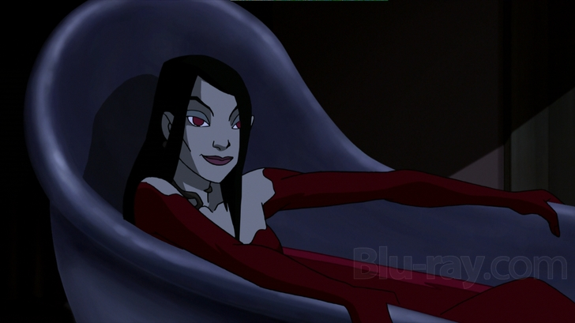
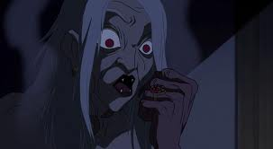

## Background

Ersebet Ondrushko was in life a Hungarian Countess obsessed with keeping herself young and beautiful. She murdered over six hundred young girls and bathed in their blood, believing it would keep her young forever.

She eventually settled in a castle in Transylvania near a village where she abducted and murdered young girls as she did in life. According to Professor Broom her victims numbered up to a thousand.

She attempted to foil the Professor's efforts by intimidating the Priest mocking God and comparing the gifts her Goddess gives her to as opposed to God's "silence". This appeared to work and weaken the professor's group as the priest fled in fear. She likely did this to weaken his faith as Broom said the strength of one's faith empowers the cross.

After abducting and murdering a village girl named Anna, Erzsebet was confronted by Professor Broom, two constables, Anna's fiance and a priest. However Erzebet scared off the priest and murdered everyone with her wolves except the Professor. The Professor was able to trick her into attacking him by throwing holy water in her face destroying her "beauty". After she attacked Professor Broom, he and Erzsebet fell out a window and she was destroyed by the light of the sun.

## Plot

Erzebet was the High Priestess of the Goddess [Hecate](/entry/Hecate) who gave her power in exchange for her service. Two of her servants plotted to resurrect her and restore her power by having her bathe in the blood of the estate owner who bought many of her possessions.

Once she was resurrected she faced Professor Broom once more. With her powers restored she went as far as to mock the now old man. In response Broom said "Growing old is not the worse thing that could happen to a person." She then starts screaming in pain and he reveals he poured holy water into her bath and High Priestess of Hecate dies once more.

## Trivia

- **Erzsebet shares many similarities to Dracula from the novel having wolves for servants.**

- **She is likely inspired by the Blood Countess Elizabeth Bathory.**
- **she shares similar powers/ abilities and flaws/weaknesses of a vampire, sunlight, garlic, wooden/silver stakes, and holy water**
- **like Dracula, she often despises humans for their faith in god for unanswered prayers, even threaten humanity to causing mass genocide by unleashing an army of vampires upon the earth**
