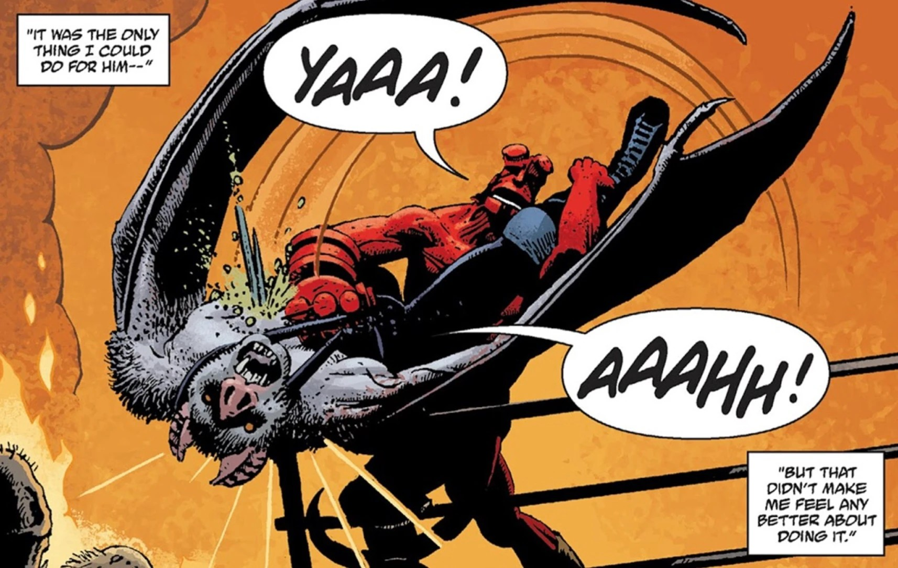

Esteban was a Mexican *Lucha libre* wrestler turned monster hunter who later became a [vampire](/entry/Vampire_(creature)) and fought against [Hellboy](/entry/Hellboy_(character)).

## History

In 1956, Estaban was one of three *luchador* brothers who had quit wrestling and taken up fighting against monsters after receiving a vision from the Virgin Mary about great trouble coming. The vision came true as a huge number of monsters appeared in the area, slaughtering many people. The brothers later teamed up with Hellboy after he arrived to deal with the threat. During this time, the four comrades fought monsters all day and partied all night. Hellboy and Estaban became particularly close.

One night during a drinking binge, Estaban wandered off and was taken by vampires. After days of fruitless search they returned to monster hunting, questioning and torturing their prey for information of his whereabouts. Eventually they discovered a *Lucha Libre* style poster for a wrestler called [Camazotz](/entry/Camazotz) and a message from the vampires for Hellboy to come to an old Mayan temple alone to face him.

When Hellboy arrived, he found that the interior of the temple had been set up as a *Lucha libre* ring which was surrounded by undead and other monsters with the masked Camazotz waiting for him. Hellboy quickly realized that it was Estaban.

During the match, Estaban removed his mask, revealing that he had been turned into a vampire. He blamed Hellboy, because he had trusted his friend to be there but he wasn't. Hellboy acknowledged this but he was here now, and there was only one thing that he could do for him. He staked Estaban through the heart on the sharpened posts of the ring, winning the fight and returning him to human form. In his final moments, Estaban thanked him.

After helping the remaining brothers bury him, Hellboy went on a months long drinking binge until he was found and returned to the [Bureau](/entry/Bureau_for_Paranormal_Research_and_Defense).

During his binge Hellboy was tormented by vampires with visions of those that he could not save while in Mexico, including Estaban, promising that they could make him forget more completely than drinking. However, after Raul destroyed the vampires, Hellboy had a vision of Estaban telling him that he knows that Hellboy tried to save him, and so did the other victim.

After returning to the area in 1982, Hellboy related Estaban's story to [Abe Sapien](/entry/Abe_Sapien), though many details were blurry due to alcohol.

## Gallery

Esteban reveals his transformation

|Esteban/Camazotz is killed by Hellboy
## Apperance

- [Hellboy in Mexico](/entry/Hellboy_in_Mexico_(story))
- [House of the Living Dead](/entry/House_of_the_Living_Dead) (vision/deceased)
