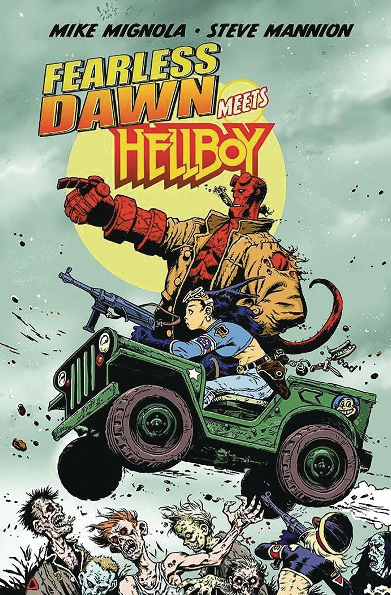

***Fearless Dawn Meets Hellboy*** is an out-of-continuity one-shot crossover issue published by Albatross Funnybooks. It is written and drawn by [Mike Mignola](/entry/Mike_Mignola) and [Steve Mannion](/entry/Steve_Mannion).

## Synopsis

It's all out pulp adventure as Mike Mignola's Hellboy teams up with Steve Mannion's legendary underground comic hero, Fearless Dawn! A misadventure in Romania drops Hellboy into the middle of the paranormal mission of Fearless Dawn's crew. But this meeting of heroes ain't no picnic when the undead 666th Panzer Division shows up.

## Gallery

Mike Mignola variant cover

|Steve Mannion cover
