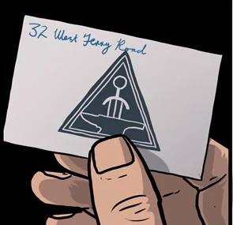

 The **Foundry** was a para-military organization under the authority of the British Empire during the reign of Queen Victoria in the late 1800s.

## Background

In 1879 Colonel Burke and his subordinate McMann were patrolling the Kyber Pass in Afghanistan for rebels. They accidentally unearthed ancient technology belonging to the Hyperborean Age. Burke brought the artifacts to London where they became a subject of intense scientific scrutiny by historians and archaeologists. More such items were later discovered by various explorers, that eventually after a few years the Queen took an interest and hand picked a group to work together in secret. Thus the Foundry was born, to unlock the secret of these strange wonder. The Foundry led expeditionary attachments to scour the globe for more undiscovered artifacts, no matter how remote or inhospitable. Research was pour into to learning their secrets and figuring out possible applications from the Empire. In addition the Foundry was also called to provide services of clandestine nature at the Queen's request.

## History

The Foundry was based of in London, 12 West Terry Road. It was located beneath the Caliburn Ironworks and Shipbuilding Ltd., Isle of Dogs. On October 1884, Queen Victoria upon learning of a heist at the Tower of London where the occult artifacts collected by Sir Edward Grey were store she directed him to the Foundry to possibly seek answers.[1] There it was learned that the Foundry faced a breach in security when one of their own, Aldous Middengard Sinclair, stole a sensitive item from their facilities. Learning that Sinclair had been associating himself with the [Heliopic Brotherhood of Ra](/entry/Heliopic_Brotherhood_of_Ra), Grey was joined by Singh in the investigation.[2]

## Known Members

- [Colonel James Fraiser Burke](/entry/James_Fraiser_Burke)
- [Professor Quinlan Maddox](/entry/Quinlan_Maddox)
- [Major Karam Singh](/entry/Karam_Singh)
- [Aldous Middengard Sinclair](/entry/Aldous_Middengard_Sinclair) (former)

## References

<references />

[1] [*The Gates of Heaven* \#1](/entry/The_Gates_of_Heaven)

[2] [*The Gates of Heaven* \#2](/entry/The_Gates_of_Heaven)
