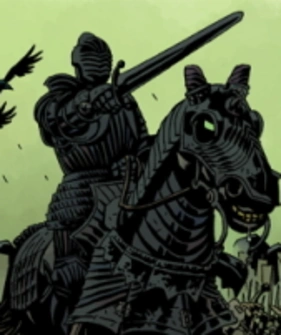

The **Four Horsemen of the Apocalypse** were beings that served the [Ogdru Jahad](/entry/Ogdru_Jahad) during [Ragna Rok](/entry/Ragna_Rok_(event)).

## History

The four were seen leading the army of the apocalypse under the banner of the [Dragon](/entry/Ogdru_Jahad) on the fields of [Vigrid](/entry/Vigrid), battling the English knights and perishing there.

## Members

- [War](/entry/War)
- [Pestilence](/entry/Pestilence)
- [Famine](/entry/Famine)
- [Death](/entry/Death)

## Gallery

Pestilence

Famine

Death

|War
## Appearances

- [*Hellboy: Wake the Devil*](/entry/Wake_the_Devil) (mentioned)
- [*Hellboy: The Storm and the Fury*](/entry/The_Fury)
