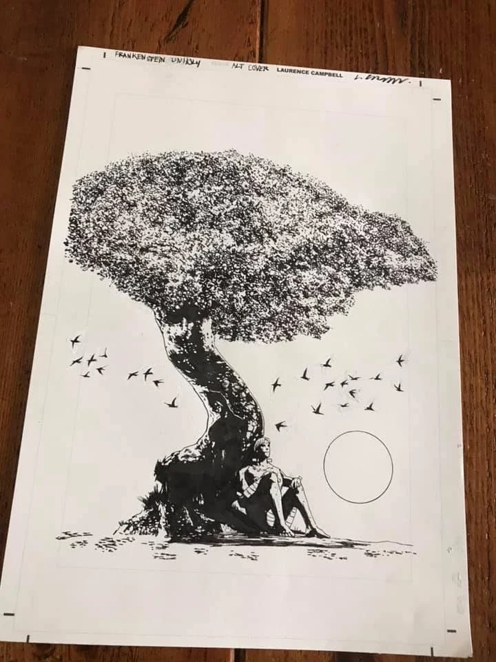

*This article is a stub. You can help Hellboy Wiki by expanding it.*

***Frankenstein*** is a series of stories about [Victor Frankenstein](/entry/Victor_Frankenstein) and his creation. The series includes the comics *[Frankenstein Underground](/entry/Frankenstein_Underground)* and *[Frankenstein: New World](/entry/New_World_(Frankenstein_story_cycle))*, and Mary Shelley's 1818 novel *[Frankenstein; or, The Modern Prometheus](/entry/Frankenstein%3B_or%2C_The_Modern_Prometheus)*. In 2020 the series was going to expand with the *[Frankenstein Undone](/entry/Frankenstein_Undone)* miniseries, but this was later canceled when [Mike Mignola](/entry/Mike_Mignola) chose to cease working with writer [Scott Allie](/entry/Scott_Allie). A third *Frankenstein* series, *Frankenstein Unholy*, was planned as a sequel to *Frankenstein Undone*, but it was likewise canceled. Some work had begun on it though, such as a variant cover by [Laurence Campbell](/entry/Laurence_Campbell).

