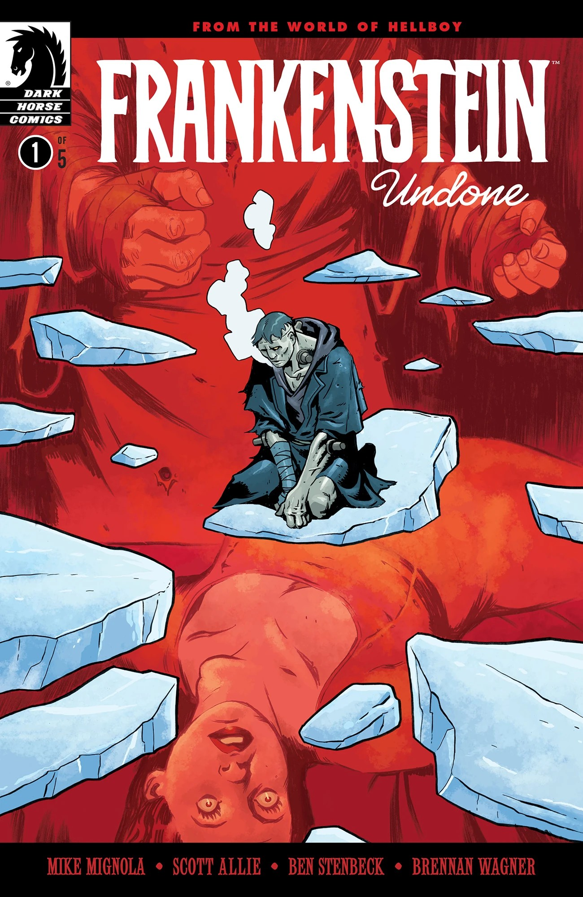
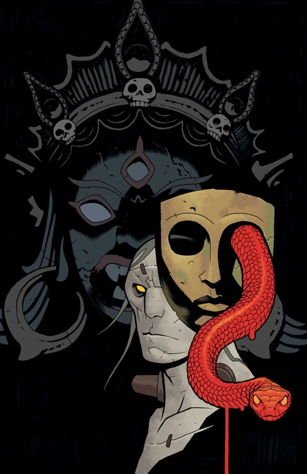
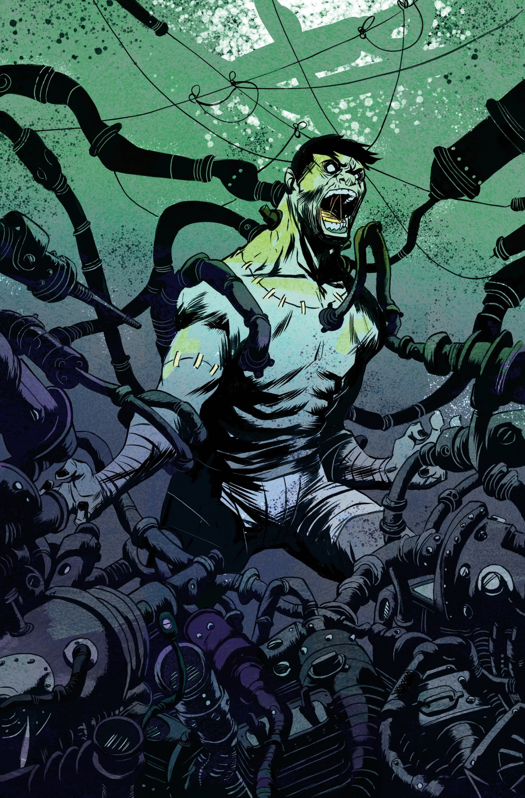
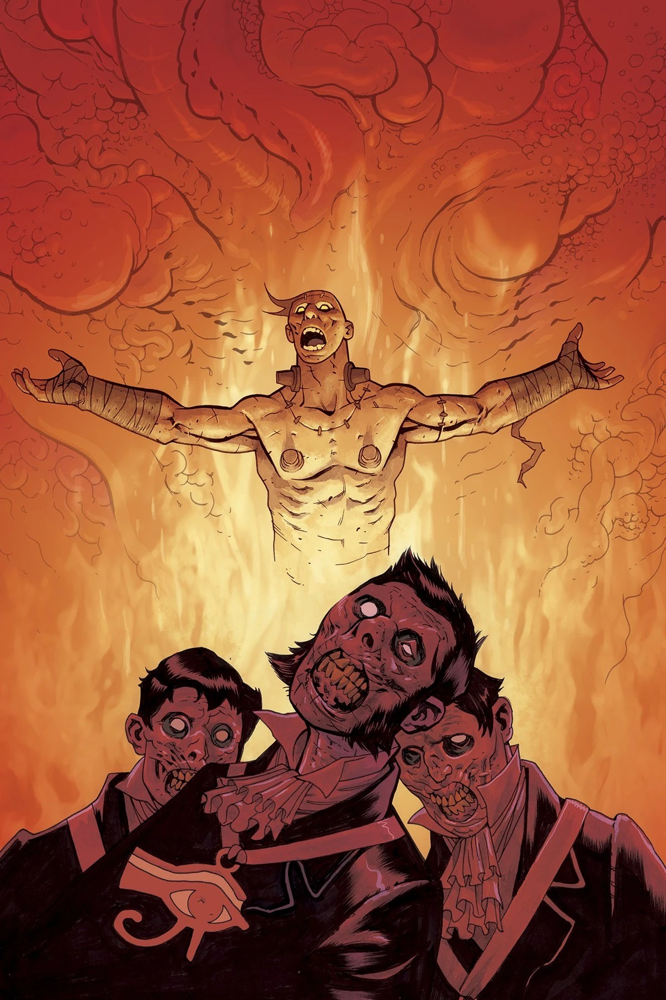
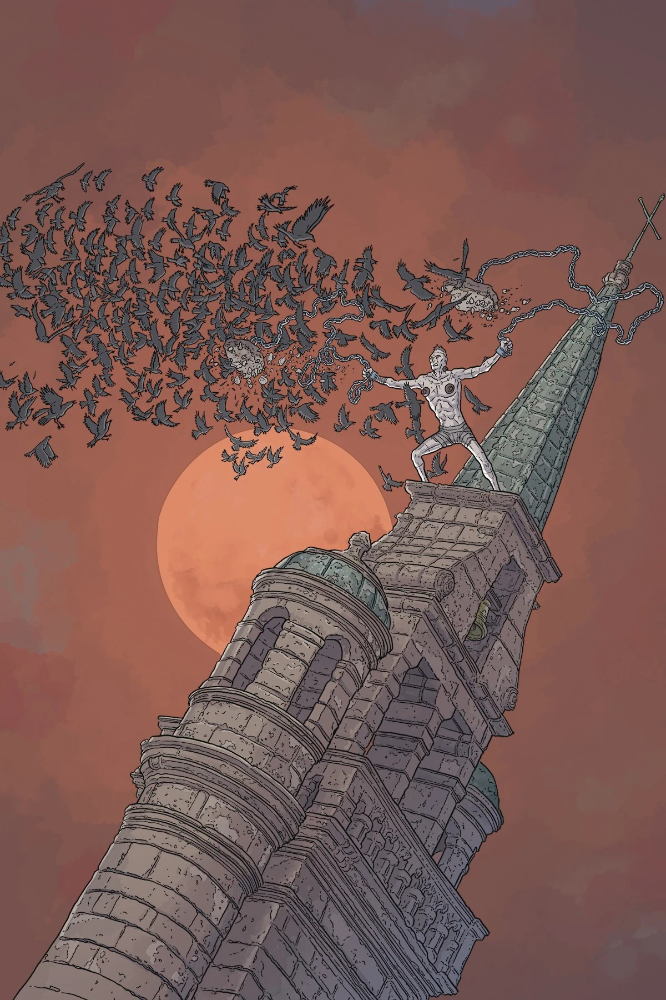
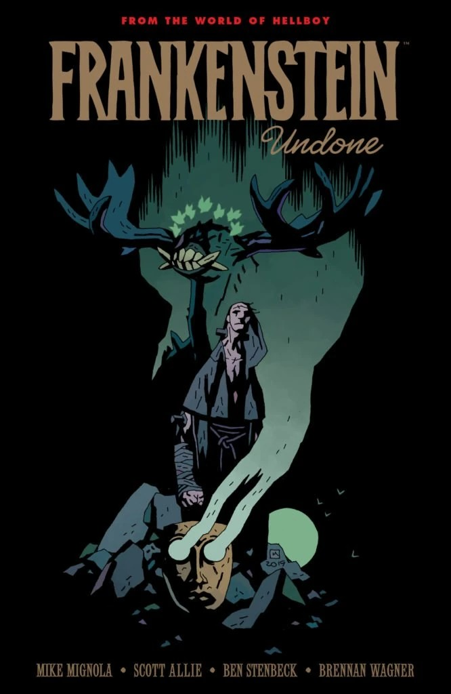

***Frankenstein Undone*** is a five-issue miniseries prequel to *[Frankenstein Underground](/entry/Frankenstein_Underground)*. It was canceled after the second issue.

## Publication History

*Frankenstein Undone* was initially teased on Twitter by Multiversity Comics on October 16, 2019. A formal announcement of the series came the following day.

The first issue came out January 2020, but subsequent issues were delayed due to COVID-19. The second came out in May with the remaining three scheduled for September to November. However, following news of co-writer [Scott Allie](/entry/Scott_Allie)'s predatory behavior, the miniseries was canceled.

When Mignola was asked whether he would return to the series at a later date with a different author, he said, "No—This story line doesn't exist. Sorry. We all had a good long talk about it and everybody agreed that was for the best." As such, *Frankenstein Undone* is considered out of continuity.

## Publisher Summaries

### Part One

Frankenstein’s creator lies dead in the icy grip of the Arctic, and the monster searches for a new purpose. Just as he thinks he’s found one with a group of unlikely companions, disaster strikes—and the monster is catapulted out of Mary Shelley’s novel and into the world of Hellboy.

### Part Two

In the leadup to the celebrated series *Frankenstein Underground*, the “monster” Frankenstein continues his journey northward. Still trapped between the weight of his guilt and desire for redemption, Frankenstein may have to choose once and for all when an encounter with the crew of an icebound ship leads him into danger on the ice!

### Part Three

Pursuing his humanity in the unlikely company of arctic adventurers, the “monster” Frankenstein unwittingly becomes the pawn of an ancient cult! Meanwhile, unbeknownst to him, he’s been recognized as Viktor Frankenstein’s creation by a powerful local man whose influence might see him arrested… or worse!

### Part Four

Frankenstein discovers that one of his shipmates has been using him for his own selfish gain. Meanwhile, a mysterious artifact pulled from the arctic ice begins to exert its dark influence on Demmings, awakening the machinations of an ancient cult.

### Part Five

This time, the undead may truly come undone.

Just as Frankenstein begins to feel a sense of camaraderie with his companions, a dark force reveals itself and threatens to consume them. Demmings’ dark mask enacts its deadly plan, and all that stands between humanity and the darkness he wished for so long is Frankenstein!

## Gallery

All covers by Ben Stenbeck, unless otherwise noted. Only issues \#1 and \#2 were published.

variant by Mike Mignola  
with [Dave Stewart](/entry/Dave_Stewart)

Issue \#2

Issue \#2  
variant by Simone D’Armini

Issue \#3

Issue \#3  
variant by Steve Purcell

variant by Sanford Greene

variant by Geof Darrow

*Frankenstein Undone* TPB cover  
by Mike Mignola

|Issue #1

|Issue #4

|Issue #4 variant by Sanford Greene

|Issue #5

|Issue #5 variant by Geof Darrow

|Frankenstein Undone TPB cover by Mike Mignola
