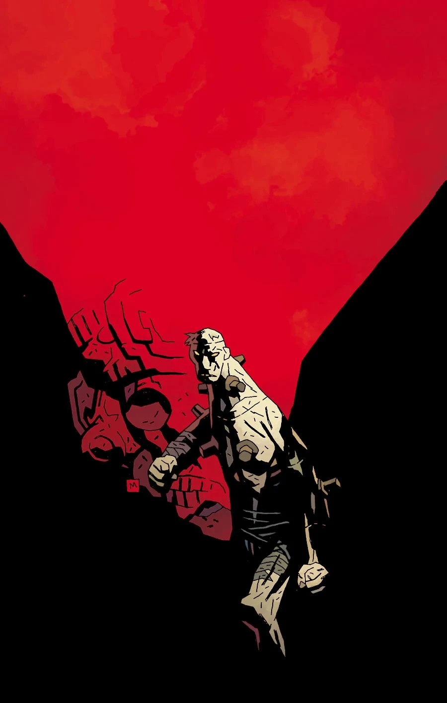
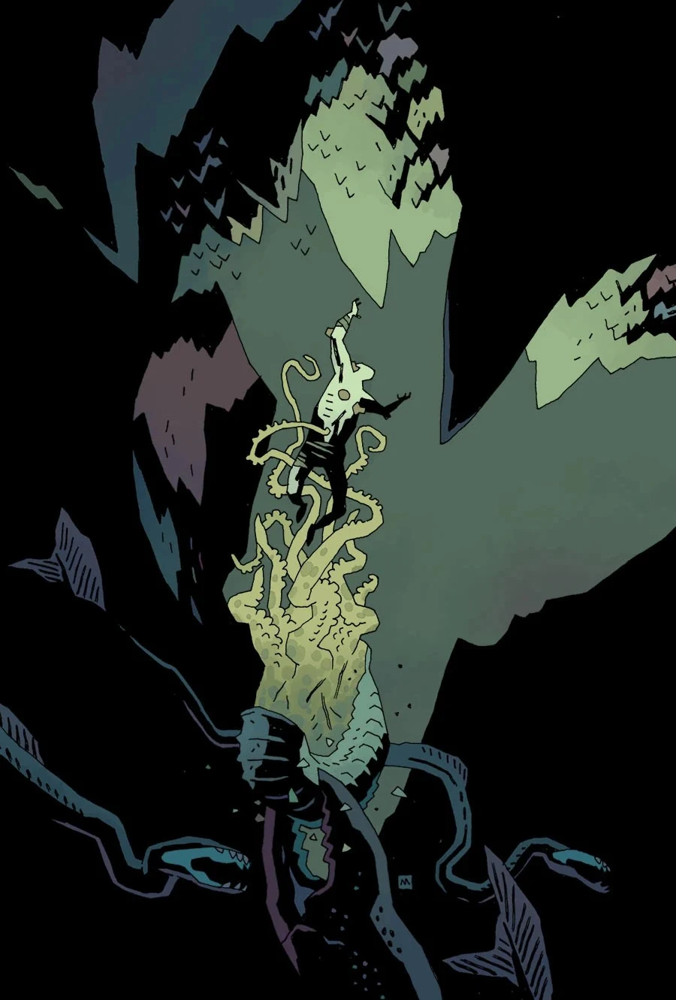
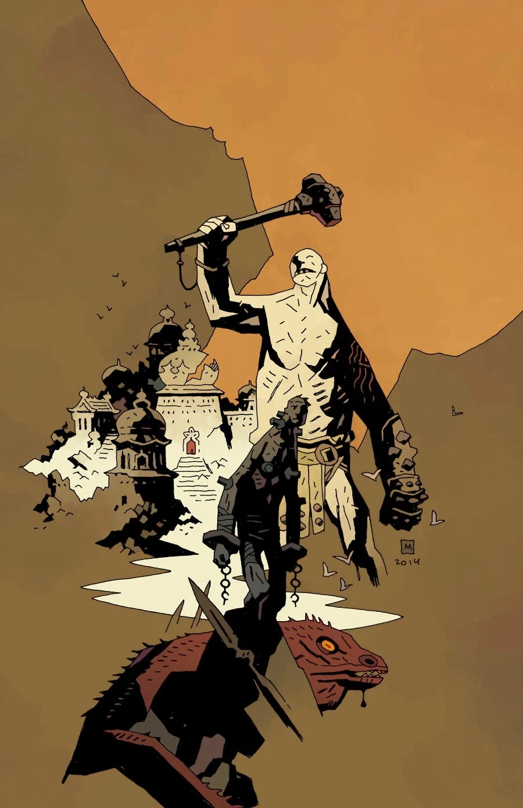
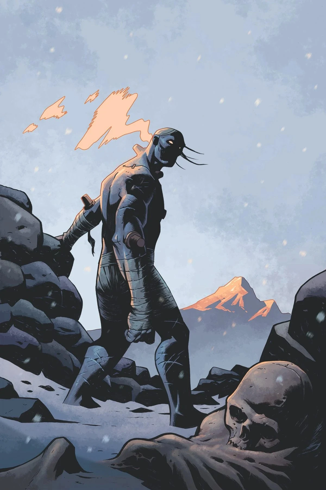
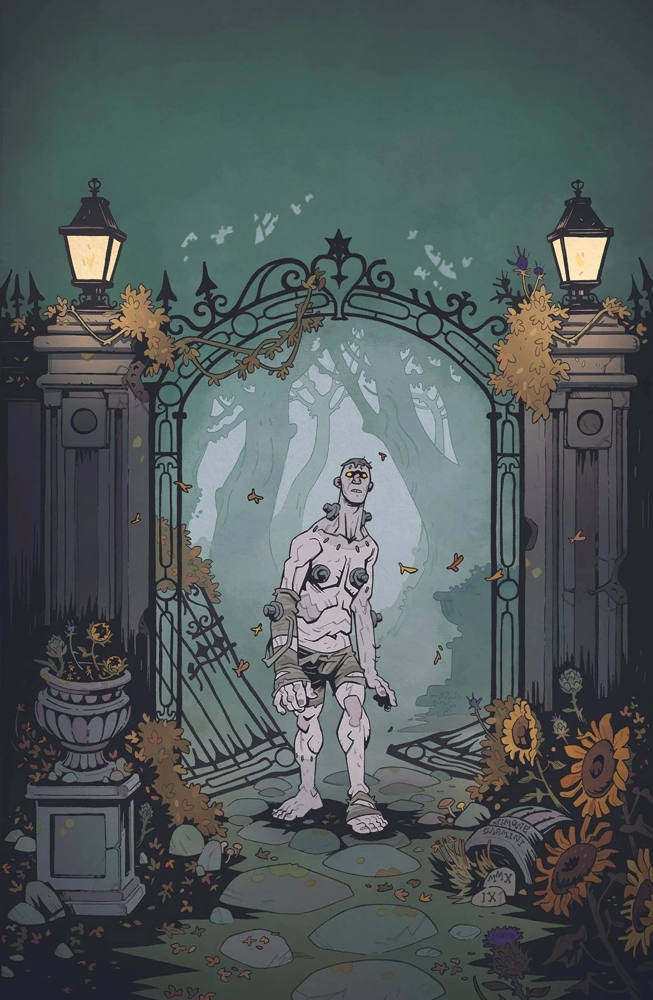
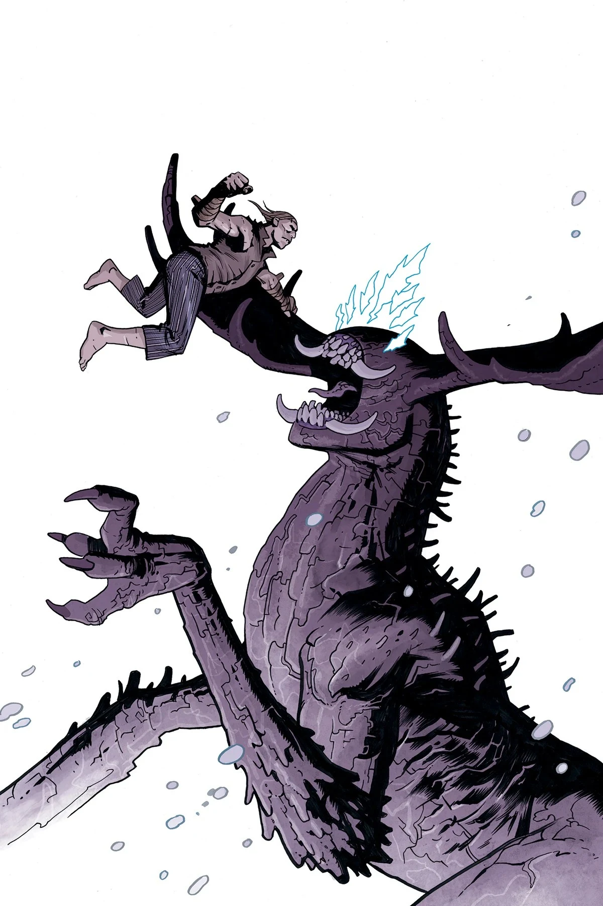
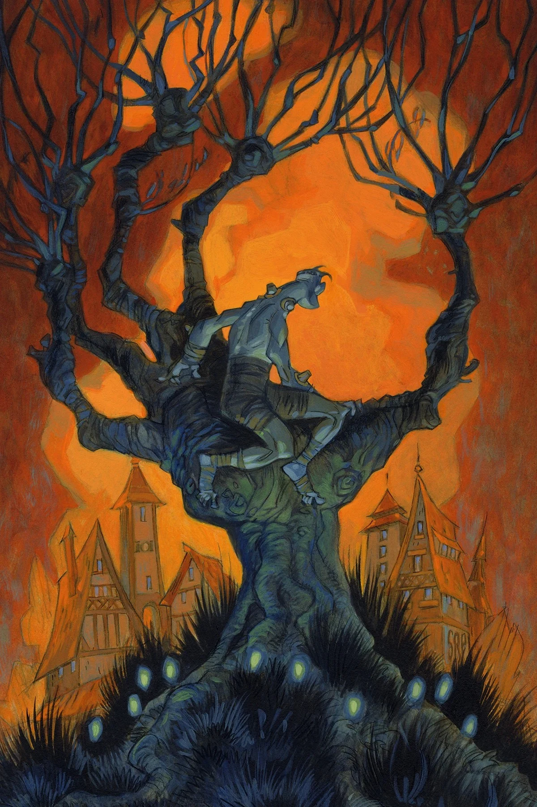

**Frankenstein** (sometimes referred to as "Frankenstein's Monster") is an artificial being created by [Dr. Victor Frankenstein](/entry/Victor_Frankenstein).

## History

The creature was created from cobbled corpse pieces by a young medical student by the name of Victor Frankenstein in 1792, Ingolstadt, Germany. Through some sort of miracle a strange bolt of lightning animated the construct, giving it life and intelligence. It was later revealed to be animated by [Vril](/entry/Vril).

Upon receiving life, Frankenstein was rejected by his creator, forcing the creature to flee. The outside world was not forgiving as all fear his monstrous figure. He haunted his father, promising to leave the world of man forever, until he created him a mate so he may not be alone. His creator refused and out of anger Frankenstein killed Victor's beloved by accident.

The story of the creature led to the inspiration of Mary Shelley's Gothic novel *[Frankenstein; or, The Modern Prometheus](/entry/Frankenstein%3B_or%2C_The_Modern_Prometheus)*, published in 1818. Since leaving behind its master the creature has survived well into the 20th Century.

After being chased from his place of origin, he was captured in France in 1863 by soldiers, and later imprisoned in Austria in 1911, becoming a circus freak for the amusement of the masses. The creature was later exchanged and transported to Mexico in 1955 to be used fighting in Mexican boxing.

In 1956 he crossed fists with [B.P.R.D.](/entry/Bureau_for_Paranormal_Research_and_Defense) agent, [Hellboy](/entry/Hellboy). In the confusion the creature slipped away whist his masters contended with the American agent. He and Hellboy later met in a bar and drank tequila together.[1]

Later that year, Frankenstein sought refuge in an abandoned temple where for the first time met a kindly old psychic woman who took pity on the creature. At this time, he was also being pursued by [Marquis Adoet de Fabre](/entry/Adoet_de_Fabre), who wished to add him to his menagerie. In order to capture him, the Marquis send [Iblifika](/entry/Iblifika), who was, at that time, his slave. Iblifika attempted to persuade Frankenstein to join her, but due to the old woman's interference, Frankenstein escapes. In the conflict, the old woman is killed, and in a fit of rage Frankenstein destroys the temple and falls into a hidden land underneath the Earth.[2]

Once in the hidden land, he battled several prehistoric creatures, and is eventually captured by a group of human-eqsue tribesmen living there. They take him to a city, where he encounters William a scientist who had led an expedition commissioned by the [Heliopic Brotherhood of Ra](/entry/Heliopic_Brotherhood_of_Ra) to establish a colony in the underground world. After discussing how they had arrived in the underground world, Frankenstein is placed in chains, but freed by a spirit, who leads him to a room where he encounters several of the members of the expedition who are effectively walking corpses.

They explain that the city had been built by Hyperboreans who eventually turned to worship Hecate and, as a result, the city was submerged underground and haunted by evil spirits. After an initial period of happiness, William is possessed by an evil spirit (shown to the reader to be an [Ogdru Hem](/entry/Ogdru_Hem)), murders his daughter, and forces the surviving colonists to continue living even as their bodies decay. Frankenstein takes William's daughter to Lubitsch, a scientist who is part of the expedition, but wishes to end the evil taking place there, and asks him to resurrect her. After initially agreeing, he betrays Frankenstein, attempting to steal the Vril energies that power him, but they are interrupted by William and Lubitsch is killed in the ensuing scuffle.

Frankenstein fights William, and, in the struggle, the Ogdru Hem spirit is released from William's body. Frankenstein flees the collapsing city while the Ogdru Hem, given physical form, pursues him. He discovers the spirit he had been freed by earlier, which destroys the Ogdru Hem, and sprouts new plant life throughout the underground world. Frankenstein, immortal, is left there alone for an extended period of time. [3]

When the end of the world comes and devastates the surface, Frankenstein is the first to greet the gathered human survivors who managed to follow the caves to the Hollow Earth.

Frankenstein had taught the human survivors how to survive in the Hollow Earth and even shared his knowledge of Vril. Eventually Frankensten underwent a deep mediation in order to commune with the Vril. Overtime in a thousand years he becomes an idol of worship to the human descendants and is referred to as the Oracle.

Frankenstein awoke from his slumber, due in part to in part of a young girl named [Lilaja](/entry/Lilaja) who received dreams from a [mysterious woman embedded in crystal](/entry/Elizabeth_Sherman). Frankenstein recognized it to be a call to the surface. Though many of the monks who had lived with tales of the Oracle pleaded he stay and teach them, Frankenstein told them if they wished to follow his teachings to be kind to one another, as his needed to go to the surface was great. Lilaja attempted to ask the Oracle to allow her to join him on his quest, but she was refused as the flesh golem did not wish to bring harm to her.

## Name

While some may know this character from Mary Shelley's novel as "Frankenstein's Monster," this moniker does not reflect how he sees himself. In *Frankenstein: New World*, he makes a point of saying he is not a monster. This idea was also explored in *Frankenstein Undone*, where he specifically choses to call himself Frankenstein as a way of recognizing his own humanity—he takes the surname of his father, Victor Frankenstein. [Though *Frankenstein Undone* is no longer canon](/entry/Frankenstein_Undone), this aspect of the story is at least consistent with Frankenstein's portrayal in other Hellboy Universe stories. 

## Gallery

FrankensteinUnderground 1.jpg FrankensteinUnderground 2.jpg FrankensteinUnderground 3.jpg FrankensteinUndone 2 Stenbeck.jpg FrankensteinUndone 2 DArmini.jpg FrankensteinUndone 3 Stenbeck.jpg FrankensteinUndone 3 Purcell.jpg

|

|

|

|

|

|

|
## References

<references />

[1] [*Hellboy: House of the Living Dead*](/entry/House_of_the_Living_Dead)

[2] [Frankenstein Underground \#1](/entry/Frankenstein_Underground)

[3] Frankenstein Underground \#5
