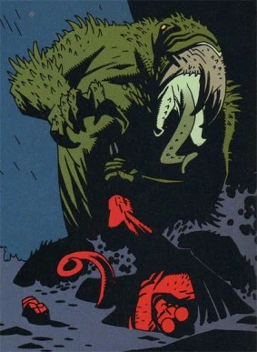
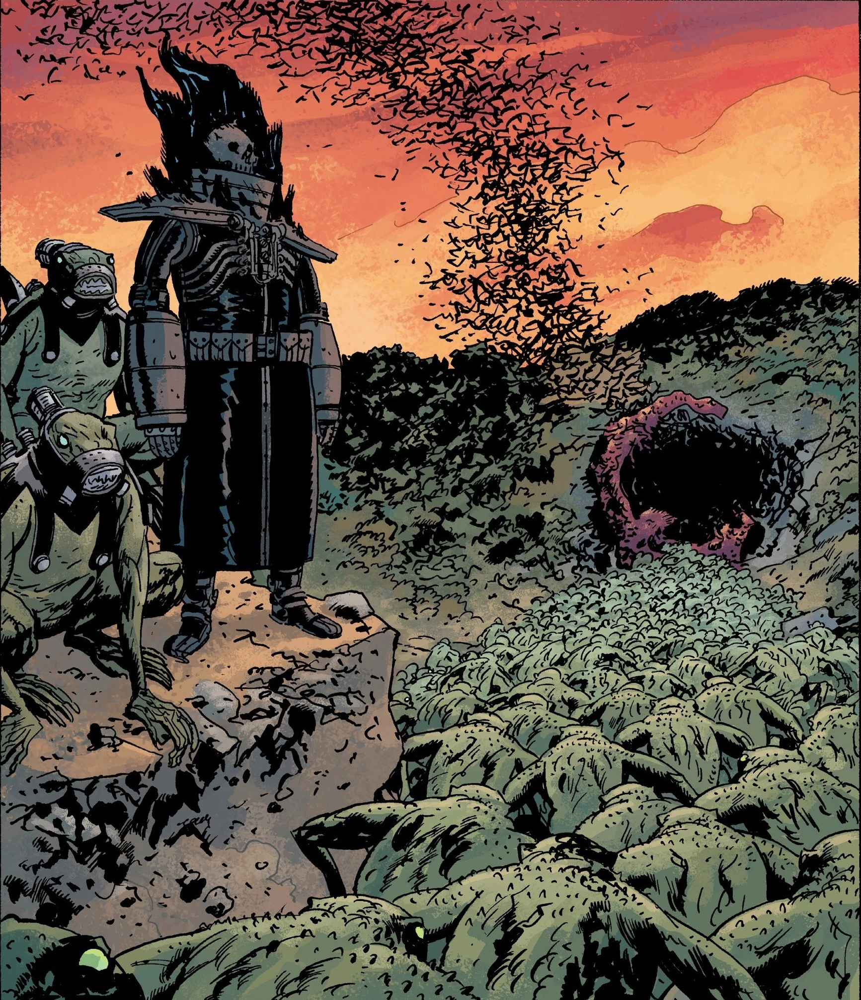
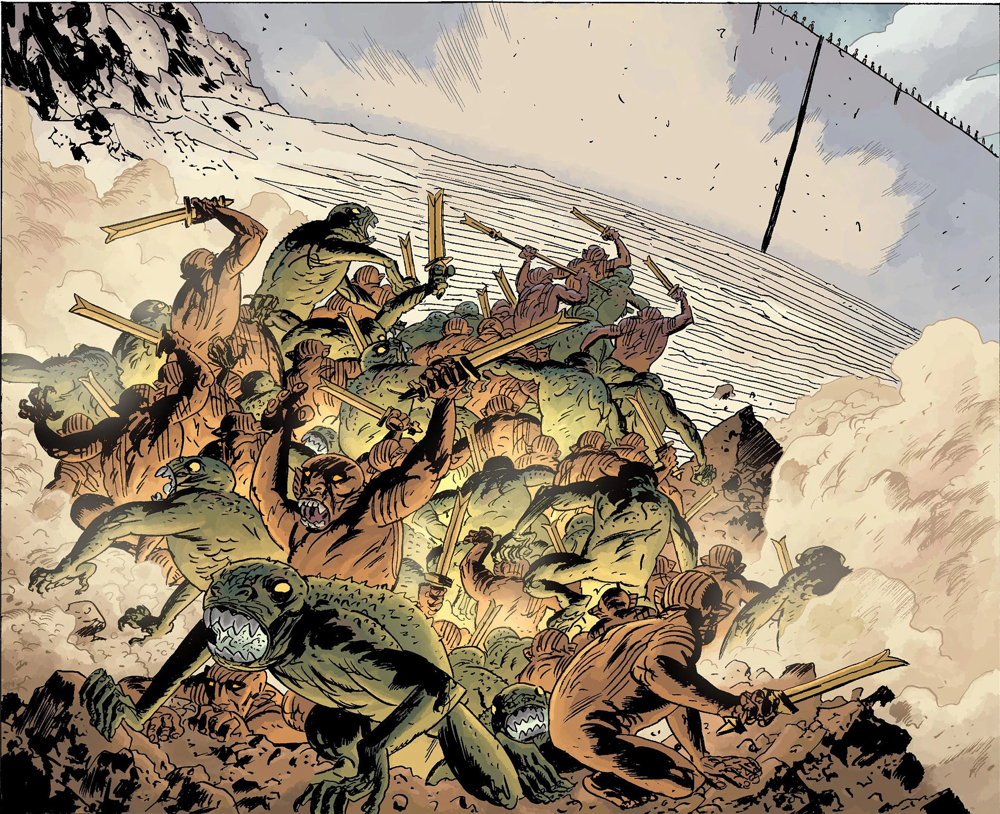
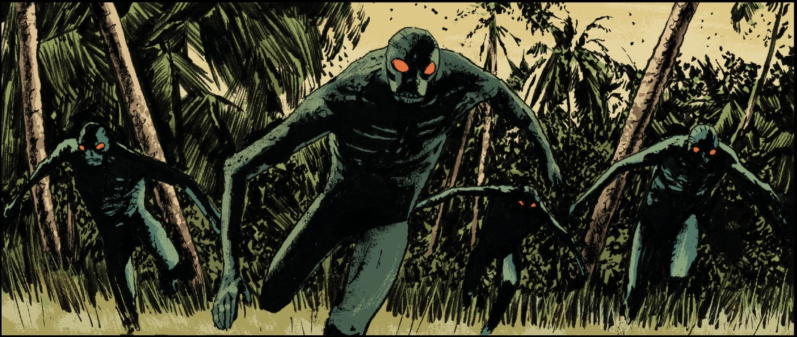

The **frog monsters** are a race of sapient humanoid frogs that are created from humans affected by the power of [Sadu-Hem](/entry/Sadu-Hem) and other [Ogdru Hem](/entry/Ogdru_Hem). The creatures were said to be the new, "final" Race of Man come to replace humanity, destined to inherit the new world that would rise from the destruction of the Earth by the [Ogdru Jahad](/entry/Ogdru_Jahad).

## Overview

The monsters are extremely powerful, both physically and psychically. A single creature was able to overpower [Hellboy](/entry/Hellboy), though this specific frog monster appeared to be stronger and more powerful than the general population. The frogmen are able to shift between their human and frog forms, allowing them to pass unnoticed in populated areas. Moreover, the frogmen can exert a degree of telepathic influence over their victims, confusing them with illusions and mind-tricks. Finally, the touch of one's tongue is extremely painful and leaves pock marks on a victim's skin.

Their nests and hideouts usually contained some sort of primitive altar to the Ogdru Hem and a mysterious language was usually carved or written throughout the area. Zinco Corporation's R&D department was able to discover that the frog's language is somehow instinctual. That is, the frog monsters never needed to be taught their own language, knowing it was in their DNA. Using a mechanical harness they were taught to speak English.

There appear to be variations amongst the human turned into frog creatures depending on which Ogdru Hem was the cause of their transformation. Not all Ogdru Hem are capable of creating frog monsters, but instead have their own species of monsters.

The main frog monsters seen in Hellboy and B.P.R.D. have been the spawn of Sadu-Hem. The [Conqueror Worm](/entry/Conqueror_Worm) entity and Istra-Hem was also able to turn men into frog monsters with its breath. A gas mask was effectively defenseless against the Ogdru-Hem's breath, succeeding in only preserving the victim's mind from becoming feral. All of these frog monsters were devoured by the worm and the Ogdru Hem was killed by [Roger](/entry/Roger) the Homunculus before it could create anymore. The monstrous [Katha-Hem](/entry/Katha-Hem) produced a variant of frog monster that spewed blue flames from their upturned heads, but these too presumably died out with their progenitor.

The frogs, at least those freshly transformed from humans, possessed souls. When [Johann Kraus](/entry/Johann_Kraus) helped a group of frog spirits pass on, he witnessed the opening of a horrifying gate to their afterlife that appeared like paradise to them, complete with insect-like angelic beings that took them to their eternal rest.

## History

The first apperance of the frogs was in 1993, created by Sadu-Hem when he was awakened by the Cavendish Expedition when they discovered its lair in a [Hyperborean city](/entry/Hyperboreans) beyond the Arctic Circle. One of the frogs killed [Trevor Bruttenholm](/entry/Trevor_Bruttenholm) in order to lure Hellboy into the clutches of Rasputin. The other two frogs, the transformed Cavendish boys, killed their mother before disappearing to the black depths of the lake beneath Cavendish Hall.

The next appearance of the frogs was in 2001, when the Conqueror Worm returned from outer space at Hunte Castle, Austria. The creature created frogs from the Nazi scientists present with its breath, only to devour them to feed its hunger and growth. With the Conqueror Worm's defeat, no more frogs appeared.

### The Plague of Frogs

After the Cavendish Hall incident, the B.P.R.D. began doing regular checkups at the site. For ten years there was nothing, until they discovered a piece of fungus from the debris. This fungus was unknowingly the last remnant of Sadu-Hem, and they regrew it in a lab in New Jersey. A cultist broke in and allowed himself to be possessed by the Ogdru Hem, escaping back to the cult's headquarters at Crab Point, Michigan. Although the B.P.R.D.'s Enhanced Talents Task Force was sent to confront the cult and killed Sadu-Hem, the frogs were able to escape capture by the B.P.R.D.

For the next three years, the frogmen began to multiply and spread across the North American countryside, moving westward over time. Their growing numbers prompted the B.P.R.D. to move from Conneticut to an old military base in the Colorado mountains to keep ahead of them. By 2006, they were even crossing into Canada.

### The Black Flame

The frogs soon allied with [Landis Pope](/entry/Landis_Pope), CEO of the [Zinco Corporation](/entry/Zinco_Corporation), who mistakenly believed he could control them. For a time, the Zinco Corporation had several frog monsters in their R&D department. They had captured these creatures when they were tadpoles and were researching the monsters in secret.  One interesting discovery Zinco was able to learn was about the frog monster's language, allowing Pope to communicate with the frogs and serve as their leader. He declared himself as [The Black Flame](/entry/The_Black_Flame_(character)) and built a suit of armor generating a fake blue flame to lead the frogs. Later, he and a few frogs were able to procure real [black flames](/entry/Shakti) through an occult ritual involving the sacrifice of one of the frogs. With the Black Flame, the frogs shifted their movements to converge at a cave in Nebraska due to it being a center of geomantic energy. There, at the cave's entrance, the frogs revealed that they were using Pope all along to awaken the Ogdru Hem, explaining how his black flame was to serve as a beacon for the Ogdru Hem's long-dim eyes. Together they awakened Katha-Hem, and although the mountain-sized abomination wreaked havoc, it was ultimately felled by [Liz Sherman](/entry/Elizabeth_Sherman).

### Allies

With the destruction of Katha-Hem, the frog monsters retreated underground, taking the now-reluctant Pope with them. In the bowels of the Earth, they encountered and forged an alliance with the [Servants of the Left Hand](/entry/Servants_of_the_Left_Hand) and their leader, the [King of Fear](/entry/King_of_Fear_(character)). As the frog threat was being exterminated in the United States, the frogs and their new allies shifted their offensive to Europe, where the King of Fear had them merged with Hyperborean war machines that his people had maintained. A horde of eight of these deadly giant mechs emerged and obliterated Munich before being taken down. Over the course of their operation, the war machines slowly changed into organic entities that grew more resilient over time.

The frog/molemen alliance surfaced once again at the outskirts of the Hyperborean city of Thadrethes, in the Stanovoy Mountain Range at the borders of Russia and China. This city was refurbished by the mystic Memnan Saa and his followers, an order of monks who claimed descent from the First Race of Man, and yeti-like wild men. Fortunately, the B.P.R.D. met them with a whole battalion of armed forces and a vicious battle took place outside the walls of the city. The frogs brought to bear more transformed war machines and even war beasts of their own. However, they were dealt another loss when [Memnan Saa](/entry/Martin_Gilfryd) used Liz's power to transform several frogs into fire-breathing dragons that decimated their armies. Eventually they retreated, unable to penetrate into the city.

### Extinction and Remnants

After the defeat and destruction of the majority of the frog forces and their allies, the frogs returned underground. With their remaining Hyperborean war machines, the Black Flame sought to incarnate Ogdru Hem through them. The last of the frog monsters were killed alongside the Black Flame and the underground mole-men by the massive wave of fire unleashed by Liz Sherman. Since the Black Flame claims that the frog monsters present were the only ones remaining it appears that the race has gone extinct, with the last of their kind remaining in the possession of the Zinco Corporation. A few years later, this last frog monster was killed by the revived Black Flame.

After the Black Flame reawakened Ogdru Hem across the globe, one such creature, Istra-Hem, produced a new generation of identical frog monsters. However, unlike before, these frogs were completely feral and possessed no desire to leave the vicinity of their progenitor, thus restricting them to the half-flooded township of Suwanee where [Istra-Hem](/entry/Istra-Hem) stood. When Abe Sapien attempted to attack Istra-Hem, the creature retaliated and fled into the sea and the frog creatures followed it.

Following the resurrection of Rasputin as the avatar of the dragon he revived every Ogdru-Hem on Earth, including Sadu-Hem. Now more powerful than ever Sadu-Hem created more Frog Monsters which began pursuing the final remnants of Humanity who were trying to flee underground. These newly created frogs were likely destroyed along with their creator when Liz Sherman scorched the earth during Ragnorak.

## The True Final Race of Man

Upon confronting the Black Flame in the Hollow Earth, the B.P.R.D. learn from him that [Abraham Sapien](/entry/Abraham_Sapien) himself was the true representative of the Third Race, a perfected version of the primitive frogs that they have been battling all this time.

Abe himself was shot in the face and suffered life-threatening injury months after this revelation and emerged from his recovery tube with a new face and abilities resembling that of the now-extinct frog monsters. Plagued with worries about his role in the apocalypse, he fled from the B.P.R.D. for a time to reconcile with his true nature. A new religion eventually emerged around the wayward fishman and the Ogdru Hem, even using a figure of his head markings as its banner. He eventually discovered a secret recording made by Professor Bruttenholm of a forgotten hypnotism session revealing the former's knowledge of Abe's past as Langdon Everett Caul. Abe then learned from the shaman ghost Shonchin that the mysterious jellyfish-like entity whose egg transformed Caul into the Ichthyo Sapien form was once his friend, a shaman who was persecuted and tortured by followers of the Left Hand. Refusing to denounce his belief in [the Right-Hand](/entry/The_Right_Hand_of_Doom) path, the shaman transcended into the form of the jellyfish being. Thus, the true Third Race of Man was born not from the Ogdru Hem, but from the power of [Vril](/entry/Vril) and the noble spirit of mankind.

Abe also made his way to England, which had vanished from the map after Hellboy's final battle. There he met [Alice Monaghan](/entry/Alice_Monaghan) who convinced him to stop hiding from his fate and embrace his role in the new world to come. Abe returned to America, defeating [Gustav Strobl](/entry/Gustav_Strobl) who intended to supplant him as the herald of the Third Race, and was found and taken by the [BPRD](/entry/B.P.R.D.). After recovering and rejoining, he fell in combat against the resurgent [Rasputin](/entry/Grigori_Rasputin), his broken corpse releasing thousands of eggs into the waters around him.

After Liz Sherman incinerated the Earth at the conclusion of the prophesied [Ragnarok](/entry/Ragna_Rok), Hellboy and [Hecate](/entry/Hecate) merged to create a new world, spilling Hellboy's blood to seed life onto to the barren planet. The eggs from Abe's body finally hatched, and the Third Race crawled forth and emerged from the seas to inherit the New World at long last.

