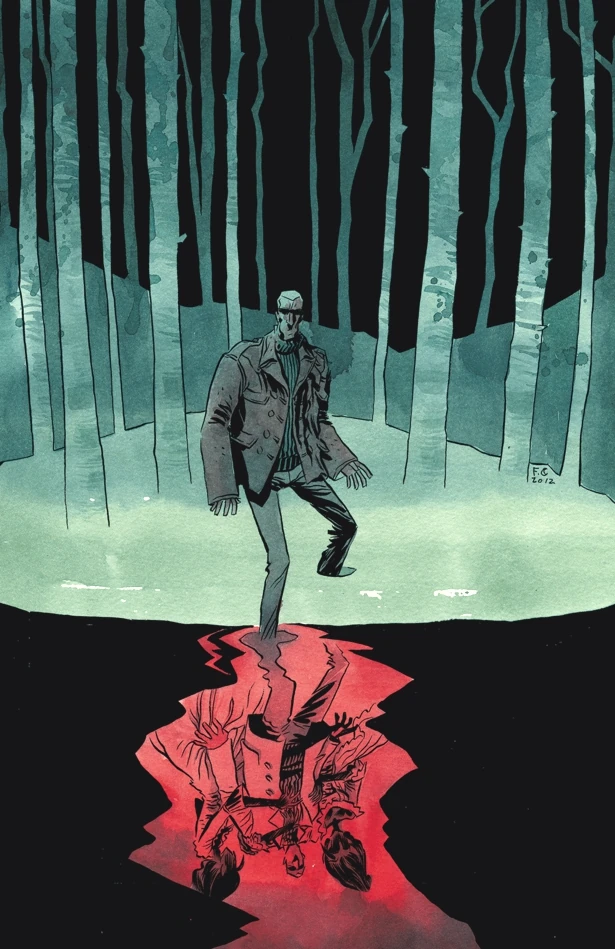
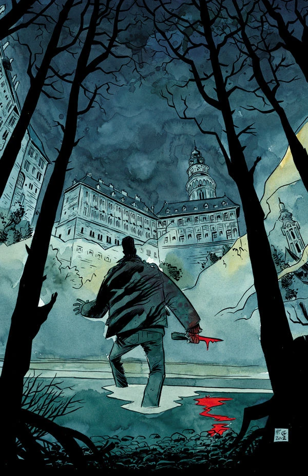
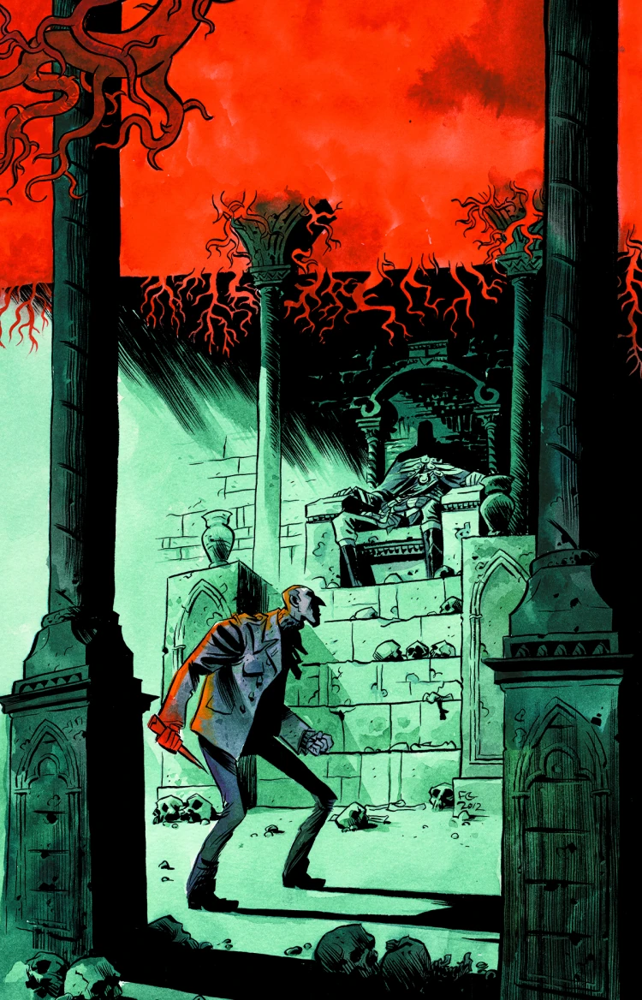
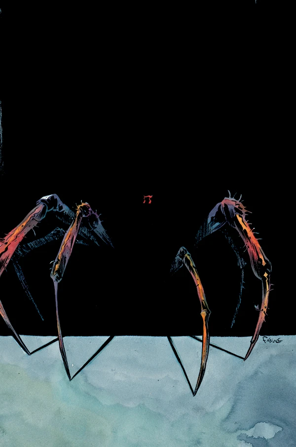
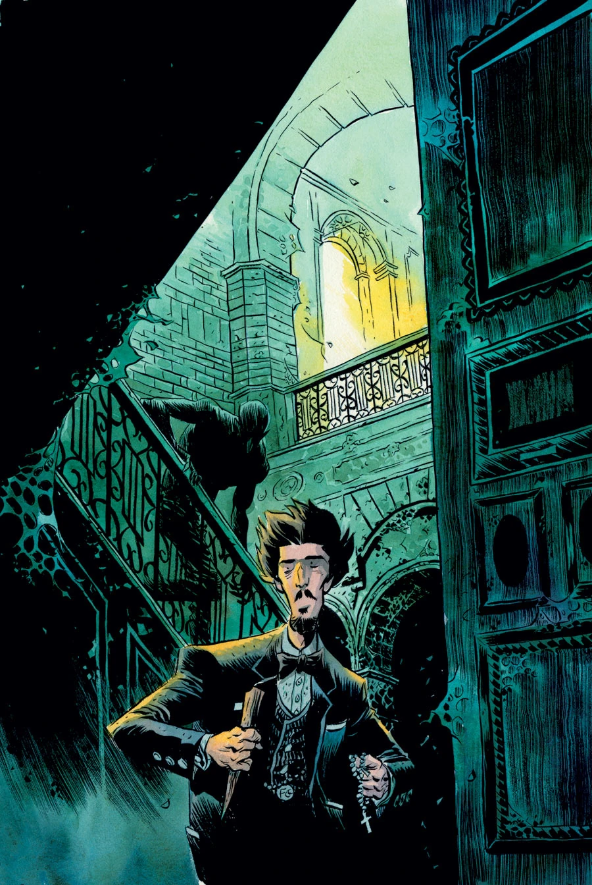

**Fábio Moon** is a Brazilian comics writer and artist. He made his Hellboy Universe debut in July 2009 with [*B.P.R.D.: 1947*](/entry/1947). He is [Gabriel Bá](/entry/Gabriel_B%C3%A1)'s twin brother.

## Writer

Fábio Moon co-wrote the [*B.P.R.D.: Vampire* story cycle](/entry/Vampire_%28story_cycle%29) with Gabriel Bá and Mike Mignola.

- *[B.P.R.D.: Vampire](/entry/Vampire_%28story%29)* (with Mike Mignola and Gabriel Bá)
- *[B.P.R.D.: Lost Ones](/entry/Lost_Ones)* (with Gabriel Bá)

## Interior Art

- [*B.P.R.D.: 1947*](/entry/1947) (with Gabriel Bá)
- [*B.P.R.D.: Vampire*](/entry/Vampire_%28story%29) (with Gabriel Bá)
- [*Hellboy: The Coffin Man*](/entry/The_Coffin_Man)
- *[B.P.R.D.: Lost Ones](/entry/Lost_Ones)* (with Gabriel Bá)

## Cover Art

|*B.P.R.D.: Vampire* \#1

|*B.P.R.D.: Vampire* \#2

|*B.P.R.D.: Vampire* \#3

|*B.P.R.D.: Vampire* \#4

|*B.P.R.D.: Vampire* \#

## External Links

- [**Wikipedia:** Fábio Moon](http://en.wikipedia.org/wiki/F%C3%A1bio_Moon)
- [**Comic Book DB:** Fábio Moon](http://www.comicbookdb.com/creator.php?ID=2930)
- [Fábio Moon and Gabriel Bá's Blog](http://www.fabioandgabriel.blogspot.com.au/)
